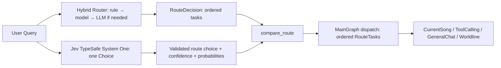

# Jev Router Baseline V1

日期：2026-09-29。阶段只审查并测量，未改 Router Prompt、阈值、Jev 模型配置、历史 Gold、任何子图或生产数据。能力边界见 [`jev_capability_alignment_v1.md`](jev_capability_alignment_v1.md) 与唯一机器 Contract `../config/router_capability_contract.json`；全量数字见 `jev_router_baseline_v1_metrics.json`，逐案结果见 `jev_router_baseline_v1_results.jsonl`，错误 trace 见 `jev_router_failure_cases_v1.jsonl`。

## 1. 冻结的真实流程



Jev 并非先于 Hybrid Router 的独立多意图 Router。`main_graph.py` 先取 Hybrid `RouteDecision`，随后在 `JEV_ENABLED && JEV_ROUTER_ENABLED` 时调用 `compare_route`。Jev 每次以 `{query: text[:4000]}` 向 TypeSafe `system_one` 发送一个 `Choice`，四个 criteria 在 `app/agent/decision/jev/router.py` 写死；它没有单独的 System Prompt 文本。输出经 `DecisionClient` 验证为单个 `route`：`choice`、`confidence`、四路 `probabilities`。没有多意图数组、top-k 或生产 Noul 输出；`Score` 类型用于其他 Jev 决策，不用于 Router。用户要求的“User Query → Jev → Structured Decision → MainGraph Route”在当前实现必须补上 Hybrid 前置层。

Jev 只可覆盖**完整、恰好一个 task、task 原文等于本轮 query、无依赖**的既有路由；低于 `0.8` 的 confidence、非法输出、调用失败或复杂路由均回退到 Hybrid 结果。当前本地配置 `jev-latest`、TypeSafe API、5 秒 timeout、`RetryPolicy(max_retries=0)`、`JEV_SHADOW_MODE=true`；因此 Jev 即使不同意也不接管 MainGraph。SDK 响应有实际模型、用量、延迟；`record_decision` 记录匿名化 telemetry。`JevClient` 对 SDK 异常只暴露类型名，避免记录敏感响应。`compare_route` 对错误、低置信度、复杂路由或 Shadow 使用既有决策；主图还可进入 `clarify`。该调用没有独立 parse-retry；本地 Hybrid 的 LLM 回退/重试属于另一层。

## 2. 数据、运行与分母

`evals/datasets/jev_router_baseline_v1.jsonl` 复制历史 `router_eval_v2.jsonl` 的全部 47 条 query/label，不改原标签：31 single、14 multi、2 follow-up。后两条的 `recent_context` 当前 Jev/Hybrid 不消费，故不计入准确率；逐案仍回放并保存结果。另加 12 条 Contract 派生候选（6 single、2 multi、2 boundary、2 negative）；它们的 proposed labels 未经审核，**不计入正式指标**。15 条旧 Gold 的 `label_status=questionable` 保留在 raw historical 分母中，名单在 metrics，原因与复核建议在能力报告。

复现：

```powershell
cd ai-service
.\.venv\Scripts\python.exe -m evals.jev_router_baseline_v1 prepare
.\.venv\Scripts\python.exe -m evals.jev_router_baseline_v1 run
```

复评会调用真实 TypeSafe API 59 次及当前 Hybrid Router，不能保证 `jev-latest` 别名或外部模型采样完全一致；逐案 `dataset_sha256`、requested/response model、UTC 时间、usage、实际输出和延迟可供对照。此次 59/59 有效 Jev 响应，实际 `response_model=jev-1.13.0`。结果文件中的 `jev_structured_output` 是现有 `DecisionClient` **验证后**的结构化回答，不是 SDK 原始 HTTP wire payload；该边界不暴露更低层 raw body。没有执行四个子图或任何客户端动作，指标只衡量决策层。

冻结快照 SHA256：dataset `E1132AF06BF50ACA89D90DF782C75D1DAE1BED22A0EDC6BC4D9191779F20671D`；生产 `jev/router.py` `1221833CBFF397DB13E01DB9084989DBE035D66AEEBF7967EF2BAE3FCEB25BCA`；生产 `jev/client.py` `95A77F13958CB2C1BE84F9A4C20A145CBE1F8F5B52A656E1B98BFE1BAB8046DB`。复现时先核对源码与有效本地配置；不要在报告中记录 API Key。

## 3. Single Intent（历史 Gold，31 条）

| 决策 | Accuracy | Macro F1 |
| --- | ---: | ---: |
| Jev `Choice` 提议 | 24/31 = 77.42% | 81.37% |
| MainGraph 最终 route（当前 Shadow） | 20/31 = 64.52% | 75.00% |

Jev 单意图各路由 Precision / Recall / F1：

| Gold route | Support | Precision | Recall | F1 |
| --- | ---: | ---: | ---: | ---: |
| CurrentSong | 4 | 100.00% | 100.00% | 100.00% |
| ToolCalling | 8 | 100.00% | 100.00% | 100.00% |
| GeneralChat | 10 | 63.64% | 70.00% | 66.67% |
| Worldline | 9 | 62.50% | 55.56% | 58.83% |

Jev confusion matrix，行为 Gold、列为预测：

| Gold \ predicted | CurrentSong | ToolCalling | GeneralChat | Worldline |
| --- | ---: | ---: | ---: | ---: |
| CurrentSong | 4 | 0 | 0 | 0 |
| ToolCalling | 0 | 8 | 0 | 0 |
| GeneralChat | 0 | 0 | 7 | 3 |
| Worldline | 0 | 0 | 4 | 5 |

最容易混淆的是 **GeneralChat ↔ Worldline**：7 个 Jev 单意图错误全在这对路由之间。Worldline 的 4 个漏判中有 4 条历史标签属于 questionable counterfactual；不能据 raw Gold 直接断言模型理解错。GeneralChat 被误判 Worldline 的典型问题是“什么是和声”“现场版和录音室版为何不同”“我不是问当前这首歌，我想知道什么是概念专辑”。MainGraph 当前 Shadow 保留 Hybrid 结果，因此 Jev 24/31 不是生产派发分数。

## 4. Multi Intent（历史 Gold，14 条）

| 决策 | Exact Match | Micro P / R / F1 | Macro F1 | Over-routing | Under-routing |
| --- | ---: | ---: | ---: | ---: | ---: |
| MainGraph 最终 route（Hybrid） | 10/14 = 71.43% | 100.00% / 75.86% / 86.27% | 86.43% | 0/14 | 4/14 = 28.57% |
| Jev 单个 `Choice`，仅结构诊断 | 0/14 | 100.00% / 48.28% / 65.12% | 60.90% | 0/14 | 14/14 |

Jev 此处的 0/14 是**单选结构上限**，不是生产多标签配置的性能。历史 v2 的四路独立 Noul 以及 v3 的阈值校准是离线实验，均不是当前 `compare_route` 的生产多意图格式。当前生产多意图由 Hybrid 识别，Jev 的提议不会拆分或覆盖多任务。Hybrid 的 4 条未精确匹配分别含未解析的组合或漏掉 GeneralChat；精确 case 与缺失 route 可在逐案 JSONL 中复查。

## 5. Boundary、Negative、运行健康与性能

历史 Gold 中带 `boundary` 标签 16 条，其中 14 single、2 条 context-dependent follow-up。可评分的 14 条单意图，Jev `Choice` 为 12/14 = **85.71%**，MainGraph 派发为 4/14 = **28.57%**；差距主要来自 Hybrid 对含否定、条件和多段语句的未完成澄清，不代表 Jev 已在生产接管。2 条 follow-up 原样回放但不计分，因 router 未读取其对话历史。历史 Gold 的 multi 案例没有 `boundary` 标签，因此该切片的 multi 分母为 0，机器结果使用 null，不报虚构百分比。

候选负例 2 条均被 Jev 的强制 Choice 分配一个 route。`cap-negative-01`（反事实历史）在 Hybrid 中还被派发 `general_chat+worldline`；`cap-negative-02`（订演唱会门票）由 Hybrid 澄清、未派发。它们尚无审批标签，只作为 unsupported 能力风险观察。候选中 `cap-general-01` 也被 Jev 错选 Worldline；模糊“讲讲这首歌的背景”选 CurrentSong，但该路由不能核查历史背景。

正式 45 条的 Jev parse/schema、API failure、retry、timeout 均 **0/45**。`fallback_rate=45/45=100%` 主要因当前 Shadow：`shadow_mode` 13、`low_confidence` 5、`complex_existing_route` 27；这里的 fallback 指“未由 Jev 覆盖既有派发”，不代表 45 次 API 失败。SDK 最大重试数为 0，本次每案一次请求。

| 耗时（正式 45 条，ms） | Average | P50 | P95 | P99 |
| --- | ---: | ---: | ---: | ---: |
| Jev API | 571.55 | 542.38 | 693.19 | 1041.37 |
| Jev compare wall clock | 571.77 | 542.57 | 693.39 | 1041.74 |
| Hybrid Router | 1640.47 | 1556.32 | 3250.72 | 3965.24 |

正式 45 次 API 用量 `input_tokens=17,384`、`output_tokens=2,362`；含 follow-up 与候选的 59 次总用量分别为 22,721 / 3,097。Hybrid 可能走主 LLM，Jev 仅做 System One 决策；耗时不构成替换后的端到端收益证明。

## 6. Failure Analysis 与第一阶段结论

`jev_router_failure_cases_v1.jsonl` 保存 32 个失败/分歧 case（包括 2 条不计分 follow-up），含 query、原 Gold、Jev 验证后结构化输出、提议与实际派发、confidence/概率、错误类别、能力/标签/阈值/模型与下游边界标志。类别可同时出现：Hybrid 派发不匹配 17，Jev 单选的 multi 结构不匹配 14，questionable label/capability mismatch 12，Jev 单意图判断或 Prompt 重叠 7，low-confidence 4。类别是诊断标记，不是已验证的因果分解；7 个 Jev 错误中 4 个涉及 questionable Gold。

此前报告的“Single Intent 反而下降”具体指 v3 **离线多标签 Noul** 的冻结 test：7/16（43.8%），低于 Hybrid 11/16（68.8%），见 `jev_targeted_optimization_v3.md`。那次用了四路分数与冻结阈值，和本次生产单个 `Choice` 的 24/31 不是同一配置或同一分母。已能确认的主要问题是 **输出/选择策略与标签能力边界**：v3 的阈值会让本应唯一的 route 不过线或同时过线；Worldline 反事实标签与真实能力不符，GeneralChat/Worldline criteria 语义重叠。当前没有同轮同模型的消融实验，不能断言 Prompt、模型本身或数据分布各自造成多少下降。本阶段未调参，也未改 Gold。

| 候选原因 | 本阶段证据与判定 |
| --- | --- |
| Capability description | 当前四句 criteria 未写清只读工具、实体/证据和当前歌曲上下文；确认存在描述缺口，未证因果权重。 |
| Gold label | 15 条反事实/producer/背景类为 questionable；4/7 个 Jev 单意图原标签错误落在这组。 |
| GeneralChat 过度吸收 | 历史 Worldline Gold 有 4 条被 Jev 判 GeneralChat，均需先审核是否实际上超出 Worldline 能力。 |
| Worldline 过度路由 | GeneralChat Gold 有 3 条被 Jev 判 Worldline，包括普通概念解释；这是更明确的能力错位。 |
| Choice strategy / threshold | 生产 Choice 对 multi 结构上不能精确匹配；v3 Noul 的阈值导致单意图 7/16。当前 45 条有 5 条 low-confidence fallback。 |
| Prompt / output schema | criteria 重叠值得下阶段消融；本轮 schema/parse 错误 0/45，没有证据指向格式故障。 |
| Model / data distribution | `jev-1.13.0` 的本轮 59 次调用成功；样本只有 31 条 single，route support 为 4/8/10/9，不能单独归因于模型或泛化分布。 |

八个交付问题的答案：四子图边界以 Contract 为准；Jev 当前 criteria 未完整表达 ToolCalling 只读查询、Worldline 实体/证据约束及 CurrentSong 所需上下文，故**描述层未对齐**；Single 与 Multi baseline 如上；最易混淆 GeneralChat/Worldline；下降最值得先检查离线多标签选择策略与 questionable Gold；Gold 存在 15 条待审；下一阶段 Top 3 建议是 **(1)** 人工裁决反事实及背景类 questionable labels 并冻结新 Gold，**(2)** 在不触动现阶段结果的前提下设计 Contract 到 Jev criteria 的单一生成/校验链，**(3)** 另立验证集对单选、多标签与 fallback 策略做成对消融，重点盯 GeneralChat/Worldline 与复杂意图。上述均为后续建议，本阶段到此停止。

## 验证限制

真实 Jev 59/59 请求完成并记录用量/延迟；没有运行下游 Subgraph 的本次在线 E2E、浏览器响应式 UI 验证或生产数据写入，因为本阶段是 Router 决策回放且未修改 UI/API/子图业务代码。历史标签的 15 个 questionable case 尚待人工复核；因此 raw Gold 分数不能解释为“真实能力正确率”。`jev-latest` 别名与外部 API 非确定性会使复跑数值波动，且 SDK 原始 wire payload 不在现有 `DecisionClient` 返回契约中。

本次验证记录：

| 命令 | 结果 |
| --- | --- |
| `python -m evals.jev_router_baseline_v1 run` | 59/59 API 回放完成；逐案结果、metrics、failure JSONL 已落盘。 |
| `pytest tests/test_jev_router_baseline_v1.py ... tests/test_worldline_runtime_integration.py -q` | 相关回归 101 passed、1 skipped、2 subtests passed（最终新增的 Recorder 失败测试另行复跑）。 |
| `pytest tests/test_jev_router_baseline_v1.py -q` | 最终版本 5 passed。 |
| `pytest tests -q` | 1212 passed、14 skipped；5 failed、6 errors、1 subtest failed，堆栈主要为 `MemoryError` / ONNX Runtime `bad allocation`，单进程完整集**未通过**。 |
| 单独复跑 `test_long_horizon_context` 失败 case、`test_pdf_adapters.py` + `test_pdf_parse_e2e.py`、`test_rag_gold_v4_expand.py` + `test_rag_group_aware.py` | 分别 1 passed、7 passed + 3 subtests、15 passed + 30 subtests；完整集中的所有失败项在独立进程通过，支持内存累积限制判断。 |
| `ruff check evals/jev_router_baseline_v1.py tests/test_jev_router_baseline_v1.py` | 通过。 |
| `ruff check app evals tests` | 未通过，41 条现存其他文件问题（例如 `app/agent/foundation/routing.py` 未用 import、`evals/artifacts` 历史脚本的 E701/E702）；本阶段文件无 lint 错误。 |
| `python -m compileall -q app evals tests` | 通过。 |

因此本阶段评测结果可审阅、复跑，相关代码测试通过；**全库单进程测试及全范围 Ruff 仍非绿色**，未把环境资源失败或既有 lint 问题记作本阶段功能通过。没有修改这些不相关模块来掩盖失败。
