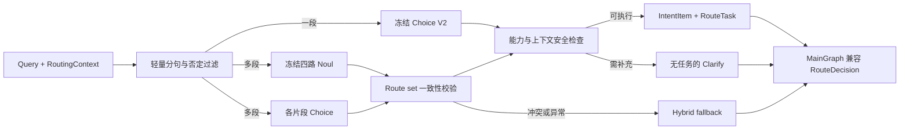

# Jev Router V4：MainGraph 候选架构

## 冻结输入与代码边界

- Single 继续使用 `capability_criteria.py` 从 Router Capability Contract v1.0 投影的 Choice V2 文案、原 `ROUTER_QUESTION_INSTRUCTIONS` 和 `jev-latest`；没有改 criteria 或 0.8 的既有生产置信度阈值。低于现有门槛时回退 Hybrid。
- Multi 使用 V3 冻结配置 `jev_multi_frozen_strategy_v3.json`：CurrentSong .30、ToolCalling .25、Worldline .45、GeneralChat .50。四个 Noul 的 state、instructions、criteria 与 V3 相同；单元测试逐字段比较。
- 运行时校验上述阈值以及配置中冻结的 Capability Contract SHA256；漂移时拒绝构造候选，而非静默改变路由语义。
- 核心实现为 `app/agent/decision/jev/router_v4.py` 的 `JevRouterCandidate`。`route()` 返回原生 `RouteDecision`；`route_with_trace()` 同时返回来源、回退原因、延迟、模型、概率、token 与 API 调用数。四个 Subgraph 的接口未改。

## Cardinality 与任务构建

先按句读、连接词、顺序词和否定前缀做轻量分句；1 个有效片段走 1 次冻结 Choice，多片段并行发出 2 次 Jev 请求：一次含四路冻结 Noul，一次含每片段的 Choice。没有用于判断 Single/Multi 的额外重型 LLM，也没有先完整运行 Hybrid 再调用 Jev。多片段包含同一 route 的两个动作时仍生成两个任务。Noul 选出的 route set 必须与片段 Choice 的 route set 一致，否则视为 task construction failure 并回退 Hybrid；不擅自重调冻结阈值。

每个片段保留原 query 的精确子串与字符 offset，生成一个 `IntentItem` 和对应 `RouteTask`。`input_text` 等于 `IntentItem.evidence`，`intent_orders` 按原文连续编号。显式“然后、接着、再、最后”等构建前序 `depends_on`；“另外、顺便、同时、并”等独立请求无依赖。MainGraph 当前调度器按 task 列表逐个执行，即使无依赖也不会并发调用 Subgraph；这里的“并行”是无业务依赖的决策表示，实际并发执行仍是生产切换前的独立工作。

当前歌曲任务要求可信 `has_current_song`，或之前有明确具名播放任务；收藏/歌词页等指向当前歌的操作也检查目标。Worldline 的未锚定代词、同名提示会澄清；能力合同明确不支持的反事实历史不强塞给 Worldline。否定动作片段不派发。澄清决策没有任务，符合 MainGraph 的 all-or-nothing 派发校验。未解析的具名实体仍须由 Worldline/ToolCalling 自身解析，Router 不能证明实体一定存在或唯一。

## Fallback 与 Shadow

Jev API/超时/无效 schema、Noul 与片段 route 冲突、任务构造失败时才调用 Hybrid。正常 Jev 候选不会运行完整 Hybrid。返回来源仅为 `jev_single`、`jev_multi` 或 `hybrid_fallback`，并保留可诊断的错误类别；SDK 原始异常文本不进入日志。

`JEV_ROUTER_V4_SHADOW_ENABLED` 默认 `false`。同时开启现有 `JEV_ENABLED` 与 `JEV_SHADOW_MODE` 后，MainGraph 的 opt-in shadow 分支并行获取 Hybrid 与候选决策，只派发 Hybrid。候选的 `RouteTask` 绝不会被送往 Subgraph；若候选需要回退，复用同一次请求的 Hybrid future，避免 shadow 内再次完整运行 Hybrid。Shadow 候选异常被隔离并记录类别，生产 Hybrid 继续运行。候选也可通过现有 `intent_router` 注入点独立产出 MainGraph 可验证的决策，但本阶段没有做生产切换。

## 已知失败边界

- 轻量分句依赖显式语法；无连接词的复合意图、长距离省略与复杂否定可能误判 cardinality。
- 片段 Choice 与冻结 Noul 有可能相互矛盾；回退可保住可用性，却不保证 Hybrid 的任务拆分正确。V4-24 仍是此类缺口。
- Worldline 实体解析、SongContext 可用性和浏览器动作完成确认发生在下游，Router 仅验证已知前置条件。
- 当前 MainGraph 无依赖任务仍串行执行；没有实际 Jev→Subgraph 全链路成功率或浏览器副作用验收数据。
