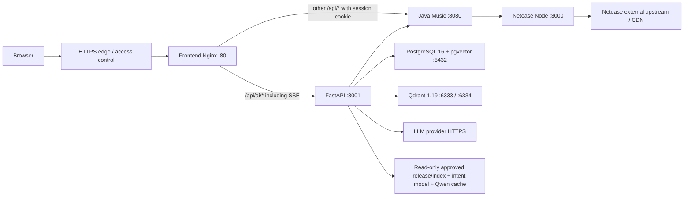

# MoodFlow Deployment Preparation / Deployability Audit

审计日期：2026-09-27 至 2026-09-28。范围：整个 MoodFlow 的生产运行结构、容器配置、资产、持久化、迁移和回滚准备。**没有部署服务器，没有启动 production Compose，没有执行迁移/restore/index rebuild，没有运行 Worldline/Semantic Eval、Jev 调优或删除用户数据。**

## 判定

```text
deployment_architecture_ready=true
docker_compose_ready=false
production_env_contract_ready=true
data_migration_plan_ready=true
can_start_server_deployment=false
```

architecture/env/plan 的 `ready` 表示设计与契约可审查，并非运行验收已完成。Compose 已可解析、包含所有服务与 readiness 依赖，四个镜像最终构建通过；AI 镜像的 CPU Torch 下载被官方 SHA256 校验拒绝，Linux 安装/镜像仍未完成，整套冷启动/恢复也未验证，因此不能进入服务器部署。具体构建结果与限制见末节。下一轮须先消除构建/恢复验证缺口；如果最终判为 `can_start_server_deployment=true`，部署准备轮立即停止，由下一轮单独执行部署。

## 冻结身份与保护范围

- Worldline V1：`worldline_v1_freeze_report.md` 为当前正式 Freeze；同名证据目录中的 `previous_blocked_freeze_report.md` 是已被取代的历史报告。
- 功能代码 Freeze commit：`7afc619`；正式 Freeze 报告 commit：`fe24b04`。
- Release：`knowledge-v2-daa965c10984eefa`。
- Approved manifest：`ai-service/data/indexing/worldline/final-native-20260927/v4/index_build_manifest.json`。
- Manifest SHA256：`445b7263221ae5864015752a6689e5d8303c21409407375a6e0b33ac831f50f3`。
- Projection SHA256：`1552c23089f8e9051011bd32d70020cdea22b3354e77f5d8dc04d61b34e6c418`。
- Collection：`worldline_knowledge_v4_daa965c10984eefa_v1_v2_v4`，41 points；named dense `dense`、1024 维、Cosine；named sparse `bm25`、IDF。
- Approved release manifest SHA256：`8c9d8ed7e4c81ce85958aebfd207d9e22ec0425f5312bd7b32c7f367f6536d24`。
- Qwen：`Qwen/Qwen3-Embedding-0.6B`，revision `97b0c614be4d77ee51c0cef4e5f07c00f9eb65b3`。

未修改 `ai-service/app`、Worldline validator、retrieval policy、知识/索引原件、Eval/Gold。现有未提交报告移动、Gold 修改、未跟踪 corpus 和截图均保留且不提交。本轮只增加部署文件/脚本/测试/审计输出，并在根 `.gitignore` 忽略派生生产资产包。

`ready_index_approval.json` 原始 approval scope 仍为 `retrieval_build_integrity_only`，其中 `semantic_source_context_readiness_approved=false` 未被改写；本轮不重新做语义验收，也不提升 approval 权限。正式 V1 acceptance 以 Freeze 报告为准。

## 正式 runtime 与调用关系



Frontend 不只经过 AI：音乐目录、扫码登录、歌单、歌词等直接调用 Java。浏览器还访问返回的网易图片/音频 CDN。LLM Provider 与网易 upstream 是外部依赖，不伪造成本地容器。没有添加 Redis、额外数据库或新的业务架构。

| 服务 | 本地开发启动命令（对应目录） | 生产入口 | 端口 | 依赖与环境 | 持久化 | Health/readiness |
|---|---|---|---|---|---|---|
| Frontend | `soul-music-room`: `npm ci`; `npm run dev -- --host 127.0.0.1` | 多阶段 `npm ci` / `npm run build`，Nginx 静态服务 | dev 5173；容器 80；宿主默认 `127.0.0.1:8088` | Java、AI；构建时 `VITE_API_BASE_URL=""` / `VITE_AI_API_BASE_URL=""` | dist 随镜像；浏览器 localStorage 非服务器 volume | `/healthz`；依赖 Java / AI healthy |
| FastAPI AI | `ai-service`: `.venv/Scripts/python.exe -m uvicorn app.main:app --host 127.0.0.1 --port 8001` | `python -m deploy.runtime serve`，单 worker，无 reload | 8001，仅容器网络 | Java、PG、Qdrant、LLM；见环境契约 | checkpoint/continuity/session/memory 在 PG；只读 release/index/intent/HF 挂载 | 原 `/health` 仅存活；生产探针另验 PG schema、approval/hash、Qdrant schema/count/status、Java/Netease。启动前校验 provider auth/connectivity，并加载模型 |
| Java Music | `music-backend`: JDK 21+；`mvn spring-boot:run`；打包 `mvn -B verify` | `java -jar /app/app.jar` | 8080，仅容器网络 | `NETEASE_API_BASE_URL`、`SERVER_PORT`、forward headers/session cookie 设置；Spring Boot 4.1.0 | 无数据库；Servlet 登录 session 在进程内存，重启需重新扫码 | 现有 `/api/auth/status` HTTP 200 + `code=200`，无登录/无 upstream 请求；Netease healthy 才启动 |
| Netease Node | `netease-music-api`: `pnpm install --frozen-lockfile`; `pnpm start` / `node app.js` | 原 `app.js` + tini；pnpm production install | 3000，仅容器网络 | Node 22、`HOST=0.0.0.0`、`PORT=3000`、`NODE_ENV=production`；外部网易 HTTPS/DNS/CDN | `/tmp` tmpfs：anonymous token、public key、上传临时文件；可重建，不把开发 token 部署 | `/inner/version` HTTP 200 + `code=200`，确认路由挂载。它不证明网易实时搜索/登录可用 |
| PostgreSQL + pgvector | 当前 `moodflow-postgres` 容器；本轮只读检查，未重启 | pinned `pgvector/pgvector:pg16-trixie`，原 docker-entrypoint | 5432，生产不映射宿主 | DB/user + password secret file；初始化后迁移 CLI | `postgres_data:/var/lib/postgresql/data`，含所有数据库/WAL/schema/业务及 checkpoint/memory | `pg_isready` 之后 migrate；AI 用认证连接检查实际 schema/extension/migration versions |
| Qdrant | `ai-service`: `docker compose -f docker-compose.qdrant.yml up -d`（现有启动方式，未执行） | 沿用 1.19.0 镜像与原 entrypoint；外层从 secret file 注入 API key | HTTP 6333 / gRPC 6334，生产均不映射宿主 | `QDRANT_URL`、API key；approved collection 先恢复才可用 | `qdrant_data:/qdrant/storage`；`qdrant_snapshots:/qdrant/snapshots` | 真实 HTTP `/readyz`；AI 继续验证 approved collection 及 binding |
| LLM Provider | 无本地进程，现有 OpenAI-compatible client | HTTPS 外部 provider | 通常 443 | `LLM_API_KEY` secret、base URL、routing/generation model、timeout/max output tokens | provider 自有；本地不保存 key 或生成 trace 为生产依赖 | 启动 `/models` 只检测连接/认证/list 格式，不声称 generation 验收；本轮不调用 generation |

Java local session 未持久化，现阶段保持单 Java 实例，不宣称多副本 session sharing。FastAPI 也保持单 worker；增加副本的容量、模型内存和并发恢复需要后续独立验收。

## 项目体积与部署边界

原始审计约 **10.14 GB（9.44 GiB）**，包含 Git、开发依赖与历史数据；此后导出的生产资产包新增约 1.305 GB；最终清单约 **11.467 GB（10.679 GiB）**，含派生包与新构建产物，不能与部署传输量混同。完整逐项清单见 `docs/deployment-preparation/size_inventory.csv` / `.json`，统计方法为文件逻辑字节，仅 stat 文件、不读其内容，跳过 junction/symlink 避免重复计算。当前存在 1832 个被跳过的链接/入口；清单不是磁盘 allocated-size，也不是 Docker image-size。生成时间后仍可能有本地开发写入。

| 原始主要目录/数据 | 约体积 | 分类/建议 |
|---|---:|---|
| `ai-service/.venv` | 5.09 GB | B：生产 Linux install 重建；不复制 Windows venv |
| `ai-service/data` 未选中 corpus/index/staging | 3.04 GB | C：不作为生产依赖，保留原件/归档 |
| `.git`（含 submodule history） | 0.806 GB | C：运行包不携带；服务器构建 checkout 可另外拉取 |
| Frontend `node_modules` | 0.265 GB | B：`npm ci` 重建 |
| `ai-service/tmp` | 0.260 GB | C：trace/debug/SQLite/local 临时数据保留，本生产方案使用 PG |
| `.venv-eval` | 0.126 GB | C：开发 Eval 环境不部署，也不运行 |
| visual-qa 副本及依赖 | 0.127 GB | C：不是正式 Frontend；不部署 |
| Eval 数据/报告 | 0.119 GB | C：审计/归档，不进入 runtime image/volume |
| Netease `node_modules` | 0.110 GB | B：pnpm lockfile 重建 |
| 当前 intent classifier 必要文件 | 96,275,033 bytes | A：encoder、head、mapping、thresholds、training config 是 runtime 读取对象；metrics/error_analysis 不部署 |
| Approved knowledge release | 955,050 bytes | A：只复制锁定的 release 文件 |
| Approved index/approval/projection | 578,632 bytes | A：只复制锁定的三文件 |
| 必需 Qwen snapshot | 1,207,469,240 bytes | A：固定 revision，本轮复制为可移植普通文件 |

生产资产包 `deployment-artifacts/` 共 **1,305,277,955 bytes**（不含源码镜像、PG/Qdrant 数据）。这是新目录，本轮复制并 SHA 验证，没有移动/删除原件；该目录已 gitignore。模型原始 HF 缓存在项目外：Embedding blobs 约 2.40 GB（包含非必需缓存对象）、BGE 约 96.4 MB、Reranker 约 1.26 GB。只选当前 revision 六个必要文件；rerank=off，因此不部署 Reranker。详见 `model_cache_inventory.json` 与 `deploy/model-cache-manifest.json`。

分类 A：正式三个服务源码、Netease submodule 指定 commit、production configs、SQL migrations、前端字体/图片等已有 runtime assets、approved release/index/approval、intent model、固定 Qwen snapshot。`deploy/frozen-artifacts.json` 锁定 20 个文件 SHA；模型 cache manifest 单独锁定六文件。Registry v5 等既有 YAML 由 AI 源码进入镜像。

**必须保留 approved release 内声明的 QA attestation/samples/sampling manifest/quality report。** Frozen `KnowledgeReleaseValidator` 会逐一检查 `artifacts` 的 SHA。它们是该 approved release 的证明链，不等于历史 Eval reports 或 Gold/review packs；任意移除/改写会破坏正式 binding。历史 Eval、其他 review corpus 和旧 release 均不复制。

分类 B：`.venv`、`node_modules`、Java target、Frontend dist、Maven/pip/pnpm/npm/Docker build caches，通过构建/install 重建。生产镜像使用锁文件与 base image digest；AI 依赖锁基于当前冻结环境的 runtime dependency closure，补 Linux `uvloop==0.22.1`，共 104 个版本条目；它是待 Linux 安装验证的候选锁，不能冒充已成功安装的 lock。CPU 容器使用同版本 CPU Torch，不携带 CUDA 依赖；Linux resolver/构建验证状态见末节。

分类 C：Eval reports、Gold/review packs、test traces、temporary corpus、source-ingestion staging、未选中旧 indexes/collections、screenshots、debug artifacts、tmp、IDE metadata、旧 QA frontend 副本。只建议项目外归档/压缩、校验 SHA 和建立索引，本轮没有执行删除/collection prune/volume cleanup。

Docker 根 `.dockerignore` 使用 allowlist，仅传构建所需源码/config/public assets；明确排除所有 `.env*`、`node_modules`、target、缓存以及 data/reports，不依赖子模块自己的 `.dockerignore`。生产资产包作为只读 bind mount 供应，不烘焙进构建上下文。

## Docker 化审计与产物

生产拓扑：根 `docker-compose.production.yml`，7 个 service（含一次性 migrate），默认项目名 `moodflow-production`，不会复用开发容器名/开发 volumes。只有 Frontend 绑定宿主 loopback；PG/Qdrant/AI/Java/Netease 不向宿主公开。Backend 网络允许 AI/Netease 的必要 outbound HTTPS，不能设置为 `internal: true` 后又期待外部 provider 可达。

- Frontend 原来仅 Vite 开发服务：新增 multi-stage build + Nginx。两个 browser API base 都为空；同源 `/api/ai/*` 路由优先进入 AI，其他 `/api/*` 保留原路径进入 Java。SSE 关闭缓冲，300 秒 read timeout；SPA deep link 回落 index。Forwarded host 保留端口，避免 Java CORS 把同源请求误判为跨源。
- AI 原无 Dockerfile：复用原 `requirements.txt` 并使用候选生产版本锁，复制既有 app/migrations/迁移 CLI。新增部署 adapter 处理 secret file、离线资产、schema readiness 与原 uvicorn/lifespan；不改变业务 response contract。
- Qdrant 复用原 `ai-service/docker-compose.qdrant.yml` 的 v1.19.0/storage 方案：生产用独立卷、auth、HTTP readiness；原开发 Compose 未改变。原镜像没有 curl/wget；探针用已有 Bash `/dev/tcp` 发送真实 `/readyz` 请求，检查 HTTP 200，没有仅以 socket open 作为 ready。
- Netease 已有 Dockerfile，但其 `COPY .` + `.dockerignore` 放行 `.env`，使用 floating `node:lts` 和 Yarn，无法满足秘密隔离/pnpm lock。为避免修改 submodule，在 `deploy/netease.Dockerfile` 复用 `app.js`/tini，固定 Node digest、pnpm 10.11.0、frozen lock、生产依赖，无 `.env`。未改变 Netease submodule pointer `321c25bd7d041711f1a9ab9e4b55997ce661313c` 的实际 Git 记录（以 `git ls-files --stage` 为准）。
- Java 原无 Dockerfile：multi-stage Maven/JDK21 `verify`，JRE21 runtime、非 root，复用 application.yaml 的 Spring relaxed env binding；没有新增 actuator 依赖，health 使用已有无登录 endpoint。
- PostgreSQL 保持已确认兼容的 PG16/Trixie/pgvector image digest，不改回 Debian12 的 `pg16` tag。

容器启动时只在 AI 镜像副本的既有 retrieval YAML 写入 `qdrant.url`、`dense.device=cpu`、`dense.local_files_only=true`；源码 YAML 和其它检索/embedding 参数不变。测试比较其余完整 policy 保持一致。没有用 Windows 的 `localhost` 路由、开发 `.env`、全量 corpus mount 或最新 release 自动选择来冒充生产配置。

## 持久化设计

| 对象 | 生产存储 | 当前本地证据/处理 |
|---|---|---|
| PG 数据库、业务连续性、Worldline session、LangGraph checkpoint、pgvector memory | 项目独立 `postgres_data:/var/lib/postgresql/data` | 原 `moodflow_pgdata` 保留；约 156,916 KiB；不是分别建三个数据库 volume |
| PG backup | 项目外受限目录/加密备份存储，独立于 DB volume | 原 Sept22 backups 与本轮新 dump 全保留；备份不是 runtime dependency |
| Qdrant approved collection | 新项目 `qdrant_data:/qdrant/storage` | 当前 storage 约 308,232 KiB 包含六 collection，不建议整体复制为生产 |
| Qdrant snapshots | `qdrant_snapshots:/qdrant/snapshots`，导出到项目外备份 | 本轮没有创建/恢复 snapshot；下一轮只选择 approved collection |
| Approved release/index | 两个只读 bind，保持 `/app/data/.../v2` 和 `/app/data/.../v4` 相对布局 | 从清洁 bundle 提供；`create_host_path=false`，缺失立即失败，不自动创建空目录 |
| Intent classifier | `/app/artifacts/intent_model` 只读 bind | 必需文件 SHA 锁定；训练 reports 不复制 |
| Qwen cache | `/models` 只读 bind，HF_HOME=/models，offline=true | 六文件固定 revision，Windows links 已复制为普通文件 |
| Frontend / Java / Netease | Frontend static 镜像；Java session 内存；Netease `/tmp` tmpfs | 不复制本地登录 cookie/token；Java 重启需重新登录 |

Qdrant 清单见 `qdrant_inventory.json`：正式 collection 41 points；其余四个 1270 points 和一个 0 points 的旧 collection 均保留本地，不做 production dependency。旧回滚 manifest `data/indexing/worldline/source-context-20260926/v4/index_build_manifest.json` 只是历史独立候选，不能自动替换被冻结 V1 的 identity。

## Production env contract

根 `.env.example` 是 Compose 插值契约；原 `ai-service/.env.example` 继续服务开发，不被生产容器载入。生产 `.env.production` 应放在 version control 外。没有填写/输出任何真实 key/password；本轮也不读取 `pgpass.conf` 内容。

| 分类 | 环境变量/方式 | 约束 |
|---|---|---|
| secrets | `POSTGRES_PASSWORD_FILE`、`LLM_API_KEY_FILE`、`QDRANT_API_KEY_FILE` | Compose 只保存外部文件路径；容器 `/run/secrets/*`。AI adapter 映射为进程内 PGPASSWORD/LLM_API_KEY/QDRANT_API_KEY；Qdrant wrapper 供应原 API-key 配置；不进 build args/history/Git |
| PG | `POSTGRES_DB`、`POSTGRES_USER`、`DATABASE_URL` | URL 无密码；URL user/db 与 PG 初始化设置一致。生产示例 `moodflow@postgres/moodflow_agent`；迁移目标 role 需能创建 extension/schema。改已有卷的环境值不会自动改角色密码 |
| service URLs | `SPRING_BOOT_BASE_URL=http://java:8080`、`NETEASE_API_BASE_URL=http://netease:3000`、`QDRANT_URL=http://qdrant:6333` | 使用 Compose DNS；Java relaxed env binding 对应 `netease.api.base-url` |
| provider/model | `LLM_BASE_URL`、`LLM_MODEL`、`LLM_GENERATION_MODEL`、`LLM_TIMEOUT_SECONDS`、`LLM_MAX_OUTPUT_TOKENS` | 保留当前 routing/generation 分工与默认；provider key 单独配置；没有 Jev 调优 |
| persistence | CHECKPOINT/PERSISTENCE/MEMORY_BACKEND=`postgres` | 固定生产契约，禁止 memory/sqlite fallback；缺 schema 失败 |
| retrieval | `AI_RAG_RETRIEVAL_MODE=hybrid`、`AI_RAG_RERANK_MODE=off`、`AI_RAG_INDEX_MANIFEST` | 指定冻结 manifest 路径；必须匹配 approval、release、projection SHA 和 frozen lock，不自动找 latest |
| assets | `APPROVED_RELEASE_DIR`、`APPROVED_INDEX_DIR`、`INTENT_MODEL_DIR`、`HF_CACHE_DIR` | 指向导出的清洁 bundle，不指向历史 data 全目录；容器路径固定 |
| frontend | Docker build 中两个 VITE base URL 固定为空；`FRONTEND_BIND_ADDRESS`、`FRONTEND_PORT` | 不把 Docker DNS 写入浏览器 bundle；更改 Vite URL 需要 rebuild；服务器默认只经 localhost HTTPS edge 访问 |
| HTTP/session | `SERVER_FORWARD_HEADERS_STRATEGY=framework`、cookie HttpOnly/SameSite=Lax、`SESSION_COOKIE_SECURE=true` | 生产入口必须 HTTPS；本地 HTTP smoke 需测试专用 `SESSION_COOKIE_SECURE=false`，不能把它当作正式服务器配置 |
| optional services | `JEV_ENABLED/ROUTER/MEMORY_FILTER/CONTEXT_SELECT=false` | 关闭 Jev，不配置 TYPESAFE key；MinerU、Eval/trace collection 不参与 runtime |

Secret 文件不能是空值，采用单行安全字符格式、最小文件权限；Compose secrets 在本地模式属于文件挂载，并非外部加密 secret store。运行 UID 10001 的 AI 必须可读挂载文件；Linux 上须事先安排适当 owner/group/权限，不能只假设 Compose uid/mode 会修改 bind 文件所有权。

## 启动顺序与 readiness

```text
PostgreSQL authenticated schema prerequisites + Qdrant /readyz
  -> approved collection restored / artifact hashes verified
  -> migrate (one-shot existing SQL + LangGraph migrations, then schema/index readiness)
  -> Netease /inner/version
  -> Java /api/auth/status
  -> AI startup preflight + pinned models loaded + original FastAPI lifespan
  -> AI production health probe
  -> Frontend /healthz
```

Compose 依赖使用 `service_healthy` / `service_completed_successfully`，不会把仅容器 running 视为 ready。这是 [Docker 官方 startup-order 契约](https://docs.docker.com/compose/how-tos/startup-order/)；`pg_isready` 本身只代表 PG 接受连接，认证与 schema 由后续检查承担。

既有 `python -m scripts.migrate_agent_postgres` 执行 001 continuity、002 memory（pgvector）和官方 LangGraph migrations；本轮未执行此命令。当前只读证据：PG16.15、vector0.8.6、两条 business migrations、十条 checkpoint migration、collation `2.41=2.41`。

生产 AI 启动前检查 approved release/manifest/projection/approval/intent SHA、Qdrant version/schema/count/green、业务/checkpoint schema、pgvector、Java/Netease readiness 和 provider connectivity/auth。Pinned Qwen 与 intent classifier 在 lifespan 内通过既有 singleton/factory 加载完成才开始 serving；没有生成、检索或 Eval。Readiness 模型加载不证明实际 provider generation 质量；冻结验收不被重新执行。

后续健康探针检查依赖，不反复调用 provider，不写 session。Compose 不会仅因容器 unhealthy 自动重启或关闭已启动 Frontend；需要运维监控/告警以及 edge 根据依赖不可用处理流量，不能把 depends_on 当成运行期 failover。Nginx 在启动时解析固定 upstream 名称；Java/AI 容器重建或回滚导致 IP 改变时，应在上游重新 healthy 后重启 Frontend，让它重新解析 DNS，避免旧地址持续 502。

## 数据迁移方案（未执行）

推荐流程是**逻辑 dump/restore + approved collection snapshot + immutable artifact copy**。源码与镜像本身不迁移用户数据。

1. 确定一致切换点：下一轮切流前暂停 AI 写入，登记数据库、approved Qdrant、release/index identity 和 image digests。停止写入期间生成最终 DB dump 与 approved collection snapshot，避免数据库 session 与索引版本错配。本轮审计备份在开发服务仍可写时生成，是 PG 一致快照，不能称为最终切流备份。
2. PG 首选 custom-format `pg_dump -Fc --no-owner --no-privileges`。用 binary-safe 输出保存，不用 Windows 文本重定向处理二进制；记录文件 SHA/非零 size、`pg_restore --list`。可另外在受限外部目录保存角色/权限管理方案，不把认证信息提交仓库。参考 [PostgreSQL 16 SQL Dump 文档](https://www.postgresql.org/docs/16/backup-dump.html)。
3. 在全新 production 项目/卷初始化同 PG16/Trixie/pgvector image，核对 digest、PG/extension/collation。目标 DB/user 与 DATABASE_URL 一致。将 dump 恢复到**新空数据库**，使用 `pg_restore --exit-on-error --no-owner --no-privileges`；不对当前本地数据库执行 DROP/CLEAN/restore，不把 source volume 与新实例同时挂载。
4. 可选 physical volume migration：完全停止 source PG 并执行一致 volume backup；版本、架构、PGDATA 布局、pgvector binary、glibc/collation 必须一致。不能在线复制正在写入的 PGDATA，不能把 `pg16-trixie` volume 直接移到 Debian12 `pg16` 或不同主版本。默认仍选逻辑恢复。
5. Qdrant 仅为 `worldline_knowledge_v4_daa965c10984eefa_v1_v2_v4` 创建/下载 collection snapshot，使用管理网络和 secret header，记录 snapshot SHA、version、collection identity/schema/count；避免 full-storage snapshot 包含其它五 collection。恢复到新独立 Qdrant v1.19.0 storage，使用官方 collection snapshot recover 流程（`POST /collections/{collection}/snapshots/recover`，location 指向管理面可访问的 snapshot；优先 snapshot 数据）；不覆盖本地/旧 production collection。参考 [Qdrant 官方 snapshots 指南](https://qdrant.tech/documentation/operations/snapshots/)。
6. Snapshot 不可用时的备选为已有正式 offline indexing 流程，使用固定 approved release/模型 revision/原参数以及**全新 collection**。现有 `run_index.py` 的 `--knowledge-path` / `--release-manifest` / `--config` / `--output-root` 应显式指定，不能使用 latest、staging、Gold 或 `--prune-stale`。单纯重跑普通 build 不保证等于当前 native projection/manifest；重建结果必须逐点核对原 41 个 point ID/payload/SHA、vector schema 和 binding，若产生不同 manifest/projection hash 就不能沿用当前 approval。本冻结轮不执行 rebuild 或新 release 审批；该情况需要下一轮明确迁移审批，不能静默改 Worldline V1 identity。
7. Artifact copy：`deployment-artifacts/` 中仅 20 个 locked runtime 文件和六个 pinned Qwen snapshot 文件。保留 `data/knowledge/.../v2`、`data/indexing/.../v4` 的路径层级，不改 manifest 内相对路径。固定 revision snapshot 已 materialize 为普通文件，跨 Windows/Linux 不依赖 symlink。传输前后分别运行下面的 SHA 验证。
8. 恢复验收：核对 PG business/checkpoint migration versions、所有表/索引/trigger、vector extension/1024 维 memory、业务表/Worldline session/checkpoint/memory row counts 与抽样 storage hashes、collation 版本、审批文件 SHA、collection green、exact count=41、dense1024/Cosine、bm25/IDF、point ID 与全 payload 对齐，provider/Netease 管理网络可达。之后才运行 migrate/readiness；如发现差异停止切流，保留目标卷诊断。

仅供下一轮、**本轮未执行**的分阶段命令：

```sh
# .env.production 在外部安全目录；已完成秘密供应与清洁资产包传输。
docker compose --env-file /secure/moodflow/.env.production -f docker-compose.production.yml config --quiet
docker compose --env-file /secure/moodflow/.env.production -f docker-compose.production.yml build
docker compose --env-file /secure/moodflow/.env.production -f docker-compose.production.yml up -d postgres qdrant
# 在新卷完成 DB restore / approved snapshot restore 和只读验收后：
docker compose --env-file /secure/moodflow/.env.production -f docker-compose.production.yml run --rm migrate
docker compose --env-file /secure/moodflow/.env.production -f docker-compose.production.yml up -d --wait
```

本轮可重复运行的资产只读校验（根目录，Python 3.12）：

```sh
python -m deploy.artifacts --root ai-service
python -m deploy.artifacts --root deployment-artifacts
python -m deploy.model_cache --root deployment-artifacts/huggingface
```

构造新 bundle 的命令 `python -m deploy.artifacts --export NEW_DIRECTORY` 和 `python -m deploy.model_cache --export NEW_DIRECTORY/huggingface` 只允许新目录，不覆盖已有 bundle，不删除源文件。运行 audit_inventory 只更新本轮清单文件。

## 当前备份与回滚策略

本轮生成新 **本地只读导出**，未执行任何 restore：

- `D:/code/ProjectsAll/MoodFlow-backups/moodflow-agent-deployprep-20260927-234049.dump`。
- 16,694,667 bytes；SHA256 `592951799aef8d0397f1cba7adaab7efd0530e7d16ff2504f5b1eba955372065`。
- `pg_restore --list` 通过，76 行 TOC；没有读取/打印 dump 数据内容。详见 `current_postgres_backup.json`。
- Sep22 的 custom dump/full-cluster SQL 仍存在且 SHA 与旧迁移报告相同；保留原 `moodflow_pgdata` 和旧兼容容器。Sep22 备份不包含当前全部 Worldline 数据，不可冒充当前 restore point。
- Approved release/index/projection/approval 原件与新 SHA-verified bundle 均保留；current collection 原卷保留。本轮没有生成 Qdrant snapshot，下一轮恢复前必须补齐 snapshot 或正式迁移分支。

回滚单位是 **代码/镜像 digest + env contract + DB restore point + approved collection + immutable artifact bundle + Worldline V1 identity**，不能只回滚一个 manifest URL。

部署失败时：停止新实例写入与 edge 切流，先恢复旧 endpoint/旧容器和原 volumes；保留失败目标卷/日志诊断，不执行 `down -v`。应用版本回滚选旧不可变 image tag/digest，同时使用与之配套的冻结 assets/env。若失败已经写入新数据库，先备份新写入，选择另建恢复卷从切流前一致 dump 恢复，再核对 row counts/schema/session/checkpoint；不在当前卷做逆向 SQL migration。Qdrant 从配套 snapshot 恢复到新卷，指向相同 approved collection；不删除当前/历史 collections。确认 checksum/schema/readiness 与 session 恢复后才重新切流。

RPO：以最终停写一致备份为界，跨版本新写入可能需要人工协调，不承诺零损失。RTO/完整 restore 演练未测量。Java 登录 session 重启后丢失属现有设计，回滚后可能需要再次扫码；不会通过复制开发 cookie/token 规避。

## 验证、限制与下一轮门槛

| 已运行命令/只读检查 | 结果 |
|---|---|
| `ai-service/.venv/Scripts/python.exe -m pytest deploy/tests -q` | 31 passed；正常/缺失/篡改/越界/禁止覆盖 bundle、transport-only config、错误后端/readiness、Compose isolation、同源/SSE、模型启动 singleton、仅 stat 的体积审计 |
| `ai-service/.venv/Scripts/python.exe -m ruff check deploy --output-format concise` | passed |
| `ai-service/.venv/Scripts/python.exe -m compileall -q deploy` | passed |
| `docker compose --env-file .env.example -f docker-compose.production.yml config --quiet` | passed；无秘密值渲染，不启动容器；必填 secret/cache env 缺失会被 Compose 拒绝 |
| `python -m deploy.artifacts` / clean bundle verify | 20 文件 SHA 通过；原 approved manifest/projection hash 不变；复用 frozen validator 校验 41 projection records，通过，不跑 Eval |
| `python -m deploy.model_cache --export deployment-artifacts/huggingface` / verify | 六文件 SHA 通过，固定 revision，portable 普通文件 |
| 本地 PG 只读 version/extension/migrations/collation + dump TOC | passed；未执行 schema migration/restore |
| Approved Qdrant 只读 schema/points integrity audit | 见 `approved_qdrant_schema.json` / `approved_index_integrity.json`；不是 retrieval query 或 Eval |
| `soul-music-room`: `npm run build`；`npm run lint` | passed；现有 minified chunk >500KB 提示保留，不做冻结范围外拆包 |
| `music-backend`: JDK24 环境 `mvn -B verify` | 32 tests passed，BUILD SUCCESS；production Docker build 使用 JDK21，仍需 Linux 验证 |
| `python -m deploy.proxy_smoke` | passed；隔离 Docker 网络/临时 HTTP stubs 验证真实 Nginx 的路由、Origin/host/port、cookie、SSE 首事件不缓冲、SPA deep link；未连接 PG/Qdrant/LLM，测试容器/网络已退出，未删除 volume |
| `docker compose ... build frontend netease java`（分别最终重建）；`nginx -t` | 四个最终镜像（Frontend、Netease、Java、Qdrant）已成功；Java 镜像内 JDK21 `mvn verify` 通过。Nginx 配置有效，browser bundle 未包含 localhost:8080；最终 digest 见 built_image_inventory.json |
| `ai-service/.venv/Scripts/python.exe -m pip check` | No broken requirements found；不等于 Linux production lock 已验证 |
| `docker build -f deploy/qdrant.Dockerfile -t moodflow/qdrant:worldline-v1-fe24b04 .` | passed；shell syntax 与 temporary helper 对当前 `/readyz` 的只读 HTTP 探针 passed，无 app topology 启动 |
| `docker compose ... build ai-service` | **failed**；原始 build 下载 timeout；冻结环境版本锁/CPU 路线重试下载完成阶段被 pip hash validation 拒绝。官方 CPU index 确认失败对象为 `torch-2.14.0+cpu-cp312-cp312-manylinux_2_28_x86_64.whl`，未安装坏包、未绕过哈希。见 ai_image_build_failure.json |
| 当前任务范围 `git diff --cached --check` / staged scope review | passed；仅本轮部署/审计文件，未暂存 Worldline/用户数据；用户既有 Gold whitespace 不在本轮修复范围 |

未验证：整套 production Compose cold boot、secret bind 的目标服务器权限、Linux CPU models 同时加载的内存峰值/延时、HTTPS edge 与真实扫码 session/SSE/播放交互、响应式视觉、目标环境 Netease outbound/DNS/区域限制、provider 当前真实 generation、完整 dump/snapshot restore/rollback 演练、迁移后 row count/storage hash 比对。没有 Frontend UI 源码变更；本轮不以 build/static proxy 检查冒充浏览器交互/视觉验收。禁止继续 Worldline Eval，因此这不是 Freeze 功能重验收。

明确的构建阻塞：下载的 CPU Torch wheel SHA256 预期为 `a09987c95ec4cffdb6df798d3d641558110a334cfccce22f2f046d83142bc260`，实际为 `81e37ec35d7237dcf9fe5323739534abe5e47e16783dc308a71c55450f786975`。预期值已与 [PyTorch 官方 CPU index](https://download.pytorch.org/whl/cpu/torch/) 对齐；原因尚不能确定，可能涉及下载截断/网络代理/缓存，但不能据此断言恶意篡改或把坏包放行。后续必须从可信渠道重新下载并得到原官方 SHA 后才能安装；不能修改 expected hash、关闭验证或静默改 Torch 版本。Java 初版 curl 的 Ubuntu package-index 连接失败已通过改用 JRE probe 消除，最终 Java build 成功，不是剩余 blocker。

下一轮的准入条件：先解决此下载完整性问题，Linux 所有镜像成功构建并锁定最终 digest、production lock 安装验证、在隔离新卷进行 restore/readiness/rollback 演练、备份/snapshot/artifacts SHA 全匹配、HTTPS/权限/secret 路径与服务器 outbound 确定、同源 Java cookie/API/SSE 的实际 smoke 与必要资源检查通过。完成这些部署验证不要求修改 Worldline 功能或继续 Semantic Eval。当前判定保持 `can_start_server_deployment=false`。
