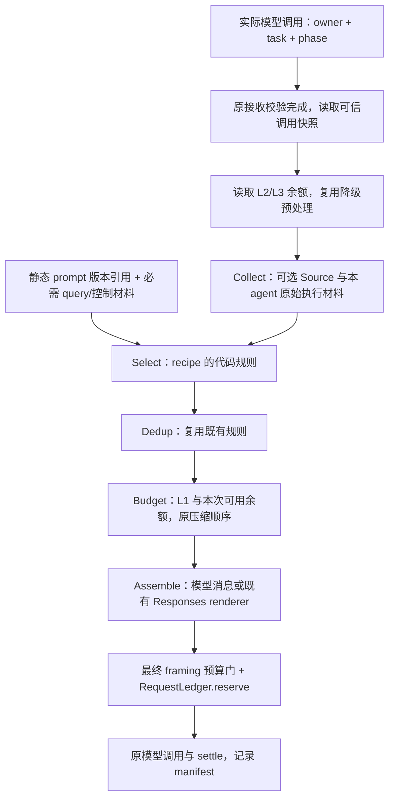

# Per-Agent ContextPack 设计

日期：2026-10-08。设计版本：`agent-pack-design/v1`。分支：`codex/context-agent-pack-design`。

基线：`codex/context-engineering-phase3`，`d1ff818c9318b532dfe5de81fb0c5cf2865a789e`。

交付状态：设计文档，尚未实现。Gate 0 已先行只读审计并停下；West 随后确认“按审计结论做设计，三处偏差是细化不是推翻，可以放行”。本文保留 Phase 1–3 的机制、契约和边界，设计接收端如何消费现有数据。

> 2026-10-11 合入核对：上面的“尚未实现”及正文的“后续”描述记录 2026-10-08 的设计状态。A/B/C、D/E、正式 RAG Source 与 Relay migration 已在 `codex/unified-integration-20261011` 汇合；当前实现以 `agent_pack.py`、`business_pack.py`、`hop_sources.py`、`stage_pack.py` 和版本化 prompt bindings 为准。最终验证与发布范围见[统一合入报告](../reports/unified-integration-20261011/report.md)。
>
> 已确认的差异：Relay 比本文的参考材料方案更严格，只选任务路径／最小控制材料，不给模型读取业务摘要、画像或 RAG；`emotion_state` 仍未实现，也未伪造情绪来源；历史存储没有新增 owner 查询参数，私有归属由 Source 校验现有元数据，缺归属的旧公开文字仍视为共享会话。新增会话偏好规则使用独立的 `general-chat-preferences/v1` 锚点，保留原 `general-chat-base/v1` 摘要。离线配额与合成测试结果不证明真实用户业务效果。

## 0. Gate 0 结论与采用口径

| 审计项 | 基线实际形态 | 本轮设计采用口径 |
| --- | --- | --- |
| Entry pack 消费链 | `prepare_context` 规范输入、初始化状态；路由节点创建 lite，再调用 `EntryContextEngine.complete`。Lite 材料供 JEV／LLM 分诊；规则命中时跳过。Full 按 RouteKey 组装，但只保留 manifest、`entry_candidates` 和 `entry_intent`，没有把 full.messages 传给首跳 | 保持入口时序；agent 的每次实际模型调用从可信源快照重新组装。复用候选和 pipeline，不把 entry manifest 或 entry Pack 当新来源 |
| Agent 上下文 | GeneralChat 有有限只读工具循环；Curator 有工具循环和当前歌曲只读分析；Explorer 是 WorldLine 分阶段工作流。当前均复用 pack 能力，但没有 agent recipe | 配方按执行者定义，按实际调用阶段取子集。Explorer 保留查询理解、叙事、分支三个调用边界，不改造成通用 ReAct 循环 |
| L2 执行 | `RequestLedger.remaining` 合并 owner 的 L2 与 run 的 L3 余额。组装前有降级预处理，模型调用前有 reserve 硬门；每跳由 `run.usage` 恢复累计值 | 将配方入口固定在有效 owner/request scope 内，复用已有组装检查和调用预留，不增加第二套余额或扣费 |
| Envelope 消费 | Guard、checkpoint、Journal 已读取／校验 Envelope；接收 agent 的模型上下文主要从 run/state 重建。Registry 默认只有 `user_profile`、`history_memory` | 在原接收校验完成后，把 Envelope 的可选业务材料注册成正式 Source；任务、授权、工具域仍由运行时控制。按四条边选择现有字段，不新增 per-edge DTO |
| Prompt | Agent 主 prompt 是 Python 常量，另有内联附加规则；无统一版本字段。查询理解有 `QUERY_ANALYSIS_PROMPT_V1` 和 YAML v1，Guard 有 `handoff-guard-v3` | 为实际使用的 prompt 及附加规则建立版本锚点，manifest 记录组成和摘要；本轮不改写 prompt 内容 |

代码依据：

- 入口：[entry_context.py](D:/code/ProjectsAll/MoodFlow/ai-service/app/agent/foundation/entry_context.py:99)、[Foundation main_graph.py](D:/code/ProjectsAll/MoodFlow/ai-service/app/agent/foundation/main_graph.py:175)、[Handoff graph.py](D:/code/ProjectsAll/MoodFlow/ai-service/app/agent/handoff/graph.py:142)。
- Agent 调用：[handoff/agents.py](D:/code/ProjectsAll/MoodFlow/ai-service/app/agent/handoff/agents.py:112)、[tool_calling/assistant.py](D:/code/ProjectsAll/MoodFlow/ai-service/app/agent/foundation/subgraphs/tool_calling/assistant.py:101)、[WorldLine generation.py](D:/code/ProjectsAll/MoodFlow/ai-service/app/agent/foundation/subgraphs/worldline/generation.py:118)。
- 预算：[budget_strategy.py](D:/code/ProjectsAll/MoodFlow/ai-service/app/llm/budget_strategy.py:12)、[runtime.py](D:/code/ProjectsAll/MoodFlow/ai-service/app/llm/runtime.py:206)、[context_engineering.py](D:/code/ProjectsAll/MoodFlow/ai-service/app/agent/foundation/context_engineering.py:642)。
- 契约：[Envelope](D:/code/ProjectsAll/MoodFlow/docs/contracts/handoff-envelope.md:5)、[ContextPack](D:/code/ProjectsAll/MoodFlow/docs/contracts/context-pack.md:5)、[manifest DTO](D:/code/ProjectsAll/MoodFlow/ai-service/app/agent/foundation/context_contracts.py:24)。

三处偏差只细化接入：full 的“首跳消费”通过下游重组实现；Explorer 的“本 agent 历史”包括工作流中间结果；“per-edge 载荷”指现有 Envelope 字段的按边投影。

## 1. 机制与职责分工

三份配方只描述本次调用需要什么，不创建另一个上下文引擎。执行仍复用 Collect → Select → Dedup → Budget → Assemble；已有确定性压缩继续属于 Budget 阶段。Select 由代码执行，新增来源不交给模型挑选。

| 设计对象 | 负责什么 | 不承担什么 |
| --- | --- | --- |
| Recipe | agent、调用阶段、prompt 引用、来源清单、新来源软配额、确定性 Select 规则 | 路由、工具授权、转交接受、模型调用和记账 |
| 调用快照 | 从当前有效 run、session、已校验转交、私有执行状态读取本次输入，绑定 owner、task、phase | 新事实持久化、创建消息、重写任务计划 |
| ContextSource | 输出有来源引用的有界候选；按已有 SourceRequest／Registry 接口接入可选数据 | 构造 prompt、提升 required 权限、执行工具、生成或总结文本 |
| 既有 pipeline | 类型／意图过滤、去重、来源配额、整体预算、压缩和消息组装 | 使用 manifest 重建内容 |
| RequestLedger／DurableAccounting | 检查 L2/L3、实际调用前预留、调用后结算、恢复原账单 | 因设计中的配额或 manifest 再记一笔账 |

`AgentPackBuilder` 是后续实现建议名：薄的 recipe 适配层，把下表的调用快照转换成既有 pipeline 输入。它不替代 `ContextCollector`、`ContextSelector`、`ContextAssembler`。`BudgetLedger Protocol`、Envelope v1 和工具调用方的授权语义保持不变。

`SourceRequest` 仍无“本轮意图决定是否收集”的参数。调用快照放在服务端控制的 invocation 数据中，Source 只检查身份／作用域并收集有界候选；agent、phase、route 的取用规则在 Select 执行。原始客户端 continuity 字典不得伪装成已校验转交。Recipe 按固定职责／phase 声明需要调用哪些 Source，不根据模型判断或 query 的意图提前筛候选；例如 query_analysis 和 relay 的来源清单不含 RAG，避免为了分析查询先做一次不需要的检索。

Prompt 为静态绑定，**不作为动态 Source 参与 Collect**。调用入口按版本引用取得现有静态文本，绑定为 required system 材料；它和 required query 一起进入同一个预算和 Assembler。后续适配层须避免现有 collector 重复加入 system。静态直拼不意味着在最终预算门后追加 SystemMessage。

此图中的“原接收校验完成”是先决条件：有 Journal 时继续等待 committed/reconciled 并校验 payload digest、目标、任务和控制消息；没有 Journal 的原兼容路径继续使用已有运行时校验，manifest 不伪造提交回执。

## 2. 共用来源、预算口径与历史纪律

### 2.1 三 agent 共用材料

| 材料 | 真实来源与类型 | 取用和生命周期 |
| --- | --- | --- |
| Agent prompt | 对应现有 Python 常量和受控附加规则；required system | 静态绑定版本，不读取用户资料；只在本次调用计入 L1 |
| 当前任务与执行控制 | 服务端 `RouteTask`、原请求、current owner、phase、原工具域；required query／runtime 材料 | 不裁剪授权依据和否定条件。当前任务文本继续按原 intent span 规则生成；旧任务无 span 时保留原完整输入作为授权依据 |
| 收到的 Envelope | 新正式 Source `received_envelope`，类型 `business_state`，只输出 optional 候选 | 已校验的当前接收 hop；按字段／结果／实体粒度输出，调用结束释放 Pack，hop 完成后不继承完整 Envelope |
| 共享 session 投影 | 原 `continuity_context.handoff`、已提交 `AgentProgress`、公开产物／key event 引用 | 原 inherited `handoff_projection` 保留 required、不可压缩纪律；附加进度摘录走 optional `session_view` Source，类型 `business_state`，相同字段只选一个来源 |
| handoff_chain | 当前有效 `run.handoff_chain`；历史链来自已提交 `AgentProgress.recent_run_chain` | 当前链是 runtime 控制事实，不按文本猜测；保留现有最多 5 hop／6 agent。旧投影无 owner 时标 unknown；不把历史链当本 run 链 |
| 本 agent 的 ReAct／工作流历史 | 当前 owner 的私有消息、成对工具调用／结果，或 Explorer 已完成阶段的事实和图 | 普通会话类型 `conversation`；工具协议使用原 collector 的 AIMessage／ToolMessage 路径；工作流中间结果使用原结构化输入路径 |
| 画像和历史回忆 | 原 `user_profile` 和 `history_memory` Source | 不增加表或二次镜像；保持身份校验、版本、白名单和原配额 |

`received_envelope` 不能通过 Registry 注入 required 项。执行所必需的任务／授权／当前链由运行时单独绑定，仍在原预算门检查；Source 只提供参考材料。这解决“需要 Envelope，但不能让外部来源提升必需权限”的接口约束。

继承投影默认生产构建目标为 1,200 token，来自既有 LongHorizonPolicy；实际仍使用投影已有预算和完整校验。Recipe 不在读取时再次截断 required 投影。SessionProgress 的 600 token 软配额只针对新增可选进度摘录，不覆盖或放宽已有投影约束。

Session view 只认已提交／可恢复的 run 和 hop，复用 Phase 3 投影读取接口。旧表完整投影仍保持只读兼容；缺少 owner 的旧行不得猜测归属。Redis P1 若以后合入，只替换该读取适配器，不成为本文前置依赖。

### 2.2 本 agent 历史与共享会话的区分

本 agent 的历史按 `run_id + route_task_id + owner_agent` 隔离。新子图的本地工具循环天然属于当前 owner；后续实现须把可靠归属随调用／工具结果的私有元数据传递。缺少归属的旧普通历史继续作为共享 conversation，不能假装为某 agent 的 scratchpad。

只收集可见的工具输入／结果、验证状态、公开回答和结构化中间产物，不存储或发送私有思考。另一 agent 的 tool 协议不会被搬入接收方的私有 ReAct 历史；接收方使用 Envelope 摘要、实体引用和已提交投影。

AI tool call 与对应 ToolMessage 作为完整单元进入原 collector。已配对的协议 requiredness 保持不变；截断／摘要不拆配对，不从工具结果删除执行所需 ID／回执。超大协议单元不能塞入时执行原预算拒绝，不伪造压缩后的成功结果。

表中 conversation／tool_result 配额沿用原 source 名称和数值，不新建“react_history”副本。GeneralChat 的只读工具结果继续走现有消息协议；它没有独立 tool_result 软配额，实际内容仍完整受 L1／最终请求门控制。

### 2.3 L1 和新来源配额

| 调用阶段 | 既有 RouteKey | L1 total | 原预留输出 | safety | 基础 Pack 输入上限 |
| --- | --- | ---: | ---: | ---: | ---: |
| GeneralChat 业务调用 | general_chat | 8192 | 2048 | 256 | 5888 |
| Curator 当前歌曲分析 | current_song | 8192 | 2048 | 256 | 5888 |
| Curator 工具循环 | tool_calling | 12288 | 2048 | 256 | 9984 |
| Explorer 工作流调用 | worldline | 12288 | 2500 | 256 | 9532 |

基础 Pack 输入上限按现有 `total_input_budget - reserved_output_tokens - safety_margin` 计算。Responses/schema/tool framing 和实时 L2/L3 余额会进一步缩小实际可用量。原 L1 预留不等于供应商输出配置：实际 `max_output_tokens` 沿用 default=1024、jev-latest=256，调用方较小值仍优先。不用二者差额放宽 pack。

下面三份配方中的数字是**来源软上限，不是预分配空间，也不是最低保留量**；不能把各行上限相加并声称总包一定容纳。整体超限仍由既有优先级／requiredness、Dedup 和 Budget 决定丢弃／压缩，必需材料不够则拒绝。

新来源初值的依据：Envelope 参考材料按 Phase 2 的 256 token 摘录单位配置，GeneralChat 3 单位、Curator 4 单位、Explorer 5 单位；session_view 600 为现有 1,200 token 投影目标的一半，仅用于附加摘录；emotion_state 240 沿用画像来源量级。它们尚未经业务 eval，不是新的生产阈值。原 user_profile 240／16 候选／120 字符、history_memory 600／24 候选／400 字符和原优先级保持原值。

可选 JSON 候选采用字段白名单、完整对象／列表项粒度作有界投影，不把 JSON 原文截成半截。超出来源上限的候选由原机制写入 dropped_items 和 source_budget_exceeded；文本摘录记录 token_before_projection。剩余上下文不会从被丢弃全文重新拉回。

## 3. GeneralChat 配方

Recipe：`general_chat/v1`。业务 phase：`answer`、`read_observation`。Prompt：现有普通聊天 prompt，加 handoff 路径现有只读工具规则；不同组成分别记录版本。

| 来源／材料 | 候选与配额 | Select 策略 |
| --- | --- | --- |
| prompt、当前任务、控制材料 | 静态／runtime required；按实际 token 计入 L1，无另设软配额 | 原完整当前任务和授权依据；不让历史／摘要改写规则 |
| received_envelope | 最多 16 候选，合计 768 token，priority=90 | 接收目标必须为 GeneralChat；优先与当前聊天任务有关的 completed_results、context_summary、当前音乐实体引用。分项摘录，不发送全部 pending_tasks 和无关歌单对象 |
| inherited session 投影 | 原 required 投影，沿用实际构建预算，默认目标 1200 | 继承 goal、约束、决策等原有效投影；不改变撤销／重新校验语义 |
| session_view＋handoff_chain | 可选进度最多 8 候选／600 token，priority=75；当前链绑定为 runtime 材料 | 取本轮完成／失败／待办状态和最近已提交链，允许诚实承接组合任务；历史链只提供引用 |
| 本 agent 历史／共享 conversation | 原 conversation=2400，priority=80；按既有候选历史范围收集 | 优先当前 task 的只读 observation，再使用相关会话。最多两次只读工具调用的现有执行限制不变，成对协议不丢 |
| emotion_state | 最多 4 候选／240 token，priority=55，类型 business_state | 只取用户明确自述的、有公开事件引用和时间的状态材料；当前 query 已包含同一自述时不另复制 |
| 情感／交流画像 | 使用同一 user_profile：16 候选／240 token，priority=10 | 继续按 `intents` 与 general_chat 的交集筛选，保留版本／置信度／更新时间；不把低置信画像当本轮状态 |
| 任务结果与播放器只读状态 | 原 structured_output=1000；business_state 沿原路径计入 L1 | 复用有界任务结果和只读播放器状态；与 Envelope/session 重叠时只取一个业务视图，不声称 pending 客户端动作已完成 |
| history_memory／既有长期记忆 | history_memory 600／24 候选，priority=20；原 long_term_memory=1000 | 按原意图、相关性和来源规则选择；优先当前任务，历史文字不授予权限 |

情绪来源现状没有独立的 typed emotion_state 表。设计新增的是只读“明确自述证据”视图，不是情绪分类器：没有上游可信标记／明确的用户状态记录时返回 empty。它不调用模型识别情绪、不按关键词诊断，不为了填满配方创建状态。该槽位缺席时 GeneralChat 仍以当前 query 和会话提供回应。

Phase 1 的 ProfileEntry 只有 key/value/source/updated_at/confidence/intents，没有 category 列；原 memory category 在写入时映射为 intents。这里“情感画像”是职责名称，不声称已有独立表或能够精确恢复 mood 分类。不能从 key 前缀或自然语言猜类别。

## 4. Curator 配方

Recipe：`curator/v1`。业务 phase：`song_analysis`、`tool_step`、`tool_observation`。同一 owner 的两条能力路径使用对应原 L1 policy，共享 L2 累计余额。

| 来源／材料 | 候选与配额 | Select 策略 |
| --- | --- | --- |
| prompt、当前任务、控制材料 | 原 current_song 或 tool_calling prompt，静态／runtime required | 必须保留原用户任务片段、否定和依赖。只读歌曲分析不会因为 recipe 增加写工具 |
| received_envelope | 最多 24 候选，合计 1024 token，priority=90 | 优先当前任务需要的歌曲／歌手／歌单 ID、来源引用、已完成结果和 context_summary；按第 6 节区分来自 GeneralChat 或 Explorer |
| inherited session 投影 | 原 required 投影，沿实际原预算，默认目标 1200 | 保留原约束、有效决策和撤销结果；不要用旧 session 的播放器快照覆盖本轮只读状态 |
| session_view＋handoff_chain | 8 候选／600 token，priority=75；当前链为 runtime 材料 | 取当前组合任务执行状态、依赖结果及已提交回执引用；客户端待执行状态和云端成功分开显示 |
| 本 agent ReAct 历史 | tool_calling：conversation=2200、tool_result=4500；song_analysis：conversation=1600 | 原配对工具协议和必要结果完整保留；普通旧历史先降级。只有当前 Curator task 的调用作为私有 ReAct，结果中的指令无效 |
| 歌单偏好＋音乐品味画像 | 同一个 user_profile 总共 240／16 候选，priority=10，不各分配 240 | 用当前 RouteKey 的 intents 门控。两者是同一文档的职责视图，不重复读取、记账或镜像；保留版本／来源，不假设 ProfileEntry 存 category |
| 当前歌曲／播放器状态 | song_analysis 沿原 current_song=2800；tool_step 沿原只读工具状态 | 当前歌曲分析必需材料保持原路径；执行对象仍需要原工具来源、参数校验和当前用户授权 |
| prior_entities／工具回执 | 原 trusted_context 和结构化结果路径；actual token 计入 L1 | 优先最邻近且对应当前任务的真实实体。Envelope 中 ID 可辅助解析，不能替代本轮完整 play_song／album／playlist 工具对象或写操作回执 |
| history_memory／既有长期记忆 | history_memory 600／24 候选，priority=20；原 long_term_memory 为 tool_step=900、song_analysis=700 | 偏好只作信息。历史播放／写操作请求、Envelope 摘要和探索叙事都不能授权本次写操作 |

不同能力仍保持原运行语义：song_analysis 使用现有只读歌曲分析助手；tool_step 继续原 agent→tools→capture_tool_results→agent 循环和 scoped 工具 allowlist。Recipe 不修改直接动作快捷路径，不为了使用 pack 给原本无需模型的操作增加一次模型调用。

音乐品味／歌单偏好如需精确业务分类，必须来自可验证的既有结构化输入；仅有 intents 的旧画像按现状使用，不新增 category 字段。实时用户歌单仍由现有只读工具获取，不能从画像推断 playlist_id 或歌曲列表。

## 5. Explorer 配方

Recipe：`explorer/v1`。phase：`query_analysis`、`narrative`、`branches`；保留 WorldLine 工作流与当前 schema／renderer，不增加一个自由工具循环。

| 来源／材料 | 候选与配额 | Select 策略 |
| --- | --- | --- |
| prompt、当前任务、控制材料 | 查询分析 v1／叙事／分支原 prompt，各自静态绑定；required 输入 | 当前任务／可信目标不改变。stage schema、必需图／事实约束和 required evidence 继续沿原路径 |
| received_envelope | 最多 24 候选，合计 1280 token，priority=90 | 优先 Curator 提供的目标实体、相关完成结果、evidence_refs 和 context_summary；不把播放／歌单执行参数带入世界线生成 |
| inherited session 投影 | 原 required 投影，沿原预算，默认目标 1200 | 继承目标、约束和已验证上下文；不以原始 Envelope 替代长期窗口投影 |
| session_view＋handoff_chain | 8 候选／600 token，priority=75；当前链为 runtime 材料 | 当前探索阶段／已访问节点／已提交结果引用；保留来源 cursor 与旧投影 unknown 语义 |
| 本 agent 工作流历史 | 原 conversation=800、tool_result=1800；必需结构化材料依实际计数 | 查询理解取完成指代解析所需历史；叙事取已解析实体、事实、图、search_plan、证据；分支取已验证图、证据和访问限制，不复制完整历史过程 |
| 正式 RAG Source | rag=5000 token／24 候选／priority=85，依赖并行 RAG 分支 | 按 worldline 意图代码选择，有文档出处才能进 Pack；保留分数、文档引用、token 审计和检索成本。候选上限同样约束该 Source 的 rerank 输入 |
| WorldLine 知识／已有 rag_pack | 继续原 rag_evidence=5000 软配额、原 required evidence 规则 | 保留世界线事实和边的证据闭包；与正式 rag 的同 evidence_id 内容进入原 Dedup，必需证据不因可选来源配额被删除 |
| user_profile（可选音乐上下文）／历史记忆 | user_profile 240／16 候选；history_memory 600／24；原 long_term_memory=600 | 继续 worldline intents 门控；画像可以调整探索偏好，但不能生成事实、改变引用或授权操作 |

RAG 依赖：`codex/context-rag-source` 的正式 Source 接入。设计按“已接入”编写；本分支基线中没有 rag 注册，不在本轮 cherry-pick 或改该分支。工作树中的 `knowledge/v2` 不在 Git 基线中，后续测试必须使用 empty/shadow 或自备合成索引。其 embedding／rerank 的既有记账和 manifest 审计由该依赖提供，本设计不缓存生成文本、不关闭 rerank、不增加 LLM 生成调用。

同一世界线调用不能把正式 rag 与旧 rag_pack 当两份可独立花满 5000 的可选证据池。后续适配层将可选证据统一投影到正式 `rag` 配额；旧侧通道必须证据继续保持原 runtime required 路径，依然计入整体 L1／最终 framing。原 Dedup 已支持 evidence_id；不改其算法、不把 required 证据降级来满足软配额。

复用的是原始检索候选／事实快照，不能复用上一调用的 Pack、manifest 或生成正文。只有 query、实体／过滤条件、索引版本和检索参数全部匹配时才可复用候选；不匹配就走原检索路径并记账。不存在这些有效性信息时不得假设候选仍然有效。

query_analysis 的原可选 LLM fallback 只分析已经完成指代的 standalone query。Recipe 仅为它提供该阶段必要的实体／Envelope／session 数据子集，不塞入叙事全部材料或 rerank 候选；纯规则命中仍不调用模型。narrative／branches 继续使用现有 Responses renderer，但必须把新增选中数据放进 renderer 的 context，并在同一最终 framing 门重新计数。

## 6. Envelope → agent pack 消费链

### 6.1 接收流程

1. 保留原转交接受／Guard、工具消息配对、checkpoint、Journal committed/reconciled 等检查。完整 payload digest 必须与原 proposal 一致；未提交或不一致不能以“Source unavailable”方式掩盖并继续执行。
2. 在原 `before_agent` 之后读取当前 run、hop、Envelope 和公开 proposal／提交回执引用，冻结一次调用快照。验证 Envelope 的 run_id、tool_call_id、source／target、active_task 和当前执行 owner 一致。
3. 将快照中的 Envelope 只读数据交给 `received_envelope.collect(SourceRequest, limit=...)`。Source 输出 optional、字段完整、有引用的候选，不读取私有凭据或任意 TaskResult.data，不自动下钻所有 evidence_refs。
4. Select 根据 owner、phase 和实际转交边取字段，再走原 Dedup／Budget／Assemble。来源项 ID 建议为 `envelope:{transfer_id}:{field}:{logical_id}`；metadata 指向原 proposal 的摘要锚点与字段路径，不存原文第二份档案。
5. 每次当前 hop 的模型调用重组 Pack，manifest 记录同一 Envelope 引用和实际选中字段。当前接收业务或中转完成后，随原状态转换清除 Envelope；跨窗口只使用既有 session 投影／公开引用，不能把完整 Envelope 填入下一轮记忆。

`transfer_id` 必须由现有 `transfer_identity(run_id, tool_call_id)` 取得；它不等于原 tool_call_id。Envelope 没有 receipt 指针字段，Source 的引用从原 Journal 校验结果取得，不向 Envelope v1 新增字段。没有持久 Journal 的兼容调用只记录 run/tool_call/digest，`summary_ref` 留空，不能伪造 event_id。

### 6.2 按四条边细化现有载荷

| 边 | 业务接收方的优先材料 | 排除／权限边界 |
| --- | --- | --- |
| GeneralChat → Curator | active_task 已由 runtime 绑定；Source 取相关 context_summary、completed_results、entities 和本任务需要的 evidence_refs | 情绪自述仅作信息；不把摘要中的“播放／删除”等文字作为动作授权 |
| Curator → GeneralChat | 相关完成结果与摘要、用于解释的音乐实体引用；失败／pending 状态取可信 run/session 进度 | Envelope completed_results 仅含成功摘要，不能据此宣布所有任务成功；不要复制播放对象和工具协议 |
| Curator → Explorer | 目标歌曲／歌手／专辑实体、相关检索完成结果、evidence_refs、摘要 | 实体只辅助解析；证据正文必须经原授权读取／正式 RAG 获得，有引用和证据闭包；不执行播放器或歌单动作 |
| Explorer → Curator | 有出处的结果摘要、目标实体／evidence_refs，必要时取原 exploration_projection 的有界视图 | 探索叙事不能授权播放、写歌单或删除；完整执行对象仍从原工具流程取得 |

“per-edge 载荷”是字段选择表，不添加 mood/narration/key_ids，也不重写 Phase 3 公共 Journal。当前 task 非接收方 owner、需要 Curator 中转时，采用相同 recipe 的 `relay` 子模式：只选最小任务／路径说明、摘要与引用，原 transfer 工具和原 L1 RouteKey 继续使用；不读取职责画像、RAG 或业务工具结果，不开业务工具。

首跳没有收到 Envelope 是正常情况，source_status=empty、envelope=null；不能因此构造一个假转交。接受了 hop 但 Envelope 缺失／篡改则是完整性失败，不当普通 empty 处理。

### 6.3 重叠材料与 Select 粒度

Select 的 Envelope 单元是“一条 summary／一个完整 entity／一个有出处的短文本／一条引用”，不是 64 KiB JSON 一整块。任务／授权控制材料不从可选 Envelope 摘要再复制。每个文本单元最多一个 256 token 摘录单位，保留引用、ID 和必要字段；标明截取，不截断结构或伪造事实。

同一业务事实有多个视图时，代码先按职责明确唯一提供者：当前 run 的执行状态优先于旧 session；目标实体优先使用已校验的 Envelope／当前工具对象；session source 不再输出这些同项，原 prior_results 适配器不再追加相同摘要的第二份呈现。这里是 recipe 输入投影，不修改事实源或原 Dedup 算法；独立来源的相同文本／evidence 仍由原 Dedup 处理。

Envelope.entities 与 evidence_refs 全丢弃后，若模型缺少必要依据，就按原缺上下文路径澄清／诚实说明，不执行无依据的操作。Runtime 仍保留完整契约数据作校验，Pack 的 soft quota 不削弱服务器校验。

### 6.4 一条消费链示例

假设原路由计划已确定为“搜索某首歌曲 → 探索这首歌的世界线 → 聊聊这次体验”，任务顺序和授权均由原路由生成，recipe 不修改它们：

| 当前节点 | 本次 pack 的接入效果 |
| --- | --- |
| GeneralChat 入口／转交 | 入口 full.messages 不传递；relay 重组最小包，通过原工具转给 Curator |
| Curator 搜索 | 消费 GeneralChat → Curator 的 Envelope 参考摘要和已绑定任务；工具循环的本地消息形成 Curator 私有历史 |
| Explorer 探索 | 消费 Curator → Explorer 的真实歌曲实体／搜索结果引用；查询理解、叙事、分支各按 phase 重组，使用正式 RAG／原证据和同一 Explorer L2 |
| Curator 中转 | 依原路径中转到 GeneralChat；只消费最小 Envelope 参考材料，不重新搜索／播放，不拉画像／RAG；仍归 Curator 原 L2 |
| GeneralChat 回应 | 消费 Curator → GeneralChat 的已完成结果摘要、可信进度和相应会话／画像；不把 Explorer 的工具协议作为自己的 ReAct 历史 |

该链四次转交，未扩大原 5 hop 上限。每一接收点仍先通过原提交／完整性检查；上一节点的 Pack 和 manifest 从未作为下一节点的数据源。

## 7. L2 检查点设计

### 7.1 余额和一次调用的检查次序

本 agent 累计预算仍归执行 owner，不归 RouteKey；Curator 两类能力共享同一 L2。relay、重试和辅助调用继续按原 owner 记账，JEV 的独立 billing 维度只展示，不再加一次 L3。

| 边界 | 设计要求 |
| --- | --- |
| recipe 入口 | 已有 request_scope／owner scope 生效；从同一 RequestLedger 读取余额，恢复沿原账本，不为重组 pack 重新初始化用量 |
| 开始组装、拉取新来源之前 | 复用 `check_task_budget`、`prepare_sources`。L2 余额耗尽不得调用新 Source；L3 必需输入无法容纳时先拒绝 |
| Collect／Select／Budget | 所有新来源纳入原 allow_new_sources/source_stops；必要 runtime Envelope／协议材料保留，可选画像、回忆、RAG 停拉。辅助检索成本发生后再次读取余额再完成 Budget |
| Assemble 和最终 renderer 之后 | L1、输出预留、安全余量、schema／tools／provider framing 与实时余额一起检查；不能在检查后追加任何字段 |
| 实际模型派发 | 原 `accounted_call`／`RequestLedger.reserve` 是唯一预留硬门；重组本身不扣模型 token，不新加“recipe reserve” |
| settle／下一调用 | 原实际 usage 或明确估算结算。真实超额完整记录、下一调用拒绝；manifest 只是投影，不退回已消费用量 |

当前余额可表达为：`min(L2_limit - owner_used, L3_limit - run_used) - active_reserved`。实际 limit 继续取原 RunLimits 与 policy 的较小值；默认 16000／32000。本轮不变更阈值，也不把 Redis 特性当作依赖。

### 7.2 降级顺序保持 Phase 2

| 顺序 | 对 agent 配方的具体作用 |
| --- | --- |
| 截断历史 | 优先缩减普通会话／旧非必要步骤；保留当前 query、任务授权、原 required session 投影及成对工具协议 |
| 摘要历史 | 原确定性摘录，使用现有 256 token 摘要量级；不引入 LLM 压缩、不改写回执或 JSON |
| 停拉来源 | 不再读新的画像、历史、RAG、可选 session 进度／Envelope 参考候选；同一 owner 的 source_stops 延续原恢复纪律。已验证控制材料仍来自 runtime |
| 诚实降级 | 必需输入／协议加输出预留仍无法容纳时停止模型调用，沿原 needs_input／failed／stop_reason 返回，保留已提交结果 |

L3 仍执行原 task_degradation → refuse。所有预算事件仍进原 History／账本观测路径；不用 Pack manifest 代替预算事件。不新增“Envelope 太长时另开模型兜底”的路径。

单 agent 同时派发模型的原预算安全性不由 recipe 解决；实际调用仍使用原 RequestLedger／既有适配器。设计没有声称读取余额等同原子扣减，未来合入 Redis P0 也必须继续保留其 reserve 权威边界。

## 8. Prompt 版本锚点与 Manifest

### 8.1 Prompt 绑定

| recipe／phase | 现有文本位置 | 建议锚点，后续实现时绑定 |
| --- | --- | --- |
| GeneralChat answer/read_observation | general_chat/assistant.py 常量＋handoff/agents.py 只读附加规则 | general-chat-base/v1 ＋ general-chat-handoff-read/v1 |
| Curator tool_step | tool_calling/assistant.py，含 search-only／song-playback 条件附加文本 | curator-tools-base/v1 ＋对应 search-only/v1 或 song-playback/v1 |
| Curator song_analysis | current_song/assistant.py | curator-current-song/v1 |
| Explorer query_analysis | query_understanding/analyzer.py＋config/v1.yaml | query-analysis/v1，沿用现有 v1 |
| Explorer narrative／branches | worldline/prompts.py＋已有重试／探索模式附加规则 | explorer-narrative/v1、explorer-branches/v1 ＋实际 variant |
| 各 agent relay | handoff/agents.py 中现有转交 prompt／重试提示 | handoff-transfer/v1 ＋ transfer-retry/v1 |

这里 v1 是**建议为现有文本补的管理锚点**，不声称基线已经存在这些字段。每个锚点固定内容摘要（SHA-256 UTF-8），文本或静态附加规则改变时必须升版本；路由／Guard 的版本独立，不能用 recipe.version 代替 prompt.version。

Prompt 引用只包含代码内静态文本与现有条件 variant，原样保留职责、工具边界和诚实措辞。重试 feedback 仍作为有界数据进入原实际请求，并计入预算；不把动态用户材料算成 prompt 版本，也不在 manifest 保存原文。

### 8.2 可审计字段与兼容策略

保留顶层 `tokens/budget/sources`，各来源的 `candidate_tokens/final_tokens/events/dedup_dropped`，以及 Phase 2 call usage、budget_events、usage_ref。保留并行 RAG 分支增加的逐 chunk／检索成本审计字段，不能以本文的扩展覆盖它们。

后续建议增加可选、严格类型的 `agent_context` 观测扩展：

| 字段 | 内容与约束 |
| --- | --- |
| schema_version | 扩展自身为 1，不改变 Envelope 或 Journal 的版本号 |
| recipe_id／recipe_version／owner_agent／route_key／phase | 标识本次执行者和实际模型阶段；owner_agent 与账本执行 owner 一致，区别于 call_manifest 的 billing_agent |
| prompts | 实际 prompt ID、版本、variant、content_digest；不包含 prompt／feedback 原文 |
| envelope | 当前 transfer_id、run_id、tool_call_id、schema_version、payload_digest、可用 summary_ref／commit_ref、选中字段路径；没有 Envelope 为 null |
| session | 已授权 session ID、projection_version、source_event_cursor、state_revision／checkpoint 引用；旧版本未知字段为空，不猜测 |
| source_selection | 最终选中 item_id、source/type、可用来源引用／画像版本、最终 token；未选候选的丢弃／压缩记录沿原 sources.events，明确是观测，不提供来源全文 |
| budget_snapshot | 组装时 owner／run 余额与降级阶段；只是快照，不成为恢复账本 |

完整性校验用的是完整 Envelope digest，不能以选中字段的 digest 代替。`summary_ref/commit_ref/usage_ref` 使用带长期 task_id 的 EventPointer；顶层 call_manifest 的 task_id/trace_id 仍是 run_id。原 `HistoryPointer` 或知识库／画像 ID 保持原类型，不混用为 event_id。

当前 PackManifest／CallManifest 设置 `extra="forbid"`，直接向旧 DTO 添任意字段会报错。因此后续实现必须同步增加可选的严格 DTO 扩展并更新生成／读取边界；旧持久文档没有 agent_context 时仍能读取，生成旧模式可省略该字段。向仍只认 v1 聚合字段的旧消费者提供明确的 v1 投影适配，不把原字典不加区分地传过去；不得通过全局放开 extra 或删除原断言取得兼容。

日志／公开观测不保存 Envelope 全文、画像值、工具结果全文、私有 scratchpad 或凭据。source_selection 是有界 ID／指针／数值清单，不能拿它或 prompts digest 重新 Collect。新审计扩展默认沿用本次 Pack／call manifest 的观测渠道，不另外把完整审计清单复制为公开 History 文档；若后续确需持久化，必须另行定义白名单投影并通过既有 16 KiB 门，不能截掉引用或放宽上限。

## 9. 与 entry pack 的关系

| 项目 | Entry | Agent pack |
| --- | --- | --- |
| 目的 | Lite 支持路由；full 记录各 route 的入口选取结果，产生可复用候选 | 为一次真实业务／relay／辅助模型调用生成实际输入 |
| 机制 | 既有 Collect／Select／Dedup／Budget／Assemble | 复用同一机制，增加 recipe 的输入投影和可选来源 |
| 选择维度 | 路由意图与各 RouteKey policy | owner＋当前 RouteKey＋phase＋接收边，仍以代码 Select |
| Prompt | Lite／入口通用 framing | Agent 和阶段的静态 prompt 引用，实际计入本次 L1 |
| Envelope | 新 run 入口没有收到 Envelope | 只有当前已接受接收 hop 读取 received_envelope |
| 预算 | 同 run 的路由和来源费用已计账 | 沿同 run 累计，检查本 owner L2，实际调用只预留／结算一次 |
| 生命周期 | 只留 lite/full manifest、源候选和意图；不留 full.messages 作输入 | 本次调用临时 Pack，调用后丢弃；不得喂给下次 Collect |

可以复用 entry 的**原始、经过来源校验的候选**，前提是 query、用户／session、源版本／cursor、来源参数和调用作用域仍一致；agent 重新计数和 Select。当前 entry 的 intent 全集必须按实际 task 的 RouteKey 缩小，不能因入口有多个任务让所有 agent 取全部画像／RAG。

下一模型调用的本 agent 历史来自原工具消息／中间结果，不是上一 pack.items。RAG 源查询变化、画像版本更新、session 有新提交时，重新取源；重组不会以旧 manifest 声称“命中”。这些有效性检查先于任何未来缓存层。

Foundation 模式没有协作 Envelope 时，按原能力 owner 绑定 recipe，received_envelope 正常为空；显式测试注入的 assistant／subgraph 保持原接口，不强迫模拟调用增加来源／模型请求。

## 10. 后续实现切分

建议拆为 5 个开发 prompt，每块独立分支／commit，全部以本文和最终合并基线做一次 Gate 0。估算是熟悉现有代码的工程人日，含相关测试，不含上线、真实索引准备和业务人工评测；不是工期承诺。

| 顺序 | Prompt 范围 | 主要落点与交付 | 验收门 | 估算 |
| --- | --- | --- | --- | --- |
| A | 共用 recipe 适配器、静态 prompt 绑定、strict manifest 扩展 | 新 recipe 描述／适配层；复用 context_engineering/model_input；prompt 引用与 agent_context DTO | 不另写 selector/assembler；旧 manifest 全兼容；system 只计一次；新增源码测试验证静态 prompt 无动态 Source 读取 | 1.5–2 人日 |
| B | received_envelope／session_view 来源与当前 hop 消费 | handoff graph 的已验证调用快照、SourceRegistry 可选来源、引用解析、按四边 Select | 未提交／篡改／错误 owner 拒绝；首跳空 Envelope 合法；旧投影只读；不改变 Guard、转交边、授权或归档全文纪律 | 1.5–2 人日 |
| C | GeneralChat／Curator 接入与私有历史隔离 | handoff agents、general/current_song/tool_calling 适配；emotion_state 可选只读证据槽 | 成对工具协议；两个 Curator RouteKey 共享 L2；原无模型快捷路径保留；画像只读一次、无类别臆造 | 1–2 人日 |
| D | Explorer 各阶段接入＋RAG 依赖兼容 | WorldLine query_analysis/generation renderer；正式 rag 与旧 rag_pack 输入投影 | 合成／empty 索引；出处和必需证据闭包；24 Source 候选上限；检索费用不漏／不双计；工作流语义不变 | 1.5–2.5 人日 |
| E | 综合回归、离线配额评测和报告 | 三 agent／四边／relay／恢复矩阵、预算／manifest／安全回归 | 原全量 0 失败，原环境 skip 单独报告；不删／弱化断言；所有新增边界可验证 | 1.5–2.5 人日 |

合计约 7–11 工程人日。A → B → C/D → E；D 还依赖正式 RAG Source 合入并核对接口。这里描述实现切分，不授权本轮执行其中任何一块或启动其他线程。

实现 Gate 要重新核对动态 Source 的 intent 排除方式、当前 strict DTO，以及已有 lint 的限制。现有可选 JEV context selector 属于旧路径；新增注册来源沿 Phase 1 规则排除在其打分之外，recipe 的新字段／画像／Envelope／RAG 选择由代码决定，不能借配方新增一次模型 Select。

## 11. 后续验收矩阵与本轮边界

| 用例 | 后续必须断言 |
| --- | --- |
| 三份配方正常组装 | 相同机制；不同来源／阶段正确；实际模型输入含选中材料，未选中的全文不出现 |
| 四边 Envelope 消费 | 每条边读取正确字段；模型可见摘要／实体引用；manifest 可追溯到同一 proposal；full digest 校验仍对完整 Envelope |
| 首跳／relay／结束 | 首跳 Envelope empty 正常；relay 无业务工具／RAG；hop 后不继承完整 Envelope；不新增模型调用 |
| 失败／边界 | 未提交、篡改、错误 run/session/owner、越权引用硬拒绝；缺可选源返回 empty/unavailable；二者不混淆 |
| L1 和配额 | system/query/frame 均计入；来源超额走原 dropped_items；超大必需协议拒绝，不能静默删除；RAG 有出处且按证据 ID 去重 |
| L2/L3 | 每次 pack 组装在原 scope 内检查；同 owner 跨能力／hop／恢复累计不重置；实际派发前 reserve 硬拒绝；既有降级顺序和事件不变 |
| 历史／画像 | 不跨 agent 搬工具协议，不发送私有思考；240 token 总画像配额不双份；身份／版本／16 KiB 白名单保持；缺 category/情绪字段不猜测 |
| Prompt／manifest | 实际版本和 variant 可查；没有调用不伪造 call_manifest；旧 DTO／历史兼容、原统计字段保留、RAG 审计保留、引用 scope 正确 |
| WorldLine／RAG | query_analysis、narrative、branches 的真实 renderer 边界全部覆盖；检索记账一次；不依赖线上索引、不缓存 LLM 结果 |
| 全量回归 | tests＋evals/tests 原全量通过；现有 L1/L2/L3、路由、Guard、转交、恢复、工具授权和 API 行为不变 |

本轮只新增设计与验证说明文档。未改任何实现、原契约、阈值、prompt 文本、生产配置或 Redis 分支；未 push、部署、调用线上模型／索引。文档检查不能证明未来 recipe 已实现或业务效果已验收。

尚需后续验证的内容：新软配额的业务分布、Envelope／session 单一事实视图的投影细节、私有历史归属元数据的兼容、strict manifest 升级与旧消费者适配、正式 RAG 分支合并后的输入接口和成本边界。它们已写入实现切分和验收矩阵，不在本轮用假数据声称通过。
