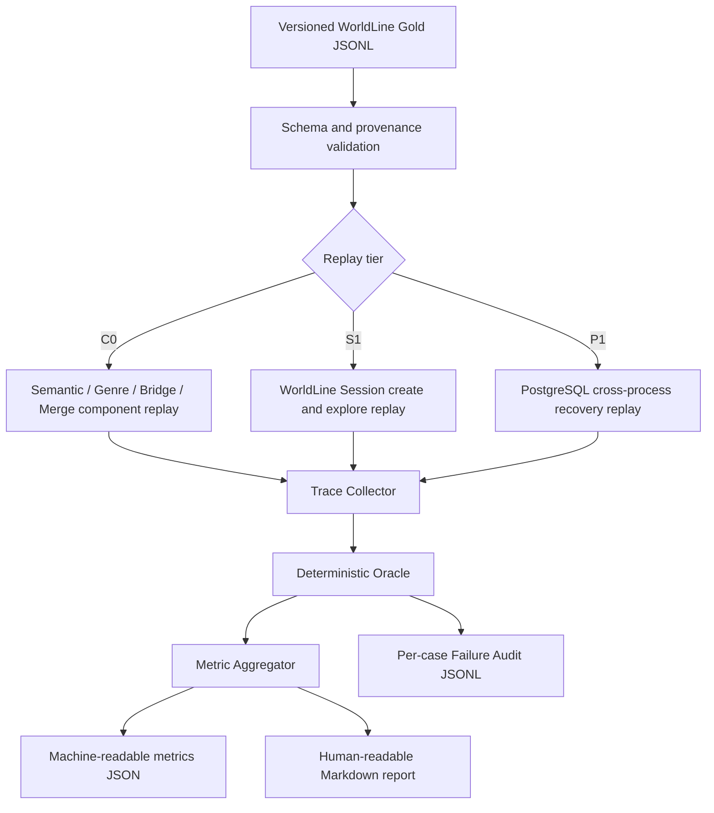

# WorldLine 专项 Evaluation 体系实施计划

> 本文基于当前 WorldLine V2.3B 实现制定。本阶段只设计 Evaluation 体系，不修改 WorldLine Graph、Semantic Expansion、Genre Executor、RAG Pipeline、Retrieval、Embedding、Reranker、数据库或关系类型。

## 1. 当前能力分析

### 1.1 当前可评测执行链

当前 WorldLine 已具备两条需要分别评测、最终在 session 中汇合的语义链路：

```text
artist query
  → Query Understanding / SearchPlan
  → catalog artist + ContextPack documents
  → Semantic Expansion
  → Candidate → Validator → Graph Projection
  → artist --associated_with / evidence_ids--> genre

genre branch
  → session branch validation
  → Genre Executor
  → supported_claims
  → Candidate → Evidence Validator
  → EntityBridge knowledge artist → catalog artist
  → Graph Projection
  → genre --associated_with / evidence_ids--> artist
  → merge → narrative/citations → checkpoint
```

当前只允许 `artist → genre` Semantic Expansion，以及 `genre:hip_hop → artist` 执行。Jazz、Jazz Hip-Hop、R&B、C-pop 已注册但不可执行，可作为 registry/action 的负样例。评测集不得把尚未支持的关系当作正向能力。

### 1.2 可以直接采集的观测数据

| 评测对象 | 当前可直接采集内容 | 真实来源 | 限制 |
|---|---|---|---|
| Artist → Genre | candidate、accepted、rejected、rejection reason、target genre、evidence IDs、registry/validator version | `SemanticExpansionResult`、`SemanticExpansionTrace` | Trace 未进入 API 或 checkpoint，只在组件返回值和结构化日志中存在 |
| Genre → Artist | retrieved document 数、candidate 数、evidence accepted 数、catalog resolved 数、projected artist 数、rejection reason、projected evidence IDs | `GenreExecutorResult`、`GenreExecutorTrace` | Session 消费 result 后不会持久化 trace；专项 runner 应直接保留 executor result |
| Entity Resolution | resolved/unresolved/ambiguous、reference、candidate knowledge IDs、reason | `CatalogResolutionResult` | 需要按 gold 标明“本应唯一解析”还是“本应拒绝/歧义” |
| Evidence | claim ID、parent ID、child ID、source chunk、exact span、confidence、source URL、context/retrieval version | `SemanticRelationEvidence`、`EvidenceSource.metadata` | 不能只检查 `evidence_ids` 非空，还要核对 ID 是否能解析和 span 是否来自冻结文档 |
| Graph Projection | nodes、edges、relation、edge evidence IDs、node entity reference | `WorldLineGraph` | Graph schema 保证唯一 ID、唯一 edge key、无悬空端点和无自环，但不判断音乐关系是否正确 |
| Graph Merge | merge result 或稳定错误码；旧 graph/source 是否未变化 | `merge_worldline_graph()` | 当前没有独立 merge trace，Evaluation runner 需要对 merge 前后快照做差异比较 |
| Citation | inline citation 顺序、source membership、knowledge excerpt、段落引用 | `WorldLineGroundingValidator`、`WorldLineResult` validator | Validator 验证引用完整性，不替代 relation gold correctness |
| Session | root、current graph/node、visited、branches、consumed branch IDs、depth、evidence history、revision、last result | `WorldLineSessionState` | 动态 branch ID 不应成为 Gold；应按 target node 查找服务端返回的 action |
| Checkpoint | 创建后的 snapshot、重启后的恢复 snapshot、继续探索后的 revision/graph/evidence | Persistent PostgreSQL Checkpointer | 正式恢复验收必须跨进程；InMemorySaver 只用于快速组件/失败用例 |

### 1.3 已有能力的复用结论

1. `SemanticExpansionTrace` 可直接形成 Semantic Expansion 的漏斗统计。
2. `GenreExecutorTrace` 可直接形成 candidate → evidence → identity → projection 的分阶段 yield。
3. `CatalogResolutionResult.reason` 可直接统计 unresolved 和 ambiguous 原因。
4. `WorldLineGroundingValidator` 可作为 citation validity 的确定性判定器。
5. `WorldLineGraph`、`EvidenceSource` 和 `merge_worldline_graph()` 可进行精确结构比较，不需要 LLM Judge。
6. `WorldLineSessionState.revision` 与完整 snapshot 可用于 checkpoint 恢复一致性比较。
7. 现有 `evals/datasets`、`evals/reports`、JSONL runner、metrics 和 failure audit 组织方式可以复用。
8. 现有 WorldLine 单元测试主要是代码回归和合成 fixture，不能直接宣称为独立 Golden Dataset；可以复用 fixture 结构，但 Gold 标签需要单独冻结、记录来源并审核。

## 2. Evaluation 目标

### 2.1 V0 目标

建立一个可重复、可审计、以确定性规则为主的 WorldLine 专项评测体系，覆盖：

1. `artist → genre / associated_with` 是否只生成 Gold 支持的关系。
2. genre branch 是否只生成具有真实 supported claim、且成功映射 catalog identity 的 artist。
3. 每条投影关系是否有可解析、可回到原始 exact span 的 evidence。
4. knowledge entity → catalog entity 是否正确区分 resolved、unresolved 和 ambiguous。
5. graph merge 是否保留旧 graph、正确去重并合并 evidence。
6. PostgreSQL checkpoint 是否能在进程重启后恢复完整 session 并继续探索。

V0 不评测新的关系类型，不把 RAG Top-K、召回率、RRF、Reranker 或 Embedding 质量纳入 WorldLine 分数。检索只作为现有输入边界使用。

### 2.2 评测原则

- **Evidence First**：关系 correctness 与 evidence correctness 分开计算；有 evidence ID 不等于 evidence 正确。
- **Deterministic First**：关系、身份、graph、citation、checkpoint 优先用结构化断言，不用 LLM Judge 替代可计算规则。
- **Stage-aware**：区分 Candidate、Evidence Accepted、Catalog Resolved、Projected，避免把严格拒绝误报为系统故障。
- **Failure is a labeled outcome**：无 evidence、未注册 genre、无法映射和歧义应按预期拒绝原因计分。
- **No generated branch IDs in Gold**：runner 从 session 返回中按 target entity 选取服务端 branch ID，再调用 Explore API/service。
- **No aggregate vanity score**：V0 输出分项指标与阻断项，不把 precision、yield、reliability 混成单一总分。

## 3. Dataset 设计

### 3.1 数据集分层

建议建立一个版本化 JSONL 数据集，逻辑上分为三个 replay tier：

| Tier | 目的 | 输入边界 | 是否访问 PostgreSQL | 是否访问实时外部服务 |
|---|---|---|---:|---:|
| C0 Component Replay | 精确评测 semantic、executor、identity、merge、grounding | 冻结 documents、catalog candidates、graph、sources | 否 | 否 |
| S1 Session Replay | 验证 create → branch → explore → merge → state | 注入既有测试边界，使用服务端 branch ID | 可用 InMemorySaver | 否 |
| P1 Persistent Recovery | 验证生产 checkpoint 恢复和继续探索 | 多进程 session worker + 冻结业务输入 | 是，真实 PostgreSQL | 否 |

C0 负责主要质量指标，S1 负责 session contract，P1 负责正式持久化验收。三层结果必须分开报告，不能用 C0 成功替代 PostgreSQL 恢复成功。

### 3.2 通用 Case Schema

建议文件：`ai-service/evals/datasets/worldline_eval_v0.jsonl`。

```json
{
  "schema_version": "worldline-eval-v0",
  "dataset_version": "v0",
  "case_id": "wl-sem-positive-001",
  "tier": "component_replay",
  "task": "semantic_expansion",
  "tags": ["positive", "artist_to_genre", "hip_hop"],
  "input": {},
  "fixtures": {},
  "expected": {},
  "label_provenance": {
    "source": "frozen_supported_claim",
    "review_status": "pending_human_review",
    "reviewer": null,
    "notes": ""
  }
}
```

通用约束：

- `case_id` 全局唯一且冻结后不复用。
- `task` 只允许 `semantic_expansion`、`genre_exploration`、`entity_resolution`、`graph_merge`、`grounding`、`checkpoint_recovery`。
- fixtures 保存必要的最小输入或内容寻址引用，不保存生产密钥、数据库连接或自由文本状态快照。
- expected 保存 semantic tuple 和 provenance，不依赖运行时 UUID。
- 每次结果记录 dataset hash、Git commit、registry version、validator version、运行时间和 backend。

### 3.3 Entity Expansion Case

输入结构：

```json
{
  "task": "semantic_expansion",
  "input": {
    "artist_catalog_id": "netease:artist:<id>",
    "artist_knowledge_id": "artist:<slug>",
    "artist_name": "<canonical name>"
  },
  "fixtures": {
    "search_plan": {},
    "directory_graph": {},
    "directory_sources": [],
    "documents": ["<frozen MusicKnowledgeDocument>"]
  },
  "expected": {
    "outcome": "accepted",
    "relations": [{
      "source_id": "netease:artist:<id>",
      "source_knowledge_id": "artist:<slug>",
      "target_id": "genre:<slug>",
      "relation": "associated_with",
      "claim_id": "claim:<id>",
      "parent_id": "<parent id>",
      "child_id": "<child id>",
      "exact_span": "<verbatim span>"
    }],
    "rejection_reasons": []
  }
}
```

验证内容：

- accepted semantic tuple 与 Gold 完全一致。
- 不允许额外 genre relation。
- relation edge 至少包含一个 evidence ID。
- evidence ID 能解析到 `EvidenceSource`。
- source metadata 的 claim/parent/child 与 Gold 一致。
- exact span 逐字存在于对应冻结 document。
- projected genre identity 来自当前 Genre Registry。

Semantic Expansion 正样例可覆盖 Hip-Hop、Jazz、Jazz Hip-Hop、R&B、C-pop；不可执行 genre 仍可以是合法展示关系。是否可执行由 action/executor 层单独评测。

### 3.4 Genre Exploration Case

Genre Explore 的 Gold 不保存动态 `branch_id`，保存目标 genre：

```json
{
  "task": "genre_exploration",
  "input": {
    "root_artist_id": "netease:artist:<id>",
    "target_genre_id": "genre:hip_hop"
  },
  "fixtures": {
    "initial_session_result": {},
    "documents": ["<frozen MusicKnowledgeDocument>"],
    "catalog_candidates": ["<ResolvedEntity>"]
  },
  "expected": {
    "outcome": "accepted",
    "artists": [{
      "knowledge_entity_id": "artist:<slug>",
      "catalog_node_id": "netease:artist:<id>",
      "relation": "associated_with",
      "claim_id": "claim:<id>"
    }],
    "old_graph_preserved": true,
    "expected_revision_delta": 1,
    "expected_depth_delta": 1
  }
}
```

Runner 流程：

1. 创建或载入初始 session。
2. 从 `available_actions` 中找到 `target_node_id == target_genre_id` 且 enabled 的 action。
3. 提交该 action 的服务端 `branch_id`。
4. 比较 accepted artist identity、delta graph、merged graph、sources、visited、revision 和 depth。

### 3.5 Entity Resolution Case

EntityBridge 独立 case 应包含：

- knowledge artist ID。
- canonical name 和 aliases。
- catalog candidate 列表。
- expected status：resolved、unresolved 或 ambiguous。
- expected catalog node ID，仅 resolved 时存在。
- expected reason，例如 `catalog_artist_not_found`、`catalog_artist_ambiguous`、`knowledge_artist_not_registered`。

需要覆盖 canonical match、alias match、错误 entity type、非法 catalog ID、零候选和多个精确候选。

### 3.6 Graph Merge Case

Graph merge case 保存：

- old graph / sources。
- increment graph / sources。
- target node ID。
- expected merged node keys、edge keys、每条 edge 的 evidence IDs。
- expected outcome 或 `WorldLineMergeError.code`。
- `old_snapshot_unchanged=true`。

必须覆盖：

- node 去重。
- `(source, target, relation)` edge 去重。
- evidence union 和顺序稳定性。
- node type conflict。
- source conflict。
- missing edge evidence。
- capacity rejection 后旧 graph 不变。

### 3.7 Grounding Case

Grounding case 保存 narrative、citation IDs、sources 和 expected validator outcome，覆盖：

- 合法 inline citation。
- unknown citation。
- citation order mismatch。
- knowledge source 无 excerpt。
- substantive paragraph 无 citation。
- edge evidence ID 存在但 narrative citation 不合法。

### 3.8 Failure Cases

首版至少包含以下负样例：

| 场景 | 预期结果 |
|---|---|
| supported claim 缺失 | 不产生 relation；`candidate_count=0` 或明确 evidence rejection |
| claim exact span 不存在 | reject，reason 与 validator 输出一致 |
| 未注册 genre | 不投影 graph，不生成 executable action |
| 已注册但不可执行 genre | 可以展示 relation，但 genre explore 被拒绝 |
| knowledge artist 未注册 | EntityBridge unresolved，不进入 executable graph |
| catalog artist 无候选 | `catalog_artist_not_found` |
| 多个 catalog identity 精确命中 | ambiguous，不进入 graph |
| duplicate relation | merge 后保持一条 edge，evidence 去重合并 |
| source/evidence 冲突 | merge 失败且旧 session 不变 |
| session 不存在 | `session_not_found` |
| checkpoint 数据无法验证 | `checkpoint_unavailable`，不生成伪恢复结果 |
| checkpoint 写入失败 | revision、graph、evidence 保持旧值 |

真实 PostgreSQL 的常规 P1 suite 负责正向跨进程恢复。数据库不可用和损坏 snapshot 使用 eval/test double 做可重复的失败分类，不在日常评测中主动破坏真实数据库。

### 3.9 Golden Set 规模

V0 建议 38 个 case，覆盖至少 20 个不同 artist identity：

| 类别 | 数量 | 建议构成 |
|---|---:|---|
| Artist → Genre | 14 | 8 正向、6 无 evidence/错误 claim/未注册 genre 等负向 |
| Genre → Artist | 10 | 6 个 Hip-Hop 正向、4 个 evidence/identity/action 负向 |
| Entity Resolution | 6 | resolved、alias、unresolved、ambiguous、非法 ID |
| Graph Merge / Grounding | 4 | 正常 merge、duplicate evidence、冲突、citation failure |
| Checkpoint Recovery | 4 | 两个跨进程成功、missing/corrupt/write failure |

Artist → Genre 正向样例可以覆盖多个已注册 genre；Genre → Artist 的正向样例只允许当前 executable 的 Hip-Hop。这样既覆盖多个 genre，又不会伪造系统尚未具备的 executor 能力。

数据集冻结流程：

1. 从现有冻结 knowledge release 或明确 fixture 中抽取 candidate，不读取本次运行输出作为 Gold。
2. 核对 supported claim、原始 parent、child 和 exact span。
3. 核对 knowledge/catalog artist identity。
4. 审核 expected relation 与拒绝原因。
5. 将 review status 从 pending 更新为 approved 后计算正式指标。
6. 输出 dataset SHA256；pending case 不进入正式分母。

## 4. Metrics 设计

### 4.1 统一计算规则

- 同时输出 micro 和 macro 指标；小样本报告必须展示原始分子/分母。
- 正向、负向、genre、failure reason 分层报告。
- 分母为 0 时输出 `N/A`，不能记为 0 或 100%。
- aborted/error case 单独计入 execution reliability，不能从质量指标分母中静默删除。
- yield 类指标只描述产出率，不代表越高越好；严格 evidence gate 产生的正确拒绝不应被当作质量下降。

### 4.2 Semantic Quality

| 指标 | 定义 |
|---|---|
| Semantic Relation Precision | `accepted semantic tuples ∩ gold tuples / accepted semantic tuples` |
| Semantic Relation Recall | `accepted semantic tuples ∩ gold tuples / gold positive tuples`，作为补充防止全部拒绝获得高 precision |
| Accepted Relation Rate | `SemanticExpansionTrace.accepted_count / candidate_count` |
| Rejection Rate | `rejected_count / candidate_count` |
| Expected Rejection Accuracy | 负样例中实际 rejection reason 与 Gold reason 一致的 case / 负样例 case |
| Unsupported Relation Count | 非 `artist→genre/associated_with` 或非 `genre→artist/associated_with` 的投影数，V0 必须为 0 |

Semantic tuple 至少包含 source identity、target identity、relation；precision 匹配还必须验证 relation direction。

### 4.3 Evidence Grounding

| 指标 | 定义 |
|---|---|
| Evidence Coverage | 有至少一个完整可解析 evidence 的 accepted relation / accepted relations |
| Evidence Provenance Validity | claim/parent/child/exact span 全部匹配冻结 evidence 的 evidence occurrence / projected evidence occurrences |
| Citation Validity | 通过 `WorldLineGroundingValidator` 的 narrative / 已生成 narrative |
| Citation Source Resolution | inline citation 可解析到相等 `EvidenceSource` 的 citation / inline citations |
| Grounded Relation Precision | relation tuple 正确且 evidence provenance 正确的 accepted relation / accepted relations |

“只存在 evidence ID”只能计入 coverage 候选；必须通过 source 和 exact span 核对后才算 provenance valid。

### 4.4 Exploration Quality

| 指标 | 定义 |
|---|---|
| Genre Expansion Success Rate | 正向 genre case 中 action 可执行、Explore 成功且命中至少一个 Gold artist 的 case / 正向 genre case |
| Genre Artist Precision | projected artist identities ∩ Gold artists / projected artist identities |
| Genre Artist Recall | projected artist identities ∩ Gold artists / Gold artists |
| Valid Artist Yield | 每个成功 genre case 的唯一、grounded、catalog-resolved artist 数，报告 mean/P50/P95 |
| Evidence Acceptance Rate | `GenreExecutorTrace.evidence_accepted_count / candidate_count` |
| Catalog Resolution Yield | `catalog_resolved_count / evidence_accepted_count` |
| Projection Yield | `projected_artist_count / candidate_count` |
| Action Gate Accuracy | 应启用/禁用 genre action 与实际 action 状态一致的 case / action cases |

### 4.5 Identity Resolution

| 指标 | 定义 |
|---|---|
| Knowledge → Catalog Resolution Success Rate | Gold 标为唯一可解析的 artist 中正确返回唯一 catalog reference 的数量 / 可解析 artist 数 |
| Catalog Identity Accuracy | resolved 结果的 catalog node ID 与 Gold 一致的数量 / resolved 结果数 |
| Ambiguity Detection Rate | Gold ambiguous case 中返回 ambiguous 的数量 / Gold ambiguous case |
| Ambiguity Rate | 全部 resolution case 中返回 ambiguous 的数量 / resolution cases；作为数据分布指标 |
| Unresolved Reason Accuracy | Gold unresolved case 中 reason 精确匹配的数量 / Gold unresolved case |
| False Executable Identity Count | unresolved/ambiguous entity 被投影进 executable graph 的数量，必须为 0 |

### 4.6 Graph / Session / Reliability

| 指标 | 定义 |
|---|---|
| Graph Merge Success Rate | 合法 merge case 中 graph、sources 与 Gold 完全一致的 case / 合法 merge case |
| Invalid Merge Rejection Rate | 非法 merge case 中返回预期错误且旧对象不变的 case / 非法 merge case |
| Node Dedup Correctness | merge 后 node key 集合和类型与 Gold 一致的 case / merge cases |
| Edge Dedup Correctness | merge 后 edge key 唯一且 evidence union 与 Gold 一致的 case / merge cases |
| Session Continuity Rate | root 保持、旧 graph/source 保留、visited/depth/revision 正确的 explore case / session explore cases |
| Checkpoint Recovery Success Rate | 跨进程恢复 snapshot 与写入 snapshot 一致的 case / 正向 recovery cases |
| Post-Recovery Exploration Success | 恢复后成功执行 branch 且 revision +1、旧 graph 不丢失的 case / 恢复后探索 cases |
| Failure Atomicity Rate | 预期失败后 graph、sources、visited、revision 均未变化的 case / 预期失败 cases |

Checkpoint snapshot 比较排除 `updated_at` 的自然变化；必须精确比较 session ID、root、graph、current node、visited、available branches 的 target 语义、depth、evidence history、revision 和 last result。动态 branch UUID 只比较“当前返回值与 checkpoint 内一致”，不跨独立重建要求相同 UUID。

### 4.7 V0 建议阻断门槛

固定 fixture 的确定性 suite 建议将以下项目作为 merge/release blocker：

- Semantic Relation Precision = 100%。
- Grounded Relation Precision = 100%。
- Citation Validity = 100%。
- Catalog Identity Accuracy = 100%。
- False Executable Identity Count = 0。
- Graph Merge Success / Invalid Merge Rejection = 100%。
- Checkpoint Recovery / Post-Recovery Exploration = 100%。
- Failure Atomicity = 100%。

Accepted Rate、Rejection Rate、Valid Artist Yield 和 Catalog Resolution Yield 首轮只建立 baseline，不设“越高越好”的硬门槛。扩大真实数据前不应为了提升 yield 放松 Evidence Gate。

## 5. Evaluation Pipeline 设计

### 5.1 总体流程



### 5.2 Trace Collector

Collector 只存在于 `evals/`，不改核心业务：

- C0 直接保存 `SemanticExpansionResult.trace` 和 `GenreExecutorResult.trace`。
- EntityBridge 保存完整 `CatalogResolutionResult`。
- Merge 保存 before、increment、after 或 error code，并对 before 做不可变性校验。
- S1 保存 create/explore response 和通过 service `load()` 读取的 checkpoint state。
- P1 每个阶段由独立进程输出最小 JSON result；父 runner 比较阶段间 snapshot digest 和关键字段。
- 若需要核对结构化日志，日志仅作旁证；正式指标以 typed result/state 为准，避免日志丢失改变分数。

由于 session 当前不会持久化 SemanticExpansionTrace 或 GenreExecutorTrace，V0 不从 API response 猜测内部漏斗。组件质量用 C0 结果计算，session 连续性用 S1/P1 计算。

### 5.3 Deterministic Oracle

Oracle 按 task 使用不同比较器：

- relation comparator：比较 `(source, target, relation)`。
- evidence comparator：比较 claim/parent/child/exact span 与 projected source metadata。
- identity comparator：比较 knowledge ID、catalog node ID、status 和 reason。
- graph comparator：比较 node map、edge map 和每条 edge 的 evidence set/order contract。
- citation comparator：执行现有 `WorldLineGroundingValidator`，并核对引用 source provenance。
- session comparator：比较 root、graph、sources、visited、depth、revision 和 target semantics。
- checkpoint comparator：比较跨进程恢复前后结构化 state digest，再执行下一 branch。

V0 不要求 DeepEval。后续如评测 narrative 可读性，可在单独、预算受控的 Judge 报告中进行，不能替代 evidence/citation 硬校验。

### 5.4 输出产物

下一阶段开发建议输出：

- `evals/reports/worldline_eval_v0_results.jsonl`：逐 case 输入版本、trace、actual、pass/fail。
- `evals/reports/worldline_eval_v0_metrics.json`：机器可读 metrics、分子/分母、运行元数据。
- `evals/reports/worldline_eval_v0_failures.jsonl`：失败类型、Gold、actual、reason、相关 evidence identity。
- `evals/reports/worldline_eval_v0_report.md`：数据集来源、覆盖、指标、失败审计、限制。

报告必须区分 C0、S1、P1；必须记录 skipped、environment error 和 execution error，不能只输出成功案例平均值。

### 5.5 建议的 Evaluation 文件范围

下一阶段实现时建议只新增 Evaluation 资产：

| 文件 | 作用 |
|---|---|
| `ai-service/evals/datasets/worldline_eval_v0.jsonl` | 冻结 Golden cases |
| `ai-service/evals/config/worldline_eval_v0.json` | dataset、tier、PostgreSQL 开关和报告路径配置 |
| `ai-service/evals/worldline_eval_models.py` | Evaluation-only case/result schema |
| `ai-service/evals/worldline_eval_runner.py` | C0/S1/P1 replay orchestration |
| `ai-service/evals/worldline_eval_metrics.py` | 纯确定性 metrics |
| `ai-service/evals/worldline_eval_report.py` | JSON/JSONL/Markdown 报告生成 |
| `ai-service/evals/tests/test_worldline_eval_dataset.py` | schema、provenance、Gold 唯一性 |
| `ai-service/evals/tests/test_worldline_eval_metrics.py` | 指标分母、N/A、failure audit 测试 |
| `ai-service/tests/fixtures/worldline_eval_postgres_worker.py` | P1 跨进程 worker，可复用现有 restart worker 模式 |

不建议为 Evaluation 增加生产 API、修改 session state、修改 graph schema或新增数据库表。

## 6. 测试方案

### 6.1 Dataset Contract Tests

- schema version、case ID、task/tier enum 校验。
- case ID 和 expected semantic tuple 唯一性。
- approved case 才进入正式分母。
- positive relation 必须有 claim/parent/child/exact span。
- exact span 必须存在于冻结 document。
- genre ID 必须存在于冻结 registry version。
- genre executor 正样例只能使用当期 executable genre。
- dataset hash 和 source manifest 可复现。

### 6.2 Metrics Unit Tests

用手工构造的小矩阵验证：

- TP/FP/FN 下 precision/recall 正确。
- accepted/rejected 分母正确。
- 分母为零返回 N/A。
- execution error 不从 reliability 分母消失。
- ambiguous 不被计成 unresolved success。
- duplicate edge 不重复计 relation precision。
- 同一 relation 多 evidence 只计算一个 relation，但逐 evidence 计算 provenance validity。
- macro/micro 结果可区分。

### 6.3 Component Replay Tests

至少覆盖：

1. 正确 artist → genre。
2. 错误 genre relation 不被接受。
3. 无 evidence 不生成 relation。
4. 正确 genre → artist 且 catalog mapping 唯一。
5. ambiguous/unresolved artist 不进入 graph。
6. duplicate relation 合并 evidence。
7. source conflict、missing evidence、capacity failure 保持旧 graph。
8. citation/source/exact span 可追踪。

### 6.4 Session Integration Tests

```text
create artist session
→ locate server-generated genre action by target ID
→ explore with returned branch ID
→ verify old graph retained
→ verify new artist identity/evidence
→ verify visited/depth/revision
→ load checkpoint and compare last result
```

负向路径验证 invalid branch、duplicate exploration、disabled genre、executor failure、merge failure 和 checkpoint write failure均不改变旧 session。

### 6.5 PostgreSQL Recovery Tests

通过环境开关显式运行，使用现有 PostgreSQL Checkpointer：

```text
process A: create session and write revision 1
process B: restart and recover revision 1
process B: submit returned genre branch and write revision 2
process C: restart and recover revision 2
process C: verify graph/sources/visited/current node/last result
```

验收还应检查：

- session A/B 隔离。
- old graph/source 是 new graph/source 的子集。
- branch 消费后不能重复执行。
-失败写入不会出现半个 revision。

P1 未配置 PostgreSQL 时应明确标为 skipped/environment unavailable；不得用 InMemorySaver 的结果填充 `checkpoint_recovery_success_rate`。

### 6.6 运行顺序

下一阶段建议命令分层：

1. Dataset validation。
2. Metrics unit tests。
3. C0 component replay。
4. S1 session replay。
5. P1 PostgreSQL restart replay。
6. 生成 metrics、failure audit 和 Markdown report。
7. 运行现有全部 WorldLine 回归，确认 Evaluation 代码未改变生产行为。

## 7. 后续扩展方向

V0 稳定后再考虑：

1. 将 Gold 从 20 个以上 artist 扩到更多地区、语言、同名 artist 和 alias 边界。
2. 当 registry 正式开放更多 executable genre 后，按 genre 分层扩充正向 executor Gold；不得提前把 disabled genre 计为正向失败。
3. 增加真实 retrieval shadow tier，只观察 WorldLine end-to-end yield，不在本项目中调 RAG 参数。
4. 增加多步 `artist → genre → artist → album/song` session continuity 评测，但仍使用当前已支持关系。
5. 增加 latency 和 cost 观测，保持与质量指标分离。
6. 如需 narrative 风格或解释质量评测，使用独立人工 rubric 或预算受控 Judge；evidence grounding 继续由确定性规则兜底。
7. 未来新增 influence、era、scene 时，为每种 relation 建立独立 Gold、validator reason taxonomy 和分项指标，不直接混入 V0 的 artist/genre baseline。

## 8. 实施顺序建议

确认本计划后，Evaluation 开发建议按以下顺序进行：

1. 冻结 schema、case taxonomy 和指标公式。
2. 建立 38 条候选集并完成 evidence/identity 审核。
3. 实现纯函数 metrics 和 dataset validator。
4. 实现 C0 runner 与 failure audit。
5. 实现 S1 session runner。
6. 复用现有 restart worker 模式实现 P1。
7. 生成首次 baseline 报告。
8. 运行全部 WorldLine 回归并冻结 V0 dataset hash。

本阶段到此停止；不提前开发 Evaluation runner、Dataset、Metrics 或报告生成器。
