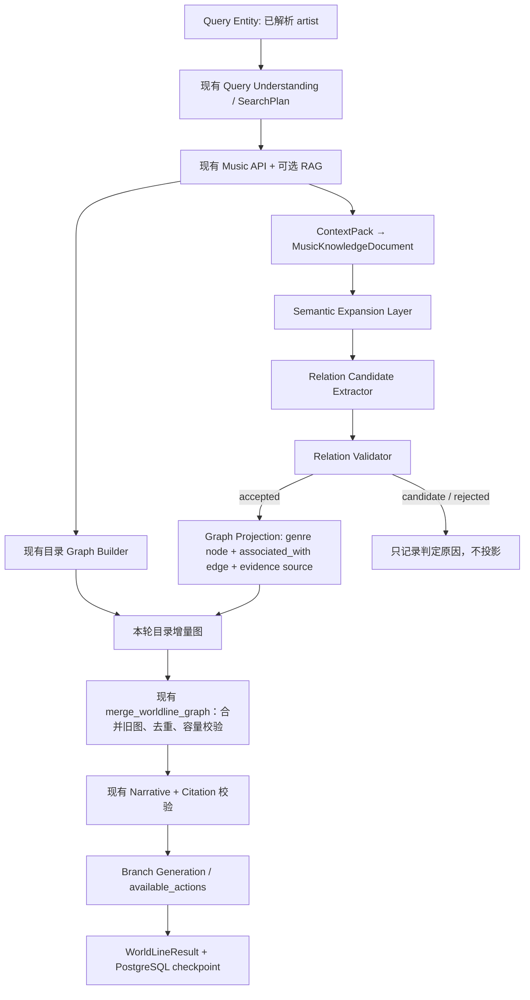

# WorldLine V2.2：证据驱动语义扩展层设计

> 状态：架构设计，尚未实施。本文只依据当前代码及已提交的 V2.1 实现；不假定在线索引一定包含示例关系。本轮未调整 RAG、模型、数据库或任何业务代码。

## 1. 当前能力分析

### 1.1 WorldLine 的真实边界

| 问题 | 当前代码结论 |
|---|---|
| Graph 能否表示 genre？ | **能表示，尚不能作为 V2.1 可执行探索目标。** `WorldLineNodeType.GENRE`、`WorldLineBranchType.GENRE` 和 `WorldLineRelation.BELONGS_TO_GENRE` 已定义；`WorldLineGraph` 校验 ID 唯一、边端点和无自环，限制为 15 节点/20 边。[模型](../../ai-service/app/agent/foundation/subgraphs/worldline/models.py#L127) |
| Edge 能否保存证据？ | **能。** `WorldLineEdge.evidence_ids` 最多 8 个；V2.1 合并按 `(source,target,relation)` 去重并合并这些 ID，要求 ID 存在于合并后的来源集合。[模型](../../ai-service/app/agent/foundation/subgraphs/worldline/models.py#L160)、[合并器](../../ai-service/app/agent/foundation/subgraphs/worldline/merge.py#L16) |
| 当前 Builder 会从 RAG 正文发现 genre 吗？ | **不会。** Builder 从 Music API 目录事实生成 song/artist/album 关系；RAG 正文只生成来源。只有文档的 `metadata.graph_nodes/graph_edges` 已预先结构化时，Builder 才尝试加入其他节点/边，并自动附上 `knowledge:<document.id>`。该分支做 Pydantic 结构校验和端点校验，**没有关系语义验收**。[Builder](../../ai-service/app/agent/foundation/subgraphs/worldline/builder.py#L31)、[结构化元数据入口](../../ai-service/app/agent/foundation/subgraphs/worldline/builder.py#L131)；现有 genre 用例是手工注入元数据的[单元测试](../../ai-service/tests/test_worldline_builder.py#L76)。 |
| Citation 能否追踪关系？ | **只能部分追踪。** Graph edge 可以指向 `EvidenceSource`；Narrative 的 `citations` 是正文中的 `[source_id]` 子集，现有校验保证 ID 存在及段落带引用，却不验证某句叙事或某条边是否被该来源中的具体片段支持。[来源/结果模型](../../ai-service/app/agent/foundation/subgraphs/worldline/models.py#L82)、[Grounding 校验](../../ai-service/app/agent/foundation/subgraphs/worldline/grounding.py#L30) |
| 当前 Explore 能执行 genre 吗？ | **不能。** V2.1 分支候选只选未访问的 `netease:song/artist/album:<正整数>`；会话的 `_canonical_target` 与 Music API 事实加载也只接受这三类，genre 会被禁用或返回 `unsupported_target_type`。[分支候选](../../ai-service/app/agent/foundation/subgraphs/worldline/generation.py#L273)、[会话执行](../../ai-service/app/agent/foundation/subgraphs/worldline/session.py#L96) |

现有执行顺序是 `retrieve_music_knowledge → build_worldline_graph →（V2.1 旧图合并）→ generate_narrative → generate_branches`。[子图](../../ai-service/app/agent/foundation/subgraphs/worldline/graph.py#L421)、[合并位置](../../ai-service/app/agent/foundation/subgraphs/worldline/graph.py#L463)。V2.2 的语义投影必须进入**叙事之前、旧图合并之前**；否则新关系不会进入本轮完整结果。

### 1.2 RAG 能提供什么，当前还缺什么

在线索引可携带经过验证的 `supported_claims`，其中包括 `claim_id`、`subject_entity_id`、`predicate`、`object_entity_id/object_value`、`source_chunk_id`、`evidence_span`、提取/验证置信度。知识声明枚举已有 `HAS_GENRE`，规则提取器可以从有风格表述的文本中提出 song/album/artist → genre 声明。[索引投影](../../ai-service/app/rag/indexing/projection.py#L95)、[Claim 模型](../../ai-service/app/rag/knowledge/claims/models.py#L14)、[风格规则](../../ai-service/app/rag/knowledge/claims/rules.py#L635)。

WorldLine 的混合检索可走 Retrieval → 可选 Reranker → `ContextPack`。`ContextPack` 保留 parent/child ID、准确证据文本、来源 URL、实体 ID，并校验 `exact_text` 属于 `context`；适配后的 `MusicKnowledgeDocument.metadata` 保留 `supported_claims`、`evidence_span`、parent/child ID 和充分性状态。[ContextPack](../../ai-service/app/rag/context_packing/models.py#L53)、[WorldLine 适配器](../../ai-service/app/agent/foundation/subgraphs/worldline/retrieval.py#L209)。不足或不可用的 ContextPack 会返回空文档；运行配置默认检索模式为 `empty`，还可设为 `shadow` 或 `hybrid`。[检索适配器](../../ai-service/app/agent/foundation/subgraphs/worldline/retrieval.py#L91)、[运行模式](../../ai-service/app/agent/foundation/subgraphs/worldline/retrieval.py#L363)。

**结论：RAG 数据契约足以作为候选关系的证据输入，但当前在线路径不能直接生成安全的语义边。** WorldLine 适配器没有把 `supported_claims` 变成 Builder 要求的 `graph_nodes/graph_edges`；Builder 也没有按 claim、实体身份、证据片段和否定语义验收关系。检索候选按 parent 合并时保留排名最高 child 的结构化字段，`ContextPack` 还可能压缩片段，因此不能只看 claim 存在就接受，必须验证其 `source_chunk_id` 与本次提供的文本片段一致。[候选合并](../../ai-service/app/rag/retrieval/selection.py#L183)、[片段压缩](../../ai-service/app/rag/context_packing/service.py#L220)。

另一个必须处理的边界是 **ID 命名空间**：目录艺术家为 `netease:artist:<数字>`，知识实体注册表使用 `artist:<slug>` / `genre:<slug>`。[目录 ID](../../ai-service/app/agent/foundation/subgraphs/worldline/music_service.py#L18)、[知识实体模型](../../ai-service/app/rag/knowledge/entity_linking/models.py#L31)。二者不能用字符串直接连接。当前知识注册表中也未见示例 `Nujabes` 或 `Jazz Hip-Hop` 的条目；`Nujabes → Jazz Hip-Hop` 应作为有明确来源时的验收样例，不能当成现有索引事实。[注册表目录](../../ai-service/app/rag/knowledge/entity_linking/registry/v3.yaml)。

## 2. V2.2 目标与整体架构

V2.2 增加一个**只消费本轮已选证据**的语义扩展层，不改检索规划、召回、Rerank 或 Embedding。它只向 Graph Builder 的目录图增加通过验收的语义增量；无证据、身份不清或容量不足时，不创建关系、不污染 checkpoint。来源与精确证据片段随关系保存。



建议在现有 `build_graph` 节点内，`build_worldline_graph(facts, docs)` 之后、`merge_worldline_graph(...)` 之前调用语义层。输入使用已解析的 `ResolvedEntity`、本轮目录增量图和同一批 `retrieved_docs`；输出必须是**已验证的增量图、来源和关系证据记录**。不能让 LLM 直接返回 `WorldLineNode/Edge` 写入最终 Graph。

## 3. 核心模块设计

### 3.1 Relation Candidate Extractor

**输入**：已确认的 artist 目录实体、现有 `MusicKnowledgeDocument[]`、文档元数据中的 parent/child ID、`supported_claims` 与 `evidence_span`。**输出**：`SemanticRelationCandidate[]`，尚不具备写图权限。

第一阶段按优先级使用两种确定性路径：

1. 读取当前文档中的、已被知识管线标记为 supported 的 `HAS_GENRE` 声明；只考虑 subject 为 artist、object 为 genre 的记录，并要求声明的 `source_chunk_id` 与本次文档证据可对上。
2. 对没有可用结构化声明、但现有证据片段**直接写明**“艺术家与某风格关联”的文本，使用受限词表及明确关系模式提出候选。词表可包含 `Jazz Hip-Hop → genre:jazz_hip_hop`，与 `genre:hip_hop` 保持不同身份；不能对任意自由文本造 genre ID。

**第一阶段不新增 LLM 抽取调用或 Prompt。** 现有 LLM 仍用于叙事和 branch 文案。未来若要处理复杂句式，可用受限 Prompt 仅提出候选：模型必须返回已有来源 ID、原文逐字片段、已给定的 artist ID 与受控 genre ID；Validator 仍独立核对。模型自报 confidence 不能作为验收依据。

### 3.2 Relation Validator

所有硬规则须先通过；任何一项失败均为 `rejected`：

1. **Evidence existence**：文档确实来自本轮已选 ContextPack；parent/child/source 可解析；`evidence_span` 逐字存在于保留下来的准确证据文本或可提供的 context 中；片段不是仅在截断前的原始候选里。来源不可用或 ContextPack 不充分时，返回空 accepted。
2. **Entity validation**：source 必须是本轮可信的 `netease:artist:<正整数>` 节点；知识 `artist:<slug>` 只可经规范名称/别名和类型的唯一映射与之关联，重名或歧义时拒绝。target 必须唯一映射到受控 `genre:<slug>`；不把 `hip_hop` 自动等同于 `jazz_hip_hop`。
3. **Relation semantics**：只接收 `artist → genre / associated_with`。`HAS_GENRE` 声明或直接、肯定的风格关联句可作为支持；`CONTAINS_MUSIC_ELEMENT`、否定、猜测、引用他人错误说法、仅共同提及两个名称，以及 song/album/artist influence 等均不投影。
4. **Duplicate detection**：以 `(source_id,target_id,associated_with)` 为关系键；同键只合并独立且有效的证据，不重复建边。源 ID、claim ID、片段哈希去重。
5. **Confidence / status**：设计阈值暂定 `accepted ≥ 0.85`，`candidate = 0.70–0.85`，低于 0.70 为 `rejected`；硬规则失败不受分数豁免。分数由 claim 提取/验证置信度、实体映射质量及证据直接性保守合成（取短板），**不采用 LLM 自评**。阈值须在 V2.2 gold 集上校准，不触碰 RAG 排序参数。`candidate` 只用于审查和评估，不进入 Graph 或 branches。

### 3.3 Graph Projection

仅投影 `accepted`：

- 保留原 artist 目录节点 ID `netease:artist:<数字>`；新增 genre 节点使用受控词表/知识注册表的稳定 `genre:<slug>`，显示名来自规范词条。例如 `genre:jazz_hip_hop`。同 ID 不同类型或不同规范名称必须报冲突，不按名称随意合并。
- 在未来实现时，为 `WorldLineRelation` 增加 **`associated_with`**。现有枚举没有此值；不把更宽泛的 artist 关联强行记为 `belongs_to_genre` 或 `related_to`。
- 每条 accepted 关系派生稳定的 `knowledge:rel:<短哈希>` `EvidenceSource`：哈希输入含 parent ID、child ID、claim ID（或片段哈希）；`excerpt` 存准确支持句，metadata 存原 parent/child、原始 source ID/URL、claim ID、验证版本。`WorldLineEdge.evidence_ids` 指向该来源 ID。这样即使同一 parent 支持多个不同关系，边也能回溯到具体片段；不只回溯到整篇 parent 文档。
- 投影结果先通过 `WorldLineGraph` 和现有 `merge_worldline_graph` 校验（15 节点、20 边、30 sources、每边 8 evidence IDs）。容量不足时整个候选图失败、旧 session 不提交；不得静默截断已接受关系。关系证据记录还需随结构化 session 保存，以便审计精确片段，而非只保存叙事文本。
- Narrative 只能描述已接受关系，并用对应 `[knowledge:rel:...]` 内联引用；现有 `WorldLineResult.citations` 和 Grounding 校验继续验证引用存在。V2.2 需增加**边到证据片段**的核对；当前 Citation 校验本身不能证明关系为真。

## 4. 数据结构草案

以下是**拟新增的 V2.2 结构**，本轮没有改 Schema：

```text
SemanticRelationEvidence
  evidence_id: str          # knowledge:rel:<stable digest>
  parent_id: str
  child_id: str
  original_source_id: str
  source_url: str | None
  claim_id: str | None
  exact_span: str
  span_hash: str
  context_version: str | None
  verification_status: supported | direct_rule

SemanticRelationCandidate
  source_entity_id: str     # catalog artist ID
  knowledge_subject_id: str | None
  target_entity_id: str     # controlled genre ID
  target_name: str
  relation_type: associated_with
  evidence: list[SemanticRelationEvidence]
  extraction_method: supported_claim | direct_rule
  confidence: float
  status: candidate | accepted | rejected
  rejection_reasons: list[str]

SemanticExpansionResult
  focus_entity_id: str
  candidates: list[SemanticRelationCandidate]
  accepted_relation_keys: list[str]
  rejected_relation_keys: list[str]
  graph_delta: WorldLineGraph | None
  sources: list[EvidenceSource]
  version: str
```

`status` 属于语义验收流程，不应写在 `WorldLineEdge` 当作事实。`graph_delta` 只包含验收后的关系，并由原有图/会话模型接管；完整 `WorldLineResult` 六字段可保持现有结构。若前端需展示逐边出处，可在后续 API 中只读暴露 `relation_evidence`，不能由客户端提交来源。

## 5. 与现有 Explore、RAG 和 Graph 集成

以“选择现有 Nujabes artist branch”为例：Explore API 先按 V2.1 从 PostgreSQL checkpoint 恢复旧图和 branch，校验 `netease:artist:<id>`，重跑该 artist 的现有 SearchPlan、Music API 与可选 RAG。若本轮 ContextPack 有直接支持 “Nujabes 与 Jazz Hip-Hop 关联” 的证据，Semantic Expansion 提出候选并验收，投影 `genre:jazz_hip_hop` 与 `associated_with` 边，再交给**现有** `merge_worldline_graph` 合并旧图。Narrative/branches 在合并后生成，最后一次性保存新版 session；验收失败则维持目录图，不产生语义边。

复用：`WorldLineSessionService` 的 branch 白名单、revision/checkpoint、Music API 目录身份、现有 RAG 及 ContextPack、`WorldLineGraph`、`EvidenceSource`、merge、叙事引用规则。拟新增：语义候选/验证/投影模块、目录 ID 与知识 ID 的显式桥接、受控 genre 词表、`associated_with` 枚举、关系片段 provenance 的会话字段，以及语义 branch 的展示策略。

当前 V2.1 `generate_exploration_branches` 会过滤 genre，`/explore` 也拒绝 genre。**第一阶段可以生成指向已投影 genre 节点的 `genre` 分支建议，但 `available_actions.enabled=false`，仅展示证据，不宣称可继续执行 genre 扩展。** 要让点击 genre 后继续检索和长出新关系，需要另设计非 Music API 的 genre executor 与深度语义搜索；不把这个能力混入 artist→genre 最小闭环。

同时，应防止现有 `metadata.graph_nodes/graph_edges` 注入路径绕开 V2.2 Validator；未来实现需限定该路径只接收受信结构化输入，或让所有语义边统一经过 Validator。此调整发生在 WorldLine 层，不要求改 RAG pipeline。

## 6. 第一阶段实现范围

仅支持 **artist → genre / associated_with**，且 artist 是已解析的目录实体、genre 来自受控词表、关系有本轮已选的直接来源片段。无足够证据就不扩展。保持原图根、旧边与来源；只追加一个或少量经过验证的 genre 关系；不新增知识图谱数据库。

暂不设计 influence、era、scene、similar artist 的执行：它们分别涉及因果方向与时序判断、年代边界、场景身份、相似度定义；现有 `HAS_GENRE` 证据规则不能替这些关系提供同等强度的验收。song/album → genre 即使底层 claim 管线可能产出，也不在第一阶段的投影白名单。

## 7. 测试与评估方案

| 验收项 | 输入 / 断言 |
|---|---|
| 正确关系 | 构造包含直接证据句和唯一实体映射的 Nujabes → Jazz Hip-Hop 文档；只在 span、source 与语义规则均通过时生成一条 `associated_with` 边。不得以示例当作在线索引已有事实。 |
| 错误关系拒绝 | “并非 Jazz Hip-Hop”、只共同提及、艺术家同名歧义、`CONTAINS_MUSIC_ELEMENT`、方向颠倒、错误 target type 均不投影。 |
| 无证据不生成 | 检索 `empty`/`shadow`、ContextPack 不充分、缺 parent/child、span 不在本轮 context、伪造 source ID：accepted 为空，旧 graph 不变。 |
| 重复关系 | 两条独立来源支持同一关系时仅一条边，evidence IDs 去重合并；相同片段重复返回不重复计数。 |
| Graph merge | artist 既有节点保留、genre 节点 ID 唯一、旧根不变；类型冲突/容量超限/来源冲突时不提交新 checkpoint。 |
| Citation 追踪 | edge → `knowledge:rel:*` → parent/child/claim/准确 span/URL 可逐级回溯；Narrative 内联引用存在且指向该关系来源。 |
| Session/Branch | 经 `/explore` 扩展 artist 后旧节点与 evidence_history 均保留；genre 建议只读/禁用；重复请求不生成重复关系。 |

建立小型人工标注集，按关系级 precision、无证据关系率、错误实体映射率、重复边率、证据追溯完整率统计。先以**关系准确率和证据完整性**作为准入门槛，再考虑召回；不要把 RAG 检索分数或 LLM 自信度当成事实正确率。

## 8. 后续扩展路线

1. 完成 artist→genre 的离线 fixture 与契约测试、ID 桥接、语义验收和精确来源投影；接入 WorldLine 子图的上述边界。
2. 在真实已授权的知识索引上审查召回与证据可用率，再校准**语义层**阈值；本阶段不改 RAG 参数。
3. 若要让 genre branch 可执行，新增独立的 genre focus/explore 策略和服务端 action 校验，再开放前端点击。
4. 每增加一种关系，单独定义实体类型、方向、证据规则、否定/时序规则及 gold 集，然后依次扩展 song/album→genre、era、influence 等。

## 9. 四个明确结论

1. **当前系统能直接加入 Semantic Expansion 吗？** 可以在现有 WorldLine `build_graph` 与 merge 之间增加一层，底座和证据字段可复用；但**不能直接开启语义图生成**：缺少 claim 到目录实体的 ID 桥接、关系级证据验收、`associated_with` 枚举、精确关系出处与 genre 分支策略。
2. **需要新增知识图谱数据库吗？** 不需要。第一阶段关系由现有 RAG 证据推导，增量图和出处随现有 PostgreSQL checkpoint 的结构化 session 保存；容量上限必须遵守。
3. **应该复用现有 RAG 吗？** 应该。只消费当前 SearchPlan 已选的 ContextPack/`MusicKnowledgeDocument` 和 `supported_claims`，不重建检索链、不调整 Embedding/Retrieval/Reranker。检索为空或证据不足时不生成语义关系。
4. **V2.2 第一阶段最小实现范围是什么？** 一个可信目录 artist、一个受控 genre ID、一种 `associated_with` 边、至少一个可逐字定位的来源片段、验收后再投影和合并；genre 只读展示，后续 genre→其他实体的持续探索留待下一阶段。
