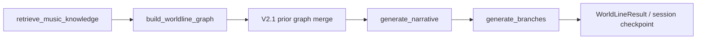
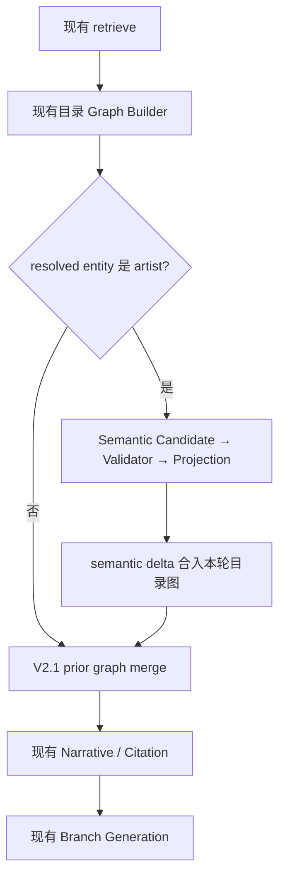

# WorldLine V2.2 Semantic Expansion 第一阶段实施计划

> 状态：待实施。本计划基于当前 `worldline_semantic_expansion_design.md` 与现有 V2.1 代码编制。本轮仅产出计划，不修改业务代码、RAG、Embedding、Retrieval、Reranker、数据库或实体注册表。

## 1. 阶段目标与边界

第一阶段只完成一条证据驱动的最小闭环：

```text
已解析的 artist
  + 当前 SearchPlan 选择出的 ContextPack / MusicKnowledgeDocument
  ↓
Relation Candidate（仅 has_genre claim）
  ↓
Validator（实体、证据、置信度、重复关系）
  ↓
Graph Projection
  ↓
artist --associated_with--> genre
```

硬性边界：

- 只接受 `artist → genre`，图关系固定为 `associated_with`。
- 只消费现有 RAG 已返回并进入本轮 `ContextPack` 的 `supported_claims`；不新增检索、LLM 抽取或 Query Understanding 调用。
- 没有可逐字定位的 evidence span、实体身份无法唯一对应、目标 genre 不在现有实体注册表、置信度不足时，均不生成节点或边。
- 不实现 genre 的再次探索，不开放 genre `available_action`，不实现 influence、era、scene、similar artist 或 song/album → genre。
- 不新增数据库；accepted 关系通过现有 `WorldLineGraph`、`EvidenceSource` 和 PostgreSQL checkpoint 随 session 保存。

第一阶段刻意只使用结构化 `supported_claims`，不实现“直接扫描正文并猜测 genre”的备用抽取规则。这样可以先把证据验证、图投影和引用闭环做实，避免把自由文本抽取风险混入核心链路。

## 2. 当前接入点分析

### 2.1 当前执行顺序

当前真实链路为：



各接入点的处理方式如下：

| 接入点 | 当前职责 | V2.2 第一阶段处理 |
|---|---|---|
| `retrieve_music_knowledge` | 依据现有 SearchPlan 获取 `MusicKnowledgeDocument[]`；ContextPack 不充分时返回空数组 | 不修改。语义层只读取 `metadata.supported_claims`、`chunk_id`、`parent_id`、`evidence_span`、`sufficiency_status` 等已有字段 |
| `build_worldline_graph` | 从 Music API 目录事实生成 song/artist/album 图，并把知识文档转换为 `EvidenceSource` | 在目录图完成后调用 Semantic Expansion Core |
| `merge_worldline_graph` | 合并 V2.1 旧图和本轮增量图；按 `(source,target,relation)` 去重并合并 evidence IDs | 复用两次：先把 semantic graph delta 合入本轮目录图，再按原逻辑合入 prior graph |
| `generate_narrative` | 消费最终 graph、sources 和 retrieved docs，生成 narrative 与 citation IDs | 不修改 Prompt 或生成逻辑；它自然看到新 genre 节点、`associated_with` 边和关系证据来源 |
| `generate_branches` | session 模式只允许未访问的 song/artist/album 目录节点成为可执行分支 | 保持现状。genre 不进入 eligible targets，不产生可执行 Genre Action |

### 2.2 确定的插入位置

Semantic Expansion 放在现有 `build_graph` 函数内部，位于：

1. `build_worldline_graph(facts, retrieved_docs)` 之后；
2. `merge_worldline_graph(prior_graph, current_graph, ...)` 之前；
3. `generate_narrative` 之前。

目标顺序：



该位置保证：

- semantic relation 只消费本轮已经选中的证据，不绕过 Retrieval/ContextPack；
- narrative 能描述并引用新关系；
- V2.1 session merge、容量限制、去重和 checkpoint 原子性继续生效；
- semantic 处理失败时，在 checkpoint 提交前结束，不污染旧 session。

不新增 LangGraph node。第一阶段把语义层作为 `build_worldline_graph` 节点内的纯服务调用，避免改变现有子图拓扑和路由条件。

## 3. Semantic Expansion Core 设计

### 3.1 公开服务边界

建议新增 `SemanticExpansionService.expand_artist_genres(...)`：

```text
输入
  ResolvedEntity focus_artist
  SearchPlan search_plan
  WorldLineGraph directory_graph
  list[EvidenceSource] directory_sources
  list[MusicKnowledgeDocument] retrieved_docs

输出
  SemanticExpansionResult
    graph: WorldLineGraph
    sources: list[EvidenceSource]
    accepted: list[ValidatedSemanticRelation]
    rejected: list[SemanticRelationDecision]
```

服务必须无外部写操作。它只读取现有实体注册表，返回新的不可变模型；最终是否写入 session 仍由现有 WorldLine 执行和 checkpoint 流程决定。

当 focus entity 不是 artist、SearchPlan 没有唯一的 catalog↔knowledge identity 映射、retrieved docs 为空或没有 accepted candidate 时，服务返回原 graph/sources 的等价结果，不生成语义关系。

### 3.2 数据结构

建议使用 frozen、`extra="forbid"` 的 Pydantic 模型，与现有 WorldLine contract 保持一致。

```text
SemanticRelationEvidence
  document_id: str
  parent_id: str
  child_id: str
  claim_id: str
  source_chunk_id: str
  exact_span: str
  source_name: str
  source_url: HttpUrl | None
  context_version: str
  extraction_confidence: float
  verification_confidence: float

SemanticRelationCandidate
  source_catalog_id: str       # netease:artist:<id>
  source_knowledge_id: str     # artist:<slug>
  target_knowledge_id: str     # genre:<slug>
  target_name: str             # 来自现有 EntityRegistry
  relation: Literal[associated_with]
  evidence: SemanticRelationEvidence
  confidence: float            # min(extraction, verification)

SemanticRelationDecision
  candidate: SemanticRelationCandidate
  status: accepted | rejected
  rejection_reasons: list[str]

ValidatedSemanticRelation
  source_id: str
  target_id: str
  target_name: str
  relation: Literal[associated_with]
  evidence: list[SemanticRelationEvidence]
  confidence: float

SemanticExpansionResult
  graph: WorldLineGraph
  sources: list[EvidenceSource]
  accepted: list[ValidatedSemanticRelation]
  rejected: list[SemanticRelationDecision]
```

`candidate/rejected` 是语义层内部审计结果，不进入公共 `WorldLineResult`，也不作为 session 核心状态。Accepted relation 投影后的 graph 和 `EvidenceSource` 会沿现有结构进入 `current_graph`、`evidence_history` 和 PostgreSQL checkpoint。

### 3.3 Relation Candidate Extractor

输入为 focus artist、SearchPlan 和当前 `MusicKnowledgeDocument[]`。不调用 LLM。

执行规则：

1. 从 `SearchPlan.entities` 中寻找唯一匹配 focus artist 的记录：`entity_type=artist`，catalog provider/id 与 `netease:artist:<id>` 一致，并且具有 `knowledge_entity_id`。
2. 只遍历本轮文档的 `metadata.supported_claims`；非列表、字段不完整或类型错误的 payload 作为无效候选处理，不抛出未捕获异常。
3. 只提出同时满足以下静态条件的候选：
   - `predicate == "has_genre"`；
   - `subject_entity_id` 精确等于上一步的 artist knowledge ID；
   - `object_entity_id` 存在且以 `genre:` 开头；
   - 不接受只有 `object_value` 的自由文本 genre；
   - target 能由现有 `EntityRegistry.get()` 唯一取得，且注册类型为 genre。
4. `target_name` 只取实体注册表中的 canonical name，不从 claim statement 或 slug 猜名称。
5. 对每个候选保留原 claim、parent/child、context version、证据片段和两个置信度，交由 Validator 决定是否写图。

第一阶段不修改实体注册表。因此只有注册表已经认识的 genre 可以投影；未注册的 `Jazz Hip-Hop` 等目标即使出现在文本中也会被拒绝并记录 `unknown_genre_entity`。

### 3.4 Validator

Validator 是唯一可以把 candidate 升级为 accepted relation 的组件。硬规则优先于分数，任一硬规则失败都拒绝。

#### Evidence existence

- 文档必须来自当前 `retrieved_docs`，不能接受客户端或模型提供的 source ID。
- `metadata.sufficiency_status` 必须为 `sufficient`；缺失时按不充分处理。这意味着旧的、未携带 ContextPack 充分性信息的兼容路径不会生成 semantic relation。
- `parent_id` 必须与 document ID 对应；claim 的 `source_chunk_id` 必须等于本次文档的 `chunk_id`。
- claim 的 `evidence_span` 必须是 document `content` 中连续、逐字存在的非空子串。
- `claim_id`、parent/child/span 共同构成稳定 provenance；任一字段缺失则拒绝。

#### Entity and relation validation

- source 必须是本轮 focus artist，且目录 ID 与 SearchPlan 中的 catalog reference 精确匹配。
- claim subject 必须是该 artist 的 knowledge ID。
- target 必须是注册表中的 genre，方向必须是 artist → genre。
- relation 只能映射为 `WorldLineRelation.ASSOCIATED_WITH`；`contains_music_element`、`related_to`、`belongs_to_genre` 等不做兼容降级。

#### Confidence and duplicate detection

- 有效分数取 `min(extraction_confidence, verification_confidence)`。
- 第一阶段 accepted threshold 固定为 `0.85`；低于阈值拒绝。该阈值属于语义层常量，不修改 RAG 排序参数。
- 关系键固定为 `(source_catalog_id, target_knowledge_id, associated_with)`。
- 相同关系只保留一个 `ValidatedSemanticRelation`；多条独立证据按 `(claim_id, source_chunk_id, exact_span hash)` 去重后合并。
- 证据超过 `WorldLineEdge.evidence_ids` 的 8 条上限时返回容量错误，不静默丢弃 accepted evidence。

建议使用稳定 rejection code，例如：`unsupported_focus_type`、`identity_mapping_missing`、`insufficient_context`、`malformed_claim`、`predicate_not_allowed`、`subject_mismatch`、`unknown_genre_entity`、`evidence_span_missing`、`confidence_below_threshold`。

### 3.5 Graph Projection

Graph Projection 只接收 `ValidatedSemanticRelation[]`：

1. 从本轮目录图取得原 artist node，保留 ID `netease:artist:<id>`。
2. 为每个 accepted target 创建或复用：
   - `WorldLineNode.id = genre:<slug>`；
   - `type = genre`；
   - `name = EntityRegistry canonical_name`；
   - metadata 只放 registry version 和语义层版本等可审计字段。
3. 创建 `WorldLineEdge`：
   - `source = netease:artist:<id>`；
   - `target = genre:<slug>`；
   - `relation = associated_with`；
   - `evidence_ids` 指向本关系的精确 evidence sources。
4. 每条独立 evidence 创建稳定的 `EvidenceSource`：
   - ID：`knowledge:rel:<24位稳定哈希>`；
   - hash material：parent ID、child ID、claim ID、exact span；
   - `source_type = knowledge`；
   - `excerpt = exact_span`；
   - metadata 保存 parent/child、claim、context/retrieval version、原 document ID、relation key 和 validator version。
5. 构造以 artist 为 root 的 semantic delta，再调用现有 `merge_worldline_graph` 合入本轮目录图。Merge 继续负责 node type 冲突、edge key 去重、evidence union、来源冲突和 15/20/30 容量限制。

若 accepted 为空，Projection 返回原图和原 sources。若投影或 merge 失败，整个 `build_graph` 失败并沿现有错误路径返回；在 session 模式下不产生新 checkpoint revision。

## 4. 与现有模型的连接方式

### 4.1 WorldLineGraph

- `WorldLineNodeType.GENRE` 已存在，可直接复用。
- `WorldLineRelation` 需要新增 `ASSOCIATED_WITH = "associated_with"`；不复用语义更窄的 `belongs_to_genre`。
- `WorldLineGraph` 已有 node ID、edge key、端点、自环和容量校验，继续作为最终结构门禁。
- Graph root 不变。初次 artist 查询保持 artist root；session 中从旧图探索 artist 时，最终 merge 保持原 session root。

### 4.2 EvidenceSource / Citation

- 现有普通 RAG source `knowledge:<parent_id>` 保留，仍可为 narrative 提供背景。
- semantic edge 使用更细粒度的 `knowledge:rel:*` source，确保 edge 可直接追到 exact span，而不是只追到整篇 parent document。
- `WorldLineEdge.evidence_ids` 与 `WorldLineResult.sources` 建立结构关联。
- 现有 narrative grounding 继续要求 citation ID 存在并以 `[source_id]` 内联出现；不修改 Prompt。集成测试验证 narrative 引用 semantic source 时，最终 `citations` 返回同一个完整 `EvidenceSource`。

### 4.3 Session / Branch

- 不新增 SessionState 字段。投影后的 graph 进入 `current_graph`，semantic sources 进入现有 `evidence_history`，由 Persistent Checkpointer 保存。
- 不修改 Explore API 或 checkpoint schema。
- 不修改 genre action 规则。当前 session branch 过滤只允许 song/artist/album，因此新 genre node 仅展示，不可点击继续探索。

## 5. 文件修改范围

### 5.1 新增文件

| 文件 | 用途 |
|---|---|
| `ai-service/app/agent/foundation/subgraphs/worldline/semantic_expansion.py` | 定义 semantic 数据结构、Candidate Extractor、Validator、Projection 和 `SemanticExpansionService`；只读现有 EntityRegistry |
| `ai-service/tests/test_worldline_semantic_expansion.py` | 覆盖候选提取、硬规则拒绝、去重、投影和 provenance 的纯单元测试 |

### 5.2 修改文件

| 文件 | 计划修改 |
|---|---|
| `ai-service/app/agent/foundation/subgraphs/worldline/models.py` | 为 `WorldLineRelation` 增加 `ASSOCIATED_WITH`；不改变现有公共 result 字段 |
| `ai-service/app/agent/foundation/subgraphs/worldline/graph.py` | 在 `build_graph` 的目录图构建和 prior merge 之间调用 Semantic Expansion；允许注入 expander 以便测试；保持 LangGraph node/edge 拓扑不变 |
| `ai-service/app/agent/foundation/subgraphs/worldline/builder.py` | 限制旧 `metadata.graph_nodes/graph_edges` 路径直接注入 `associated_with`，保证该关系只能经过新 Validator |
| `ai-service/tests/test_worldline_builder.py` | 验证旧结构化 metadata 不能绕过 Validator 注入 `associated_with` |
| `ai-service/tests/test_worldline_graph.py` | 增加完整子图集成测试：retrieve docs → semantic relation → narrative/citation；确认现有节点拓扑不变 |
| `ai-service/tests/test_worldline_merge.py` | 增加 `associated_with` 重复边、evidence union、冲突不污染旧图的测试 |

### 5.3 明确不修改

- `retrieval.py`、ContextPack、RRF、Reranker、Embedding、索引 projection 和 RAG 配置；
- Query Understanding、SearchPlan 生成逻辑；
- entity registry YAML 或数据库；
- `session.py`、Explore API、PostgreSQL checkpointer schema；
- narrative/branch Prompt；
- 前端 contract；
- Genre Executor 或新的 branch action。

## 6. 测试方案

### 6.1 正确 artist → genre

Fixture 包含：唯一的 catalog↔knowledge artist 映射、注册表中存在的 genre、`has_genre` supported claim、`sufficient` ContextPack metadata，以及确实出现在 document content 中的 exact span。

断言：

- 生成一个 genre node；
- 生成一条 `artist --associated_with--> genre` edge；
- edge 只引用 `knowledge:rel:*`；
- source excerpt 等于原始 exact span；
- graph root 和原有目录节点不变。

### 6.2 无证据拒绝

参数化覆盖：retrieved docs 为空、`supported_claims` 缺失、ContextPack 不充分、claim span 不在 content、source chunk 不匹配、subject 不匹配、target 未注册、置信度低于 0.85。

断言：不新增 genre node/edge/source；输入 graph/sources 不被原地修改；WorldLine 仍能退化为目录事实结果。

### 6.3 重复关系去重

输入两份文档或多条 claim，均支持同一 artist→genre：

- 相同 claim/span 只保留一个 evidence ID；
- 不同有效来源合并到同一条 edge；
- evidence IDs 顺序稳定且不重复；
- 超过 8 条有效证据时显式失败，不静默截断。

### 6.4 Graph merge

验证两层 merge：

1. semantic delta 合入本轮 artist 目录图；
2. enriched current graph 再合入 V2.1 prior graph。

断言旧 root、旧 nodes、旧 edges、旧 sources 全部保留；genre node/edge 只增加一次；同 ID 不同 type、source 内容冲突、容量超限均失败；失败后旧 graph 和 session revision 不变。

### 6.5 Citation 追踪

验证完整链路：

```text
WorldLineEdge.evidence_ids
  → EvidenceSource knowledge:rel:*
  → parent_id / child_id / claim_id / exact_span / source URL
  → narrative [knowledge:rel:*]
  → WorldLineResult.citations
```

断言 citation 是 `sources` 中同一个完整对象，inline anchor 存在，exact span 可在原 document content 中复核。未知 citation 或 edge 引用缺失 source 必须失败。

### 6.6 额外边界回归

- song/album focus 不触发 semantic expansion；
- `contains_music_element`、influence、era、scene 等 predicate 全部拒绝；
- legacy `graph_edges` 无法直接写入 `associated_with`；
- genre node 不出现在 session 可执行 `available_actions`；
- Retrieval 失败或 `empty` 模式继续返回原有目录图；
- 现有 song/artist/album session、merge、API 和 PostgreSQL checkpoint 测试保持通过。

计划执行的验证命令：

```powershell
python -m pytest tests/test_worldline_semantic_expansion.py tests/test_worldline_builder.py tests/test_worldline_merge.py tests/test_worldline_graph.py tests/test_worldline_grounding.py
python -m pytest tests/test_worldline_session.py tests/test_worldline_api.py
python -m pytest
```

命令在 `ai-service` 目录执行。若完整测试依赖外部服务，需单独记录未运行项、原因和风险，不能用跳过或弱化断言代替。

## 7. 实施步骤与提交边界

1. **Contract**：新增 semantic 内部模型和 `ASSOCIATED_WITH` enum，先补模型与拒绝非法 payload 的测试。
2. **Core**：实现 supported claim extractor、Validator、稳定 provenance ID、Projection；完成纯单元测试。
3. **Integration**：在 `build_graph` 内接入，先合 semantic delta，再走 prior graph merge；限制 legacy metadata 绕过路径。
4. **End-to-end verification**：补 graph、citation、session merge 与 branch scope 回归；运行相关测试和完整测试。
5. **交付报告**：开发完成后记录实际修改、测试结果、仍不支持的目标和环境限制。本步骤不扩大到 Genre Executor 或新关系类型。

每个逻辑完整且验证通过的步骤独立提交，只暂存本阶段相关文件，不带入仓库现有未提交内容。

## 8. 第一阶段验收标准

满足以下条件才算完成：

1. 只有已解析 artist 能触发语义扩展。
2. 只有本轮充分 ContextPack 中的有效 `has_genre` claim 能成为 candidate。
3. 无 exact evidence、实体不匹配、目标未注册或分数不足时不生成关系。
4. Accepted relation 稳定投影为 `artist --associated_with--> genre`。
5. 重复关系只有一条 edge，多来源 evidence 正确合并。
6. Edge 可追溯到精确 evidence span，narrative 引用能进入 `WorldLineResult.citations`。
7. Semantic graph 可与 V2.1 prior graph 合并并由现有 PostgreSQL checkpoint 保存。
8. Genre 不可执行探索，RAG、Query Understanding、数据库和前端 contract 无变化。

## 9. 当前限制

- 只识别现有 EntityRegistry 中已经规范化的 genre；本阶段不新增 `Jazz Hip-Hop` 等注册项。
- 不从自由文本临时创建 genre ID，不调用 LLM 做关系抽取。
- 不保证每个 artist 都有 semantic edge；证据不足时返回目录图是预期行为。
- Genre node 只用于图展示和 narrative grounding，不能继续点击探索。
- 第一阶段验证“关系有直接证据”，不解决 influence、时间、scene 或相似性等更复杂语义。
