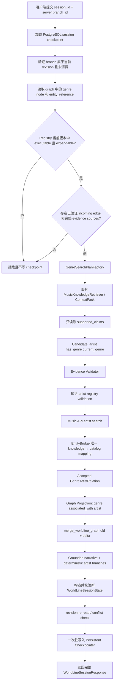

# WorldLine V2.3B Genre Executor 实施计划

> 本文基于当前 V2.3A 代码制定。本轮只完成方案设计，不修改业务代码、RAG、Retrieval、Embedding、Reranker、数据库或知识图谱。

## 1. 当前问题

V2.3A 已能通过受控证据生成：

```text
catalog artist
  --associated_with / evidence_ids-->
knowledge genre
```

genre 节点已经具备 `WorldLineEntityReference`、受控 registry identity 和关系证据，但当前仍是展示节点。阻断执行闭环的位置如下。

### 1.1 Action 层明确排除 genre

`session.py` 中 `_SUPPORTED` 只有 song、artist、album。`_canonical_target()` 还要求目标 ID 满足 `netease:<type>:<positive id>`，而合法 genre ID 是 `genre:<slug>`，所以 genre 必然返回 `unsupported_target_type`。

`_actions()` 直接依赖上述规则。即使 branch 指向已验证的 genre node，返回给前端的 action 也不会启用。

### 1.2 Branch 生成层明确排除 genre

`StructuredWorldLineGenerator.generate_branches()` 的 eligible node 只包含 song、artist、album，session prompt 也明确写着只支持这三种类型。因此 V2.3A genre node 通常不会进入 `available_branches`。

### 1.3 Explore 流程只接受 Catalog Entity

当前 `WorldLineSessionService.explore()` 对所有分支调用 `_canonical_target()`，随后把目标转成 `ResolvedEntity` 并进入现有 WorldLine turn graph：

```text
resolve catalog entity
→ query understanding
→ music API facts
→ retrieve
→ graph build
→ narrative / branches
```

`ResolvedEntity.EntityType` 只有 song、artist、album。genre 是 knowledge entity，不应构造虚假的 catalog `ResolvedEntity`，也不应调用 Music API genre detail。

### 1.4 EntityBridge 尚不能解析任意检索结果中的 artist

当前 `EntityBridge.resolve_artist()` 要求 SearchPlan 已经包含 knowledge artist → catalog artist 映射。这适合当前查询焦点 artist，但 genre 检索会从 `supported_claims.subject_entity_id` 发现多个新 artist；这些 artist 通常不在 genre SearchPlan 的 catalog references 中。

因此 V2.3B 需要在不绕过 EntityBridge 的前提下增加一个受控解析入口：knowledge artist + Music API artist candidates → 唯一 catalog artist reference。

### 1.5 已有能力可以直接复用

| 已有能力 | V2.3B 复用方式 |
|---|---|
| `GenreVocabularyRegistry` | 验证 genre identity、版本和 executable/expandable 开关 |
| `WorldLineEntityReference` | genre 保持 knowledge identity；accepted artist 保持 knowledge/catalog 双 ID |
| `EntityBridge` | 新 artist 必须通过唯一 catalog mapping 后才能投影 |
| Semantic Expansion evidence contract | 复用 `supported_claims`、exact span、parent/child、confidence 和 provenance 规则 |
| `MusicKnowledgeRetriever` / ContextPack | 使用 Genre SearchPlan 调用现有检索边界，不修改 RAG Pipeline |
| `merge_worldline_graph()` | node/edge/source 去重、evidence union、容量及引用完整性校验 |
| `WorldLineGroundingValidator` | 校验 genre turn narrative 的 inline citations |
| `WorldLineSessionState` | 保存合并后的 graph、evidence history、visited nodes、revision 和 branches |
| Persistent Checkpointer | 保持现有 PostgreSQL snapshot、锁、revision check 和原子提交路径 |
| Explore API / frontend | 继续提交服务端生成的 `branch_id`，不新增客户端 node ID 输入 |

## 2. V2.3B 目标与边界

V2.3B 只完成以下闭环：

```text
artist
  ↓ 已验证 supported_claim
genre
  ↓ 点击服务端 genre branch
artist candidates from supported_claims
  ↓ EntityBridge 唯一 catalog mapping
catalog artists
```

核心验收条件：

1. genre 必须来自当前版本 `GenreVocabularyRegistry`。
2. registry entry 必须同时满足 `executable=true` 和 `expandable=true`。
3. 当前 session graph 中必须存在指向 genre 的已验证 relation，并且 relation 的全部 evidence IDs 能在 `evidence_history` 找到。
4. 新 artist 只能来自本轮 ContextPack 内的 `supported_claims`。
5. claim 必须精确满足 `artist has_genre current_genre`。
6. artist 必须由 EntityBridge 唯一映射到 catalog identity。
7. accepted artist 必须有关系证据，edge 必须保留 evidence IDs。
8. 完整结果验证成功后才能写 checkpoint；任何失败保持旧 revision、graph 和 sources 不变。

本阶段不实现：

- influence、era、scene、similar artist；
- song/album → genre；
- genre 之外的新 executor；
- LLM artist extraction；
- 无 supported claim 的正文推断；
- RAG、Retrieval、Embedding、Reranker 参数或实现调整；
- 新数据库或知识图谱。

### 2.1 第一批 registry 开关

建议新增不可变的 `genres_v2.yaml`，保留 `genres_v1.yaml`。第一批只为已有集成证据 fixture 覆盖的 `genre:hip_hop` 设置：

```yaml
executable: true
expandable: true
```

Jazz、Jazz Hip-Hop、R&B、C-pop 在确认当前 knowledge release 有足够 `artist has_genre genre` supported claims 前继续保持 false。新增 genre 或开放更多开关只通过下一版 registry 文件进行，不允许 LLM 或运行时创建 ID。

## 3. V2.3B 完整执行流程



### 3.1 branch_id 和 session 验证

继续使用现有 `/api/ai/worldline/explore`：

```json
{
  "session_id": "...",
  "branch_id": "wlb:<revision>:<server-generated-id>"
}
```

执行前必须保持现有校验：

- branch 必须存在于当前 `available_branches`；
- consumed branch 返回 `duplicate_exploration`；
- 旧 revision 的 branch 返回 `invalid_branch_id`；
- target node 必须真实存在于当前 graph，type/name/ID 必须与 branch 完全一致；
- visited genre、深度上限和并发 revision conflict 继续拒绝。

客户端仍不能提交任意 genre ID 或 artist ID。

### 3.2 加载并验证 Genre Entity Reference

Genre Action Policy 从 node metadata 恢复 `WorldLineEntityReference`，并验证：

- `node.type == genre`；
- `node.id == reference.node_id == reference.knowledge_entity_id`；
- `catalog_reference is None`；
- 当前 registry 存在相同 canonical ID/name；
- node 的 registry version 与当前执行版本一致；
- registry entry 的 `executable` 和 `expandable` 均为 true。

旧 V2.3A checkpoint 中 `registry_version=v1` 的 genre 节点不自动升级为可执行节点。这样部署新代码不会静默改变旧 session 的行为；用户重新创建 V2.3B session 后才获得 v2 action。

### 3.3 Action 的 Evidence Gate

仅 registry 开关不足以生成 action。还必须在当前 graph 中找到：

```text
catalog artist --associated_with--> current genre
```

并满足：

- edge 至少有一个 evidence ID；
- 每个用于授权 action 的 evidence ID 均存在于 `evidence_history`；
- source metadata 的 `relation_key` 与 edge source/target/relation 一致；
- source 包含 claim ID、parent/child、exact excerpt 和 validator version；
- edge 是 V2.2/V2.3A Validator 投影的关系，而不是任意 graph metadata 注入。

这些 evidence IDs 作为 `GenreExecutorInput.trigger_evidence_ids`，用于证明 genre 节点本身可执行。它们不替代本轮 genre → artist 结果的新增证据。

### 3.4 Genre SearchPlan

新增 WorldLine 内部 `GenreSearchPlanFactory`，不修改 Query Understanding 核心逻辑：

1. 用受控 genre reference 构造 `ResolvedQueryEntity`：
   - `entity_type=genre`；
   - `knowledge_entity_id=genre:<slug>`；
   - `catalog_reference=None`。
2. 生成明确查询，例如“查找有证据与 Hip-Hop 类型相关联的歌手”。
3. 复用现有 `QueryUnderstandingService.resolve_context()`、`analyze()` 和 `plan()`。
4. 对生成结果做后置校验：SearchPlan 必须包含当前 genre knowledge ID，metadata filter 必须约束该 entity，query type 必须适合 relationship/exploratory 查询。
5. 后置校验失败则 fail closed，不以无约束 SearchPlan 发起检索。

SearchPlan 中不预先写入 artist。artist 只能从检索结果的 supported claims 出现。

### 3.5 复用现有 RAG / ContextPack

Genre Executor 注入现有 `MusicKnowledgeRetriever` 并调用同一个 `retrieve(..., search_plan)` 边界。当前接口的第一个参数是 `ResolvedEntity`，而 genre 没有合法的 catalog entity。V2.3B 不创建伪 genre `ResolvedEntity`，采用以下兼容方式：

- 使用触发 genre relation 的 source artist 作为 `retrieval_anchor_artist`；
- SearchPlan 中的 genre knowledge ID 和 metadata filter 是实际检索约束；
- 新增的 WorldLine `GenreEvidenceRetriever` 只是适配现有调用签名，不修改 retrieval.py 或底层 pipeline；
- adapter 不得改变 SearchPlan、top-k、RRF、rerank、ContextPack 或 token budget。

生产 `HybridMusicKnowledgeRetriever` 当前由 SearchPlan 驱动，第一个 entity 参数不参与候选查询。该接口不对 genre 原生建模是当前技术债，必须在测试中锁定 adapter 行为并在风险章节记录。

### 3.6 Candidate 提取

不调用 LLM。只遍历本轮 `MusicKnowledgeDocument.metadata.supported_claims`，并提出满足以下条件的候选：

- `predicate == has_genre`；
- `object_entity_id == GenreExecutorInput.genre_id`；
- `subject_entity_id` 是 `artist:<slug>`；
- subject artist 存在于现有 knowledge EntityRegistry；
- claim 包含 claim ID、source chunk、evidence span、extraction/verification confidence；
- parent、child、context version 和 sufficiency metadata 完整。

自由文本 artist name、claim statement 中的名称以及 LLM 生成名称均不能成为 candidate identity。

### 3.7 Validator

Validator 沿用 V2.2/V2.3A 硬规则：

1. 文档必须唯一存在于本轮 retrieval result。
2. `sufficiency_status == sufficient`。
3. parent ID、child ID、source chunk ID 必须一致。
4. exact evidence span 必须逐字存在于 document content。
5. supported claim 必须与 candidate 的 artist、genre、predicate、confidence 完全一致。
6. 有效 confidence 使用 `min(extraction_confidence, verification_confidence)`，阈值继续使用现有 semantic threshold，不调整 RAG 参数。
7. 同一 `(artist knowledge ID, genre ID)` 按 claim/chunk/span hash 去重并合并 evidence。
8. 已在当前 graph 中的 artist 默认记为 `artist_already_in_graph`，V2.3B 第一阶段只投影新的 artist 节点，避免生成反向重复关系。
9. 按 confidence、ContextPack rank、knowledge artist ID 做确定性排序，最多接受 3 个新 artist；该上限属于 WorldLine executor capacity，不改变 retrieval top-k。

### 3.8 Artist Knowledge → Catalog Resolution

对每个 evidence-valid candidate：

1. 从 knowledge EntityRegistry 获取 canonical name 和 aliases。
2. 调用已有 `WorldLineMusicService.search_entities(canonical_name, ARTIST)`，不调用 LLM。
3. 将返回的 catalog artist candidates 交给 EntityBridge 新入口进行解析。
4. EntityBridge 只接受 name 与 canonical name/alias 规范化精确匹配的 candidate。
5. 恰好一个唯一 catalog ID 时返回 `WorldLineEntityReference`。
6. 无匹配返回 `catalog_artist_not_found`；多个不同 catalog ID 返回 `catalog_artist_ambiguous`。
7. unresolved/ambiguous artist 保留在 decision/trace 中，但不进入 graph。

EntityBridge 是 knowledge → catalog 的唯一准入边界。Genre Executor 不自行拼接 `netease:artist:<id>`。

### 3.9 Graph Projection

V2.3B 继续使用 `WorldLineRelation.ASSOCIATED_WITH`，不新增 relation enum。对每个 accepted artist：

- artist node ID 使用 EntityBridge 返回的 catalog node ID；
- artist metadata 保存完整 `WorldLineEntityReference`；
- delta graph root 为当前 genre ID；
- delta 包含当前 genre node和新 artist nodes；
- 创建 `genre --associated_with--> artist` edge；
- evidence IDs 指向本轮 claim 的精确 `EvidenceSource`。

原始 claim 的语义方向是 `artist has_genre genre`。`associated_with` 是当前 WorldLine 中的对称展示关系，V2.3B 为表达探索方向投影为 genre → artist；EvidenceSource metadata 必须保存原 claim subject/object/predicate，避免丢失事实方向。后续若要引入有方向的新 relation，属于独立版本，不在本阶段实现。

### 3.10 Merge、Narrative、Branches 与 Checkpoint

执行顺序固定为：

1. `GenreExecutor` 先构造并验证完整 delta graph/sources。
2. 调用现有 `merge_worldline_graph(old, delta, ..., target_node_id=genre_id)`。
3. merge 继续负责：
   - node ID/type 去重；
   - edge key `(source,target,relation)` 去重；
   - 重复 edge evidence union；
   - source ID 去重和冲突检测；
   - graph/source/evidence 完整性与容量限制。
4. 使用确定性的 `GenreExpansionPresenter` 从 accepted artists 和 relation evidence 生成 narrative，例如每个 artist 关系都带 `[knowledge:rel:*]` inline citation。
5. 使用现有 `WorldLineGroundingValidator` 校验 narrative/citations。V2.3B 不让 LLM生成 artist 或补写关系。
6. 为 accepted artist nodes 确定性生成 `WorldLineBranchType.ARTIST` branches，最多 3 条；branch target 必须来自刚投影并验证的 graph node。
7. 复用 `_assign_branch_ids()` 生成当前 revision 的 server branch IDs。
8. 构造新的 `WorldLineSessionState`：
   - `current_node = genre_id`；
   - visited 增加 genre；
   - depth + 1；
   - graph/sources/narrative/branches 使用完整新结果；
   - revision + 1；
   - consumed branch 增加当前 branch ID。
9. 重读旧 revision，确认无并发写入，再执行一次 `_commit()`。

如果 retrieval、Music API、EntityBridge、validation、projection、merge、grounding 或 checkpoint write 任一步失败，旧 checkpoint 保持不变。若没有任何 accepted artist，返回 `no_grounded_genre_connections`，不增加 visited/depth/revision，允许未来证据更新后重试。

## 4. 数据结构设计

所有结构建议使用 `extra="forbid"`、frozen Pydantic model，并保留在 Genre Executor 内部，不修改公开 `WorldLineSessionResponse` schema。

### 4.1 GenreExecutorInput

```text
GenreExecutorInput
  session_id: str
  genre_id: str
  genre_name: str
  genre_reference: WorldLineEntityReference
  source_artist_reference: WorldLineEntityReference
  trigger_evidence_ids: list[str]
  current_graph: WorldLineGraph
  current_sources: list[EvidenceSource]
  visited_nodes: list[str]
  exploration_depth: int
```

约束：

- genre reference 必须是无 catalog reference 的 genre knowledge entity；
- source artist reference 必须来自触发 genre 的已验证 incoming edge；
- trigger evidence 必须全部存在于 current sources；
- graph/root 只读，不在 executor 内原地修改。

### 4.2 GenreArtistCandidate

```text
GenreArtistCandidate
  genre_id: str
  artist_knowledge_id: str
  artist_canonical_name: str
  evidence: list[SemanticRelationEvidence]
  confidence: float
```

### 4.3 GenreArtistDecision

```text
GenreArtistDecision
  candidate: GenreArtistCandidate
  status: accepted | rejected
  artist_reference: WorldLineEntityReference | None
  rejection_reasons: list[str]
```

### 4.4 GenreExecutorResult

```text
GenreExecutorResult
  genre_id: str
  genre_name: str
  evidence_ids: list[str]
  candidate_artists: list[GenreArtistCandidate]
  accepted_artists: list[WorldLineEntityReference]
  rejected_reason: dict[str, int]
  decisions: list[GenreArtistDecision]
  search_plan: SearchPlan
  delta_graph: WorldLineGraph
  delta_sources: list[EvidenceSource]
  trace: GenreExecutorTrace
```

`candidate_artists` 只表示通过静态 supported claim 形状检查的候选；`accepted_artists` 必须已经通过 evidence validator 和 EntityBridge。`rejected_reason` 是聚合统计，逐 candidate 细节保存在 decisions。

### 4.5 GenreExecutorTrace

```text
GenreExecutorTrace
  genre_id: str
  registry_version: str
  validator_version: str
  trigger_evidence_ids: list[str]
  retrieved_document_count: int
  candidate_count: int
  evidence_accepted_count: int
  catalog_resolved_count: int
  projected_artist_count: int
  rejection_reason: dict[str, int]
  projected_evidence_ids: list[str]
```

Trace 写结构化日志，不加入 public API 或 checkpoint schema。Graph 和 EvidenceSource 已通过现有 session fields 持久化。

## 5. 接入点设计

### 5.1 推荐插入位置

Genre Executor 不加入现有 WorldLine LangGraph node，也不进入普通 song/artist/album turn graph。推荐放在 `WorldLineSessionService.explore()` 的 branch target 类型分发处：

```text
validated branch target
  ├─ song / artist / album → 现有 _run_turn()，完全不变
  └─ genre                → 新 _run_genre_turn() / GenreExecutor
```

原因：

- genre 没有合法 `ResolvedEntity` 和 Music API detail；
- Explore API 与 checkpoint 原子提交都已在 session service；
- executor 返回 graph delta，现有 merge 正好支持以 graph 中 genre node 为 expansion root；
- 普通 WorldLine 子图无需新增 node、edge 或 state 字段；
- failure 在 session commit 前结束，不污染旧 snapshot。

### 5.2 Branch / Action 插入位置

在每次 `_run_turn()` 返回 `WorldLineSessionResult` 后、`_assign_branch_ids()` 前调用确定性的 `GenreActionPolicy`：

1. 扫描 graph 中未访问的 genre nodes。
2. 用当前 registry 和 evidence gate 计算 executable genre targets。
3. 为合格 genre 生成 `WorldLineBranchType.GENRE` branch。
4. 与现有 catalog branches 按 target ID 去重。
5. genre branch 优先保留一个槽位，其余槽位保留现有 branches，总数仍不超过 3。
6. `_assign_branch_ids()` 为全部 branches 统一生成 server IDs。

`_actions()` 改为按 node type 分发 eligibility：catalog targets 继续走 `_canonical_target()`；genre targets 走 `GenreActionPolicy.validate()`。`WorldLineAction.action_type` 仍是 `explore_node`，API 和前端无需新增字段。

### 5.3 API 和前端

- 不新增 endpoint。
- `POST /api/ai/worldline/explore` request/response schema 不变。
- 前端已经根据 `available_actions.target_node_id` 为任意 graph node 绑定点击，并提交 action ID，因此基础交互无需修改。
- 可选文案调整和 genre 图形样式不属于 V2.3B 核心后端闭环。

## 6. 计划修改文件

### 6.1 新增文件

| 文件 | 计划内容 |
|---|---|
| `ai-service/app/agent/foundation/subgraphs/worldline/genre_executor.py` | GenreExecutorInput/Result、SearchPlan factory、candidate extractor、validator、catalog resolution orchestration、projection、trace |
| `ai-service/app/agent/foundation/subgraphs/worldline/genre_actions.py` | registry/evidence gate、deterministic genre branches 和 action eligibility |
| `ai-service/app/agent/foundation/subgraphs/worldline/registry/genres_v2.yaml` | V2.3B registry version；首批安全启用的 genre |
| `ai-service/tests/test_worldline_genre_executor.py` | candidate、evidence gate、bridge、projection、failure atomicity 单元测试 |
| `ai-service/tests/test_worldline_genre_actions.py` | registry flag、evidence gate、branch/action server authority 测试 |

### 6.2 修改文件

| 文件 | 计划修改 |
|---|---|
| `genre_registry.py` | 加载 v2 registry；继续验证 executable/expandable 关系和 alias 冲突 |
| `entity_bridge.py` | 增加 knowledge artist + catalog candidates 的唯一解析入口；不改变现有 artist/genre 方法 |
| `semantic_expansion.py` | 仅把 supported-claim/evidence provenance 共用逻辑提升为可复用 helper；现有 artist → genre 行为保持不变 |
| `session.py` | genre target dispatch、GenreActionPolicy、GenreExecutor 注入、原子 merge/result/checkpoint；catalog flow 保持原分支 |
| `tests/test_worldline_session.py` | artist → genre → artist 连续探索、无证据/bridge/API/commit failure 不修改 session |
| `tests/test_worldline_api.py` | 相同 Explore API 执行 genre branch；任意/过期 branch ID 拒绝 |
| `tests/test_worldline_merge.py` | genre delta merge、node/edge 去重和 evidence union |
| `tests/test_worldline_postgres_restart.py` | 真实 PostgreSQL 下创建、重启、genre explore、再次重启恢复 |
| `tests/fixtures/worldline_postgres_restart_worker.py` | 为 opt-in 重启验收提供 evidence-backed genre fixture |

### 6.3 明确不修改

- `retrieval.py`、Hybrid Retrieval、RRF、Reranker、Embedding 和 ContextPack 参数；
- Query Understanding 的 analyzer、entity resolver、planner；
- `WorldLineGraph`、checkpoint table/schema 和公开 API schema；
- 普通 WorldLine LangGraph 拓扑；
- 数据库、索引结构或新知识图谱；
- song/album semantic expansion；
- Influence、Era、Scene、Similar Artist。

## 7. 测试方案

### 7.1 Genre Exploration 闭环

准备：artist session 通过现有 Semantic Expansion 生成 evidence-backed `genre:hip_hop` node。

断言：

1. genre branch 由服务端生成，action enabled。
2. 点击 branch 后加载相同 session。
3. Genre SearchPlan 精确包含 `genre:hip_hop`。
4. supported claim 中的另一个 artist 经 EntityBridge 映射为 catalog artist。
5. 新 graph 保留旧 artist、genre、旧 edge 和旧 sources。
6. graph 新增 catalog artist 和 `genre --associated_with--> artist` edge。
7. current node 是 genre，depth/revision 各增加 1。
8. narrative 引用新 relation evidence。
9. 新 artist branch/action 可继续进入现有 artist turn flow。

### 7.2 Evidence Gate

分别覆盖：

- sufficient document + exact span + matching supported claim → accepted；
- 无 incoming genre evidence → 不生成 genre action；
- 无 supported claims → 无 candidate；
- claim genre 不匹配当前 genre → rejected；
- insufficient ContextPack → rejected；
- parent/child/span/claim mismatch → rejected；
- confidence 低于现有 semantic threshold → rejected；
- evidence ID 不在 session history → action/execution 拒绝。

所有拒绝场景断言旧 graph、sources、visited、depth 和 revision 不变。

### 7.3 EntityBridge

- registered knowledge artist + 唯一 exact catalog match → resolved reference；
- alias exact match → resolved；
- catalog 无结果 → unresolved；
- 多个不同 catalog IDs 同名 → ambiguous；
- 非 artist knowledge entity → rejected；
- 未注册 knowledge artist → rejected；
- unresolved/ambiguous decision 不产生 graph node/edge。

### 7.4 Action / Branch Authority

- registry false + evidence 存在 → disabled/no genre branch；
- registry true + 无 evidence → disabled/no genre branch；
- registry true + evidence 完整 → server branch + enabled action；
- 客户端提交任意 genre ID 不可执行；
- 旧 revision branch、重复 branch、已访问 genre 和深度上限按现有错误码拒绝；
- 三条 branch 容量下 genre priority 和 catalog branch 保留规则确定性一致。

### 7.5 Graph Merge

- old graph + genre delta 保留全部旧节点和边；
- 同 ID 同 type node 去重；
- 同 edge key 合并 evidence IDs；
- source ID 去重；
- node type/source conflict 和容量超限抛错；
- merge 失败不改变输入模型，也不写 checkpoint。

### 7.6 Session Recovery

真实 PostgreSQL opt-in 验收使用至少三个独立进程：

```text
进程 A：创建 artist session，得到 evidence-backed genre action
进程结束
进程 B：恢复 session，执行 genre branch，得到新 artist
进程结束
进程 C：再次恢复 session，校验完整 graph/sources/visited/revision/branches
```

同时覆盖两个并发进程提交同一 genre branch，只有一个成功，另一个得到 duplicate/conflict，graph 不出现双写。

### 7.7 Failure Atomicity

分别注入：

- retrieval exception；
- Music API search exception；
- EntityBridge unresolved/ambiguous；
- malformed supported claim；
- projection/merge capacity error；
- narrative grounding failure；
- checkpoint write failure。

每次失败后重新 load session，断言与执行前 snapshot 完全相同。

### 7.8 Regression

必须运行：

- EntityBridge、Genre Registry、Semantic Expansion 全部测试；
- WorldLine graph、generation、grounding、merge、session、API 测试；
- song/artist/album 连续探索；
- citation/source validation；
- memory checkpointer 单元测试；
- opt-in PostgreSQL restart acceptance；
- 完整 `tests/`、Ruff 和 compileall。

## 8. 风险分析与控制

### 8.1 Knowledge artist 缺少 catalog mapping

这是 V2.3B 的主要 yield 风险。supported claim 只带 knowledge ID，Music API 名称检索可能无结果或同名歧义。

控制：只接受 EntityBridge 唯一映射；不按排序第一名猜测；把 `catalog_artist_not_found` 和 `catalog_artist_ambiguous` 分开记录。低 yield 可以接受，错误 artist 不可以接受。

### 8.2 Retriever 接口以 ResolvedEntity 为参数

genre 没有合法 catalog entity。若伪造 genre `ResolvedEntity` 会破坏 V2.3A identity 原则。

控制：WorldLine adapter 使用已验证 incoming relation 的 source artist 作为接口 anchor，Genre SearchPlan 作为唯一检索语义；不修改底层 pipeline。测试锁定 production retriever 仍完全按 SearchPlan 查询。未来若建立 plan-only retrieval protocol，应单独设计，不混入 V2.3B。

### 8.3 supported_claim coverage 不足

部分 registry genre 可能没有足够 `artist has_genre genre` claims，导致点击后无结果。

控制：v2 registry 只启用已验证 coverage 的最小 allowlist；action 还要求 session 内已有证据；零 accepted result 不提交 session。

### 8.4 Registry 升级与旧 checkpoint

直接用 v2 flags 重新解释 v1 node 会让旧 session 在部署后突然出现新 action。

控制：要求 node metadata registry version 与 active executor version 一致；旧 session 保持只读 genre，重新创建 session 才进入 V2.3B。

### 8.5 Branch 数量上限

`WorldLineSessionResult.branches` 和 `available_actions` 当前最多 3 条。新增 genre branch 可能与 catalog branches 竞争槽位。

控制：确定性保留最多一个 evidence-backed genre branch，再按原顺序填入 catalog branches；target ID 去重。该策略必须写入测试，避免依赖 LLM 顺序。

### 8.6 Graph 容量

WorldLineGraph 当前最多 15 nodes、20 edges、30 sources，每条 edge 最多 8 个 evidence IDs。

控制：每次 Genre Executor 最多投影 3 个新 artist；投影前预检容量；最终仍以 `merge_worldline_graph` 为权威校验。容量失败不提交 checkpoint。

### 8.7 Relation 方向

claim 是 `artist has_genre genre`，探索路径需要 `genre → artist`。错误地把方向变化当作新事实可能削弱 grounding。

控制：V2.3B 只使用语义对称的 `associated_with`；EvidenceSource 保存原 claim subject/object/predicate；narrative 使用“相关联”措辞，不写“genre 拥有 artist”等有向断言。

### 8.8 Narrative 幻觉

直接让 LLM 根据 genre 自由写 narrative 可能引入未验证 artist 或关系。

控制：V2.3B 第一阶段使用 accepted relation 的确定性 narrative，并复用 GroundingValidator 和 inline citation contract。自由叙事增强留到后续独立阶段，不进入本计划。

## 9. 实施顺序

1. 新增 v2 Genre Registry，并仅开启一个 evidence-ready genre。
2. 扩展 EntityBridge 的 knowledge artist → catalog candidates 唯一解析。
3. 实现 Genre Executor 纯服务及单元测试。
4. 实现 Genre Action Policy 和 deterministic branches。
5. 在 session `explore()` 增加 genre 类型分发和原子 commit。
6. 接入 grounded presenter、citations 和 accepted artist branches。
7. 增加 API/session/merge/recovery/failure tests。
8. 运行完整回归和真实 PostgreSQL restart acceptance。

完成以上步骤即形成 V2.3B 的最小闭环：

```text
创建 WorldLine
→ evidence-backed artist → genre
→ 点击 server genre branch
→ supported claims 提供 candidate artists
→ EntityBridge 唯一映射 catalog artists
→ merge graph
→ 保存 PostgreSQL checkpoint
→ 继续点击 artist 进入现有探索流
```

本计划到此停止，不包含 V2.3C 或其他语义关系扩展。
