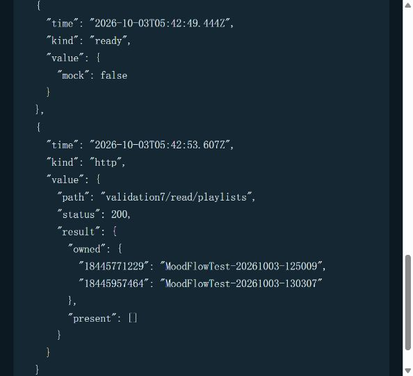

# validation-7：MoodFlow 真实操作验收

日期：2026-10-03；正文时间均为北京时间，JSON 原始时间为 UTC。

**结论：本轮不能判定 P1 闭环验收通过。** 真实写入、播放器、供应商、检索和进程终止均已实际执行；发现写入成功但返回失败、ACK 命名空间不匹配、恢复缺回执等问题。两张本轮歌单已由 West 删除并读回确认无残留。供应商控制台账单按 West 最新指示暂缓，F 未完成。

## 1. 门控、隔离与提交

- West 扫码登录，确认 `我也无话可说_t` 是测试账号并明确授权本轮 A–F；Java 实际身份为 `17994646607`。所有远程写入前均已完成身份确认。
- 验收中间件通过原有浏览器 / Spring 会话边界再次解析真实身份，非该 ID 返回 403。浏览器会话关闭失效后出现过 403；重新扫码并读回相同 ID 后继续。登录期间暂时阻止歌单、收藏请求，确认后解除。未操作主账号。
- 只创建了两张 `MoodFlowTest-时间戳` 私密歌单（`privacy=10`）。写入目标按本轮实际注册 ID 校验，不依赖名称前缀猜测所有权。历史歌单未修改、删除。
- 费用授权为 TypeSafe/JEV 与 DeepSeek **合计最多 5 元**。客户端守门预留 4.5 元预算、最多 60 次、限制请求字节和模型输出。早期 JEV SDK 没有经过 HTTP 观察边界，5 次早期 JEV 调用未覆盖该预留守门；后续 6 次已在真实 SDK 边界预留。不能据此声称全轮已完成硬预算审计。
- 使用本轮独立 PostgreSQL 容器 `moodflow-validation7-20261003-pg`，仅监听 `127.0.0.1:15457`。OperationJournal、HistoryWriter、checkpoint 均为真实 PostgreSQL 实现；生产数据库未修改。
- 使用真实本地 Java、网易云 API、现有 Qdrant 数据索引和供应商服务。验收观察器透传原始调用与响应，不替换业务结果。真实 Handoff 的自动重试上限设为 0；没有通过重试使原始失败消失。
- `.env` 未改；默认图保持 `foundation`、灰度开关关闭；通过已有显式 `/handoff` 接口验收，没有切换默认图。无部署、无 push、无新增依赖。长时记忆后台在验收进程中禁用，因此本报告不证明生产长时记忆链路。
- 基线：`02cce23`。本轮验收工具独立 commit：**`db1ad0eda5322d789485e827b40f6010706636f8`**。报告和脱敏证据另作本轮独立提交，最终交付消息给出其 commit。已有用户改动未暂存或修复。
- 收尾已验证并停止本轮启动的 Python、Java、Vite、网易云 API 四个进程。独立 PostgreSQL 容器已暂停，保留原始缺回执故障现场（`--rm` 容器停止会删除数据，所以没有停止删除）；已有其他容器未操作。该保留资源可在后续核查后另行清理。

## 2. A–F 逐项结论

| 项目 | 结果 | 依据与限制 |
| --- | --- | --- |
| A 真实写入与读回 | **失败；清理通过** | 创建、红心返回成功并读回一致；加歌返回 502，但歌曲实际已加入，成功记账缺失。两张本轮歌单最终均无残留。 |
| B 实际播放器 ACK | **部分通过，原始路径失败** | 真实音频播放、暂停均发生；原始前端 ACK 409。独立故障案例中新进程显式指定 Handoff 后 ACK 200，与 History 对账一致且重复提交只有一条账。 |
| C 真实模型 / 检索 / Java | **独立全链路通过；原始组合案例失败** | 陈奕迅案例完成真实首跳→转交→结束，DeepSeek、JEV、Java、Qdrant 均真实。Qdrant 查询命中为空，最终使用目录事实；最初播放加探索组合请求失败，未覆盖重试。 |
| D 逐点进程故障 | **失败** | 三个点实际 `os._exit(73)`。未观察到重复远程写入；但写入故障留下成功记账缺口，转交故障恢复停止并留下 committed 回执缺口，不能满足零丢失记账。 |
| E payload_digest | **正常真实转交通过；故障恢复受限** | 7 个 committed 转交均有一致 digest 并到达真实 target_started；没有 integrity_conflict。另一个故障转交只有 proposed，恢复是 missing_receipt，不能计作该转交核验通过。 |
| F 供应商账单 | **未完成，按 West 指示暂缓** | 有客户端 usage 与 History 明细，未获得控制台实扣费用；不能将估算冒充供应商账单或宣称已满足 5 元实扣上限。 |

## 3. A：请求、返回和写后读

目标歌曲：`2652820720`，目录真实名称 `晴天(深情版)`，艺人 `Lucky小爱`，不是周杰伦原唱。来自真实 Java 目录搜索。

| 步骤 | 实际 Java 请求 / 参数 | 返回及读回 |
| --- | --- | --- |
| 创建主案例歌单 | `POST /api/playlists?name=MoodFlowTest-20261003-125009&privacy=10` | 12:53:13 HTTP 200、业务 code 200；ID `18445771229`、status `created`。12:53:51 详情名称、创建者 `17994646607` 一致，track_count=0。 |
| 加歌 | `POST /api/playlists/18445771229/songs/2652820720` | 12:54:26 HTTP 502，原始错误见下。12:55:24 详情中实际出现目标歌曲、track_count=1。**没有再次加歌。** |
| 红心 | `POST /api/songs/2652820720/like?liked=true` | 12:56:12 HTTP 200、code 200、status `synced`。写前交互观察目标未收藏、总数 16；12:58:21 读回目标已收藏、总数 17。13:41:40 再读回仍为 true / 17。写前目标布尔状态为操作时观察，未归档整份历史收藏列表。 |
| 删除两张本轮歌单 | West 在手机网易云 App 删除准确名称 / ID（如下） | 手机删除请求、响应未抓取，不能伪造 HTTP 成功回执。West 确认已删除后，13:28:14、13:42:53 两次真实 `GET /api/user/playlists` 经本轮 ID 过滤，均 HTTP 200、`present=[]`。 |

原始加歌错误：

```json
{"code":502,"message":"网易云 API 响应缺少有效字段: code","data":null}
```

验收接口保留 `MusicServiceError` 并返回 HTTP 409；Journal 只有 proposed，没有该 operation 的 success receipt。**外部状态达到预期不等于请求成功、记账完整，A 不计为 100% 通过。**

| 本轮歌单 | ID | 最终残留 |
| --- | --- | --- |
| `MoodFlowTest-20261003-125009` | `18445771229` | 无 |
| `MoodFlowTest-20261003-130307`（D 写入故障案例） | `18445957464` | 无 |

红心写入的已知持久效果：测试账号仍收藏目标歌曲；本轮没有撤销收藏。这与歌单删除后的无残留核验分开记录。

## 4. B：真实播放器与账本 ID

13:08:11 使用生产前端的 `usePlayerStore`、全局真实 HTMLAudioElement、Java 返回的歌曲 URL 播放目录歌曲：`paused=false`、`readyState=4`、duration≈278.96s。没有 MockAudio。

Thread：`validation7-player-ack`；真实请求“暂停播放”，返回 success。13:11:33 通过原有 `executeClientAction` 执行 pause，实际音频 `paused=true`，currentTime≈201.29s。

- action ID：`d209e5d0a49641f98873aadd4402b58f:tool_calling:0:direct:0`
- task ID：`d209e5d0a49641f98873aadd4402b58f:tool_calling:0`
- run ID：`cca18b0865ab42d6b3324908482c9b54`
- History CLIENT_ACTION：`evt:2b0dc1db3d3781d027c4b6106f045ef09a8e601eb77aafea2d63208e263d4a09`，event_seq=87。
- 原始 `acknowledgeAiAction(thread_id, action_id, applied)`：**HTTP 409**，前端原始错误“播放器操作回执尚未保存，请稍后重试确认”。网络观察捕获了状态码，但原响应体获取失败，未将源码中的通用错误冒充捕获结果。

源代码显示前端 helper 不传 graph_mode，服务端则默认按当前默认图选择 ACK 命名空间；显式 Handoff 请求与默认 foundation ACK 因而存在不一致风险。这是根据调用参数、源码和后续实验得到的归因，未修改生产 helper 或切图来消除失败。

在独立 D-ACK 案例中，仅对上述已经真实执行的动作发送回执，不再次执行 pause：

```json
{"thread_id":"validation7-player-ack","graph_mode":"handoff","action_id":"d209e5d0a49641f98873aadd4402b58f:tool_calling:0:direct:0","status":"applied"}
```

13:29:48 新进程响应 HTTP 200 / applied；13:30:10 同一 DTO 幂等重交仍 200。数据库只有 **1** 条 ACTION_ACK：`evt:6044db1dbdcc958f6a1694e7647a20ad48166e6fe135c67daa6258031fa2c556`，event_seq=104，action_ref 精确指向 CLIENT_ACTION seq=87；action ID、session、task 一致。恢复对账通过，原始 409 仍保留为验收失败。

## 5. C：真实链路与原始失败

最初 Thread `validation7-live-chain` 请求“播放周杰伦的晴天，并探索周杰伦的世界线”，run `a8247447339547bc97f06bb18e0f6c00`：真实 DeepSeek 3 次、JEV 3 次，Java 搜索成功；general_chat→curator 转交完成，但 tool_calling 结果 failed，worldline 任务留在 pending，未到 Qdrant。HTTP 200 不代表业务成功。底层失败只给出规范化任务错误，具体原因未确定；该案例没有重试。

独立只读案例 Thread `validation7-worldline-real`，请求探索陈奕迅的世界线，run `5de3a1815c4540c4ac43031261251137`：

- 13:35:23 开始、13:36:17 completed；链路 `general_chat → curator → explorer → curator → general_chat → curator`。
- 真实 DeepSeek 9 次、JEV 5 次；该 run 的 durable usage 为 14 次、27,608 tokens，retries=0。
- Java 真实目录查询，根艺人 `2116`，返回世界线图谱与成功任务结果；没有歌曲 / 歌单写操作，也没有播放器动作。
- Qdrant 容器真实日志：13:35:40 GET 真实 collection 200；13:35:45 `POST /collections/worldline_knowledge_v4_daa965c10984eefa_v1_v2_v4/points/query/batch?timeout=5` 200。索引 manifest 使用现有 final-native v4；不是 empty / fake retriever。
- 检索没有补充知识命中，最终结果明确使用音乐目录事实，并不足以核验“关联艺人”知识质量。HTTP pass-through 在 Qdrant 高层调用边界覆盖不全，因此以 Qdrant 服务端日志补充证明实际查询，未重跑来制造客户端 trace。

此独立案例满足真实模型 / 检索 / Java 的完整执行要求；不将其成功覆盖原始组合案例失败。

## 6. D：三处真实进程终止与恢复

| 故障点 | 实际终止 | 新进程恢复及结论 |
| --- | --- | --- |
| `after_write_before_result` | 13:04:01，PID 20580 在 Java 成功创建 `18445957464` 后、OperationJournal success receipt 前 `os._exit(73)`。请求 502。 | 新 PID 6740，同 run / 参数、不同 tool_call ID，13:05:09 HTTP 409：`write effect unknown; read-only reconciliation required`。没有重发 Java 创建；只存在一张对应歌单。但 success receipt 仍缺失，零丢失记账失败。外层早期 shell 包装返回 1，不能冒充捕获到 native exit 73；日志记录的是注入值。 |
| `before_action_ack` | 13:28:55，PID 20660 在原始已执行 pause 的 ACK 入账前 `os._exit(73)`，工具实际返回 exit 73；请求 502。 | 新 PID 17860。13:29:27 因服务尚未启动完成出现额外 502，原样保留；13:29:35 启动就绪后按恢复协议发送原 DTO，ACK 入账 200。再次提交仍只有一条账，没有重复执行播放器动作。 |
| `before_journal_committed` | 13:31:28，PID 17860 在 checkpoint 已保存、转交 committed append 前 `os._exit(73)`，工具实际返回 exit 73；请求 502。 | 新 PID 46708；空输入恢复同 Thread `validation7-crash-transfer`。13:33:28 HTTP 200 / needs_input；reality_revalidation=`missing_receipt`、action=`stop`、reason=`original_run_limit_exhausted`。原始 120s 时限在重启、图初始化及恢复期间耗尽；未重置时限、补 journal 或重建任务。该转交未恢复完成。 |

转交故障 run：`bb88b875cd284a23ae801ede84267cd3`；已保存 checkpoint：`1f1beeba-eec4-69d9-8003-5fd3f956cbb6`。缺少的 committed key：`transfer:4bc9deb281a8bb63feb6cf6791cdc540fc7a927c99bba826b5016aaed3f323d9:committed`。

最终数据库的写 operation：

| operation_id | 真实外部效果 | Journal 状态 |
| --- | --- | --- |
| `op:117cb440bf53e2598d67255cd98a41ebe35101187f1759a5027ffaedb89cd59c` | 主案例歌单创建一次 | proposed + success |
| `op:eac7426ebb964a62040f80f0907058235703b4b4548cd16ce63a1f68385a74fd` | 目标歌曲实际加入一次，但响应 502 | 只有 proposed；未知写效果 receipt |
| `op:5d5043cf3a611306f57ac2755f37b7c57f8db4e9f79178bcef8330042803665d` | 红心 true | proposed + success |
| `op:ca2cbaf1abe99c0d306df8f282b979c93390e17c8ad2033e23936a8374788e97` | 故障歌单创建一次 | 只有 proposed；恢复拒绝重复派发 |

观测到的 Java 远程写请求总共 **4 次**（两次创建、一次加歌、一次红心）；没有恢复导致的重复写请求。**2 个写操作缺成功记账、1 个转交缺 committed 回执**，D 不满足零丢失记账。这里只证明本轮已观测的故障与作用点，不扩大为所有并发 / 断电场景。

## 7. E：真实 payload_digest

从实际数据库而非观察器重复 append 计数：8 个 transfer ID、27 条转交事件；7 个 committed 均有 proposed / committed / target_started，同一 transfer 的 digest 一致且非空。真实 target 入口调用现有 `verify_payloads(..., require_receipts=True)`，没有绕过完整性检查。未发现 `integrity_conflict`，没有修载荷或重试该类冲突。

示例原始组合转交：

```text
transfer:9a2cfa2f006f9c56e6b6bff4c4a357a04396f6c4caffcf2f5bc51e8255af211d
sha256:d09ab88589843c3a5405bb46066b29511c0700decdd3d4c67a95d3baebeb780d
```

此 digest 在 proposed、committed、target_started、target_finished 四个阶段相同。故障转交的 digest 为 `sha256:0773626af35fe08c17c5c81a61e2ed8fddc3ba5c74b090faf37f0d5877bdf61b`，只有 proposed；恢复中的 missing_receipt 是缺回执，不宣称该案例已通过 digest 恢复核验。

## 8. F：调用明细、估算和未完成项

West 在收到账单明细请求后答复“我不知道，这个先不管吧”。截至本报告，**未收到供应商控制台明细、实际扣款、余额变化或账单币种，F 未完成**。

| 供应商 | 客户端次数 | 输入 / 输出 token | 本轮费用结论 |
| --- | --- | --- | --- |
| DeepSeek `deepseek-flash` | 15 次，15 个唯一响应 ID、全部 HTTP 200 | 输入 29,110；输出 4,937；总 34,047；缓存命中 7,808、未命中 21,302 | 人民币单价估算 **0.04120616 元**；实际账单未知。 |
| TypeSafe/JEV | 8 次直接 SDK 观测 + 3 次依据真实 Jev 调用位置及 History usage 推断，待账单确认 | 直接观测输入 9,202 / 输出 311；另外 3 次总 token 为 1,891，输入 / 输出拆分未知；总 token 11,404 | 以全部未知 token 当输入，估算上界 **0.000465906 USD**；实际账单及换算未知。 |

DeepSeek 公布的空闲时段人民币价格为：缓存命中 0.02 元 / M、未命中 1 元 / M、输出 4 元 / M；本轮周六调用属于空闲时段。计算：`(7808×0.02 + 21302×1 + 4937×4) / 1,000,000`。[DeepSeek 官方价格](https://api-docs.deepseek.com/zh-cn/quick_start/pricing/)

TypeSafe 公布输入 0.042 USD / M、输出免费；上界计算：`(9202+1891)×0.042 / 1,000,000`。守门采用 10 CNY/USD 作为保守假设，**并非实际汇率或实扣费用**；按该假设两家合计估算约 0.04586522 元，上限比较有余量，但不能替代账单核对。[TypeSafe 官方价格说明](https://typesafe.ai/blog/introducing-system-one-models-and-jev)

| 独立案例 | 供应商调用次数 | 总 token |
| --- | --- | --- |
| 最初组合请求（失败） | DeepSeek 3 + JEV 3 | 12,173 |
| 实际播放器 pause | DeepSeek 1 + JEV 1 | 1,952 |
| 独立真实 JEV probe | JEV 1 | 325 |
| 转交 journal 故障请求 | DeepSeek 2 + JEV 1 | 3,393 |
| 独立陈奕迅完整链路 | DeepSeek 9 + JEV 5 | 27,608 |
| 合计 | DeepSeek 15 + JEV 11（3 次待供应商确认） | 45,451 |

History 只有 25 个唯一 settled call ID、45,126 tokens；加上不在 ContinuityCall 内的独立 JEV probe 325 tokens，恰为 45,451。不得把 reserved、baseline 或观察器重放当成另一次供应商调用。逐次时间、DeepSeek 响应 ID、usage、JEV 拆分未知项见 `client-usage.json`。

持久预留记录：21 次已守门派发、0.38133822 元；另有早期 5 次 JEV 未计入该预留。所有估算在预期 5 元内，**实扣金额是否超限仍未知**。本轮付费调用在 13:36:16 后结束，后续仅做读回、归档和离线检查。

## 9. 测试、检查与限制

| 命令 / 验证 | 结果 |
| --- | --- |
| `.venv/Scripts/python.exe ../.dev/context-loop-p0-20261002/validate.py -m pytest -q tests` | 1824 passed、38 skipped、160 warnings、286 subtests passed，exit 0，624.35s。已有离线包装；其中受环境限制的 PostgreSQL / live 测试仍跳过，不冒充本轮真实验收。完整回归执行时为早期 14 个本轮守门测试版本。 |
| `.venv/Scripts/python.exe -m pytest -q tests/test_validation7_guards.py` | 最终版本 15 passed，覆盖账号拒绝、历史 ID 排除、名称边界、真实 id 字段、持久费用上限与无界请求拒绝。 |
| `ruff check scripts/validation7_guards.py scripts/validation7_runtime.py tests/test_validation7_guards.py` | 全部通过。 |
| `python -m compileall -q scripts/validation7_runtime.py scripts/validation7_guards.py` | 通过。 |
| `npm run build` | 最终 exit 0；保留既有 >500kB chunk 警告。 |
| `npm run lint` | 最终 exit 0。 |
| `npm run test:ai-stream` | exit 0，stream store / durable ACK 检查通过；其中自动化替身不作为 B 的真实播放器证明。 |
| 本地页面交互 / 390×844 视觉检查 | 本轮写入、读回、故障布防、真实播放、ACK / 恢复均有真实交互证据；窄屏控件可操作，临时 viewport 已复位。页面无整张歌单删除按钮，清理由已授权的手机 App 完成。 |
| 本轮 staged diff check | 通过。全工作区 diff check 发现用户已有 `gold_review_v0_blind_pack.md:26` 空白问题，未修改或提交该文件。 |
| 归档校验 | JSON 解析、公开证据 SHA-256、凭据模式排除、8 个 transfer / 7 个 committed、4 个写 operation / 2 个 success、1 条 ACK 与 25 个 settled usage 对账断言均通过。 |

初始准备中的失败也保留：直接迁移入口出现 `HybridRetrievalService` partially initialized 的循环导入；正确导入顺序后对本轮空库迁移成功。最初代理 / 会话传递失败及空响应 502、未登录 403 没有写效果；通过本轮独立 Vite 同源配置和 loopback NO_PROXY 解决。没有改生产 `.env`。禁用长时记忆产生后台提取不可用警告，不能把它当成生产记忆验证通过。

工具准备限制：批量后台启动曾被自动审批返回 `blocked by policy`，改用工具托管进程后完成启动；Chrome 控制不可用，改用应用内浏览器。直接导航 API 地址曾报 `ERR_BLOCKED_BY_CLIENT`，正常前端按钮的请求与读回成功；没有绕过浏览器安全提示。

B 原始 ACK 响应体未取到；手机删除的请求 / 返回未取到；F 实扣账单缺失。以上缺失均未用 mock、估算、源码字符串或成功响应替补。

## 10. 可核查证据

- [真实外部观测、错误与退出点](live-observations.json)：无 Cookie / Token / Header / 私有 prompt 导出；原始 Java 写请求、返回和错误保留。普通目录响应仅保留状态元数据。
- [数据库公共账本投影](history-public.json)：由本轮真实 PostgreSQL 查询得到，保留 operation / action / transfer / usage ID。候选转交文字和生成正文省略，原始数据库未修改，digest 没有按投影重新生成。
- [浏览器请求与播放器结果](browser-results.json)：原始失败与恢复分别保留；历史收藏只导出数量和本轮目标成员状态。
- [逐次客户端 usage](client-usage.json)：供应商账单字段为 null / 未收到，三次 JEV 的 provider 归因标为推断。
- [Qdrant 服务端日志](qdrant-server.txt)：真实查询证据，不是模拟 trace。
- [证据 SHA-256](evidence-sha256.json)：公开文本按 LF 标准化计算，二进制和本地原始文件按原始字节计算；公开指纹已与 Git 暂存 blob 对账，避免跨平台换行转换影响。原始运行日志保留在忽略目录 `.dev/validation-7/`，未提交凭据、历史列表或私有 checkpoint 内容。

清理读回截图（`present=[]`）：



后续若补 F，应只用供应商已有账单明细对账，不重新发起付费调用来覆盖本次未知项。A、B 原始路径和 D 的失败需要另立修复任务，本轮没有修改它们以获取通过结果。
