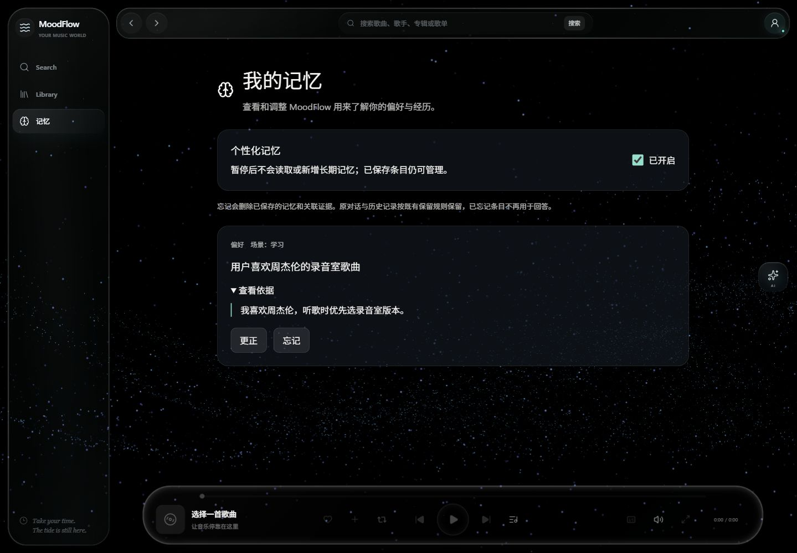
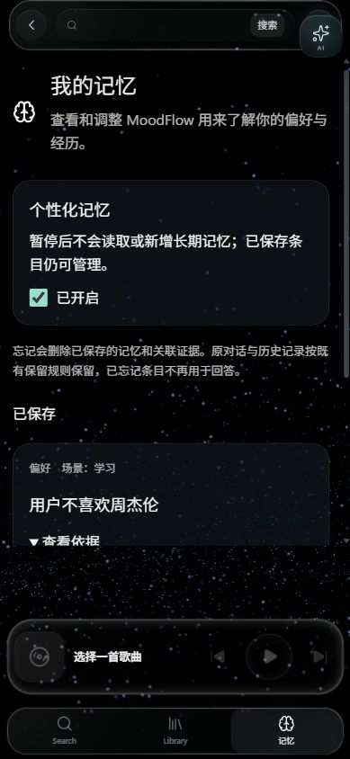

# MoodFlow 分支核对与统一整合结果

日期：2026-10-11。执行目录：`C:\Users\33994\.codex\worktrees\unified-integration-20261011\MoodFlow`。

## 结果与发布范围

- `main` 与实际远端 `origin/main` 均为 `174d7093f27b4c9e88cd8a7c524c17055644e033`，已完成此前授权的 push。
- 六条代码主线及一条设计线已合入本地分支 `codex/unified-integration-20261011`；最终代码验证基准为 `4c6b28aa59c4fbd7123b506132bb3d2c2f95dd8e`。本报告随后单独提交，报告提交号可用 `git log -1 -- docs/reports/unified-integration-20261011` 查询。
- 本地整合分支通过最终 Python 全量回归、Java verify、部署工具测试和前端验证。该分支尚未 push，也尚未合入 main。
- 未 force-push、删除分支、部署或执行生产数据库迁移。主 worktree 最终干净；其他已有 worktree 未修改。Redis Infra 合入了仓库中的 Docker/Compose 源文件，但未修改运行中的生产配置或读取 `.env`。

## 第一轮：更新并发布 curation

主 worktree 从 `0fdf4f71` fast-forward pull 至 `3a11237cbce78ffb1e8ce6dc31db681c1430e360`，与 West 确认的目标一致。拓扑检查证明该 main 已是 `174d7093` 的祖先，因此按照确认后的方案以 fast-forward 合入 `codex/curation-integration-final`，无需生成额外 merge commit。

在 `174d7093` 的实际 tree 上，Python `tests + evals/tests` 为 **2892 passed、12 skipped、288 subtests passed，0 failed**；Java **100 tests，0 failures/errors/skips**；373 个冻结文件的物理哈希一致。随后执行 `git push origin main` 成功，并通过 `git ls-remote --heads origin refs/heads/main` 验证实际远端指针。[第一轮验证](evidence/main_verification.json)、[push 结果](evidence/main_push.json)。

## 14 个分支的完整清单

以下“main”专指任务要求的旧 main **3a11237c**；“integration”专指 **174d7093**（亦为现在已发布的 main）。通过 `git merge-base --is-ancestor` 逐一核对。独有提交数为同时不属于这两个基准的提交数，包含 merge commit；“main..分支”列对应原任务要求的完整 `git log main..<branch>` 范围。

| 分支 | tip SHA（完整） | 在 main 3a 中？ | 在 integration 174 中？ | 独有提交数 | main..分支提交数 | 在本地统一分支中？ | 主要文件 / 功能 |
|---|---|---|---|---:|---:|---|---|
| `codex/agent-explorer-v2` | `89f1b0cce6f20c414a1724adfba430f427eb1829` | 否 | 否 | 3 | 86 | 是 | Explorer 分支探索、会话偏好与 Journey（`explorer*.py`、`journey.py`） |
| `codex/agent-generalchat-v2` | `fc5944357c1287ffddb6d7146c6fa3753b8a4a18` | 否 | 否 | 6 | 92 | 是 | GeneralChat 结构化对话、歌曲对话及会话偏好（`general_chat/{conversation,session,song_dialogue,structured}.py`） |
| `codex/agent-integration-chains` | `100004a5105e15624369b7bbea4abf94969925b2` | 否 | 否 | 8 | 94 | 是 | 协作链与 Journey 消费（`handoff/journey_consumer.py`、`chain_receivers.py`、`agents.py`） |
| `codex/agent-pack-relay-migration` | `1e2e4108c91c2c0b446bcee603cf033dadb15f88` | 否 | 否 | 13 | 99 | 是 | TransferEnvelope 与 AgentPack 迁移（`foundation/context_contracts.py`、`entry_context.py`、`handoff/agents.py`） |
| `codex/context-agent-pack-design` | `8b88dc2ee8ea992ea75fd5d721620116472ee914` | 否 | 否 | 1 | 80 | 是 | AgentPack 设计文档（`docs/architecture/context-agent-pack-design-20261008.md` 及对应验证报告） |
| `codex/context-agent-pack-impl-d` | `1f75b0588f053ea0890c5b55f940ec22df285327` | 否 | 否 | 4 | 85 | 是 | WorldLine 分阶段 Pack（`foundation/subgraphs/worldline/stage_pack.py`、`context_engineering.py`） |
| `codex/context-agent-pack-impl-e` | `70cec051b0f5f0213719333dd6397a36f89ca190` | 否 | 否 | 10 | 96 | 是 | Explorer Pack（`handoff/agents.py`、`foundation/model_input.py`） |
| `codex/context-rag-source` | `041392a788660483f591ec6be495bb409dab7975` | 否 | 否 | 2 | 81 | 是 | 受控 RAG 来源与审计（`foundation/rag_source.py`、`context_selector.py`） |
| `codex/longhorizon-foundation-projection` | `3be8707008db9e032685b85b6b1b7968dc926e0b` | 否 | 否 | 1 | 80 | 是 | Foundation 进度投影（`long_horizon/foundation_projection.py`、`coordinator.py`） |
| `codex/longhorizon-query-drilldown` | `deeb960d9ab4291e259d37bbadf28121e584911b` | 否 | 否 | 1 | 80 | 是 | 长程历史按 query 下钻（`long_horizon/query_drilldown.py`、`history.py`、`coordinator.py`） |
| `codex/memory-hardening` | `ed6ae0a7c3c36154a92fac20a989c6d1f2e29817` | 否 | 否 | 13 | 101 | 是 | Memory 隔离、任务、修正和撤销（`agent/memory/`、`api/memory.py`、`MemoryPage.tsx`） |
| `codex/redis-infra` | `d37eb9ed0f7e2ae51d60fa77ef9982169478a252` | 否 | 否 | 11 | 96 | 是 | Redis 运维验收及 P1b/P3（`deploy/redis_infra_*.py`、Compose、Dockerfile） |
| `codex/redis-p3-events` | `10e90595ebdef5425e8cb3d5edf01a6ec7e13bfe` | 否 | 否 | 2 | 85 | 是 | 事件流及播放量持久化（`redis_events/`、`api/redis_events.py`、`008_redis_events.sql`） |
| `codex/redis-ratelimit` | `ca8b02f187d6ff01e4ad852d5a4e596c6d0a7a72` | 否 | 否 | 2 | 83 | 是 | P1b 滑动窗口限流（`api/rate_limit.py`、`api/lua/sliding_window_counter.lua`） |

这些分支初始共有 **48 个去重后的未包含提交**，不是 14 份独立工作。Explorer → GeneralChat → Chains、RAG → D → E → Relay、P1b/P3 → Infra 分别存在祖先关系。按六条代码主线和设计线合入即可保留全部工作，无需逐一重复 merge。[逐分支独有提交及去重文件完整列表](evidence/topology_before.json)。

截至本次交付，14 个原分支 tip 全部保持不变，且全部是本地整合 HEAD 的祖先；在整合分支范围内已无孤立工作。它们的新增工作仍未进入远端 main，不能把“本地已包含”视为“已上线”。[最终拓扑与主 worktree 状态](evidence/final_snapshot.json)。

## 实际合入提交与冲突处理

| 顺序 | 来源 | 合入提交 | 验证结果 |
|---:|---|---|---|
| 1 | `codex/redis-infra` | `76528aa3a4af55be4c78016b70dc71fe5b41efa4` | 229 passed，0 failed |
| 2 | `codex/longhorizon-foundation-projection` | `c655597aeb1cf6c63a44fe86135eac4e6541b595` | 97 passed，0 failed |
| 3 | `codex/longhorizon-query-drilldown` | `a7db3dec18a96f647e4f4e2d34802f31bc69f64a` | 100 passed，0 failed |
| 4 | `codex/memory-hardening` | `488deb261d3be1c6accd31e2902a2b250d854552` | 122 passed，0 failed |
| 5 | `codex/agent-pack-relay-migration` | `d8b58e1c4ebb7fd1952fdf7af25b22bd084a81ec` | 293 passed，0 failed |
| 6 | `codex/agent-integration-chains` | `acf828951f688d3b7569e049c0da72b3fc8f6ce6` | 404 passed，0 failed |
| 7 | `codex/context-agent-pack-design` | `c60ade8d5dd3ade954d2b034ea105c2ad9d2db30` | 纯文档；与实现核对及 diff 检查通过 |

六条代码线使用 `git merge --no-ff <branch>`，每个合入结果通过相关回归后独立提交。整合期间的兼容处理如下：

1. Query Drilldown 与 Session Projection 同时修改 coordinator：保留 `history.read(..., query=message)` 和继承 session projection 两条路径，新增真实 SQLite 会话及 graph 回归。
2. Memory 与 Redis P3 同时修改应用生命周期：保留 Memory worker 和 Redis flush worker 的启动、drain、关闭及缓存释放顺序；新增启用/禁用两种生命周期测试。另新增隔离 PostgreSQL 测试，确认两个不同名称的 `008` 迁移均执行且可重入。
3. RAG/Relay 与派生缓存组合：保留 ContextSelector 的辅助能力与缓存装饰器；`source_audit` 同时纳入缓存键及 manifest。Explorer 的现有规则会直接解析部分请求，因此将网络边界测试扩充为“规则命中 / LLM fallback × 三种 RAG 模式”，实际验证两条路径、owned tool pairs 和 replay。
4. GeneralChat 与 AgentPack 组合：结构化结果、歌曲查询及偏好快捷路径先运行；需要模型时继续走 business pack 及来源隔离。仅对普通会话内容过滤未确认偏好，保留合法 owned AI/Tool 对；新增组合回归。原 `general-chat-base/v1` 的文本和哈希保持不变，新增独立 `general-chat-preferences/v1` 绑定，哈希 `d077ede03d1941f9c41c81cd4ee4b2d70d5045096c64a26b7dc289dd523b9bc8`。
5. 设计文档保留历史设计记录，并补充当前实现状态：Relay 仅传路由和最小控制信息；业务历史、RAG、Profile 不经 Relay 传播。设计中的 emotion_state 槽位仍未实现，已明确记录为后续功能缺口。
6. 全量回归暴露 Windows CRLF 对字节冻结哈希的影响。独立提交 `f2e0c8e49fb7fb116279fce63365aa07b2706929` 为 32 个已确认与原 Git blob 相同的冻结/哈希引用文件设置 LF 检出规则；未改变数据、阈值、Gold、prompt base 或任何冻结哈希。专项回归 **121 passed**。[换行修复证据](evidence/byte_hash_eol_repair.json)。
7. 补齐 Coldchain 与 GeneralChat 新增 preferences prompt 的组合审计契约：保留收据状态、私有历史隔离及原有 prompt 断言，新增第三个绑定的精确顺序、variant、v1 和哈希检查。独立测试提交 `7df58e5840e613d3b7c9a42733a5a19f1b3a6a1b`，相关回归 **191 passed、2 subtests passed**。[验证证据](evidence/coldchain_preferences_accepted.json)。
8. 旧 Jev 测试直接重写仓库的 Gold/诊断文件，上游原始数据的 Windows 换行会污染生成的来源哈希。独立提交 `4c6b28aa59c4fbd7123b506132bb3d2c2f95dd8e` 将两个生成测试改为 `tmp_path`，固定上游输入 LF，并增加生成结果与冻结字节完全一致、原件不变、失败时输出不变的断言。Jev 全套专项 **145 passed、1 原有 live skip**；标签、63 条 Gold 内容及其预期哈希保持原样。[隔离与恢复证据](evidence/gold_test_isolation.json)。33 个 LF 检出规则与 3 个历史混合换行文件最终共 36 项字节检查通过。

## 重点文件归属与子模块

下表基于 blob 存在性、祖先检查及 `git log --all --oneline -- <path>`；完整 30 个重点路径的 blob SHA 和来源历史见[归属核对](evidence/ownership-final.json)。

| 文件 / 实现 | 旧 main 3a | integration 174 / 当前 main | 本地统一分支 | 关键来源 |
|---|---|---|---|---|
| `handoff/journey_consumer.py`、`chain_receivers.py` | 无 | 无 | 有 | Chains，`61f75b5` |
| Redis P0：`llm/redis_budget.py`、`lua/reserve_budget.lua`、`scripts/reconcile_redis_budget.py` | 无 | 有 | 有，核心 blob 不变 | `065297e` |
| Redis P1：`cached_checkpointing.py`、`long_horizon/cached_postgres_store.py` | 无 | 有 | 有，核心 blob 不变 | `112d52a` |
| Redis P1b：`api/rate_limit.py`、`api/lua/sliding_window_counter.lua` | 无 | 无 | 有 | Ratelimit → Infra，`d6fe13d` |
| Redis P2：`derived_cache.py`、`profile_cache.py`、`dedup_locks.py`、`redis_reuse.py` | 无 | 有 | 有 | `d73b1d1`；派生缓存调用方合入 RAG 来源审计 |
| Redis P3：`api/redis_events.py`、`redis_events/{store,transfer,playcount,streams}.py`、`008_redis_events.sql`、`flush_redis_playcounts.py` | 无 | 无 | 有 | P3 → Infra，`447692c` |
| Infra：`deploy/redis_infra_acceptance.py`、`redis_infra_smoke.py`、Docker/Compose 源文件 | 通用部署文件存在 | 通用部署文件存在 | 包含 Redis Infra 新增能力 | `eca6e0a` 及 Infra 后续提交 |

表中采用文件名或简写路径；每个文件的完整仓库相对路径、三个版本的 blob SHA 与 `git log --all` 来源历史均在归属核对 JSON 中。

`netease-music-api`：旧 main `3a11237c` 记录 `321c25bd7d041711f1a9ab9e4b55997ce661313c`，integration `174d7093` 和当前 main/整合分支均记录 `ba9236e5cdf5eaeaffb330850d268e5101c31f69`。旧指针是新指针的祖先，相差 1 个提交。主 worktree 实际 checkout 为 `ba9236e`，内部 `git status --porcelain` 为空；新整合 worktree 未初始化该子模块，未执行 update 或修改其内容。审计开始时主 worktree 的“子模块 modified”来自 checkout 与旧 main gitlink 不一致，内部没有未提交文件；第一轮合入后两者一致。

## 最终验证命令与结果

Java verify 在全部功能合入后执行；前端验证在 Memory 功能合入后执行。后续提交只涉及 Python 测试与换行规则，相应 Java/前端子树与最终代码完全一致，见[子树一致性证据](evidence/validation_subtree_equivalence.json)。

验证代码基准：`4c6b28aa59c4fbd7123b506132bb3d2c2f95dd8e`。本次报告及证据提交仅新增文档，不改变上述经过验证的代码 tree。

| 验证 | 实际命令 / runner | 结果 |
|---|---|---|
| Python 全量 | 在 `ai-service`：`D:\code\ProjectsAll\MoodFlow\ai-service\.venv\Scripts\python.exe ..\.dev\unified-integration-20261011\run_validation.py unified_full_verified tests evals/tests` | **3361 passed、12 skipped、288 subtests passed，0 failed/error**；531.55 秒 |
| Java | JDK 21；在 `music-backend`：`D:\apache-maven-3.9.4\bin\mvn.cmd --batch-mode --no-transfer-progress -o clean verify` | **100 tests，0 failures/errors/skips**；BUILD SUCCESS |
| 部署工具 | 根目录：`python -m pytest -p no:cacheprovider -q deploy/tests --junitxml=.dev/unified-integration-20261011/deploy-final.xml`，`PYTEST_DISABLE_PLUGIN_AUTOLOAD=1` | **127 passed，0 failed/skipped** |
| 前端 | `npm ci --ignore-scripts`；`npm run lint`、`npm run build`、`npm run test:memory` | 全部退出码 0 |
| 前端其余回归 | `npm run test:ai-layout`、`test:ai-stream`、`test:music-assets`、`test:search`、`test:ai-trigger`、`test:worldline` | 六个 script 全部退出码 0 |
| Redis Infra | Python runner 的 P0/P1/P2/P1b/P3、PostgreSQL 及 Linux OOM 验收集 | 229 passed；使用隔离测试服务，未连接生产 |
| Compose 源文件 | `docker compose -f docker-compose.production.yml config --no-interpolate --no-env-resolution --quiet` | 退出码 0；无 `.env` 解析，无部署 |
| 静态检查 | `python -m ruff check --no-cache ai-service/app ai-service/tests ai-service/evals --output-format json`；只比较 Git 跟踪的文件，排除 main 本地 ignored 分析脚本 | 两边均 5 个既有问题，**新增问题 0**；不能宣称全仓 Ruff 已通过 |
| 冻结保护 | `.dev/unified-integration-20261011/audit_snapshot.py` 对照第一轮 SHA256 | **373 / 373 物理哈希一致** |

[Python 最终摘要](evidence/unified_full_verified.json)、[Java](evidence/java-final.json)、[部署测试](evidence/deploy-final.json)、[Ruff 比较](evidence/ruff-comparison.json)、[前端回归](evidence/frontend-regression.json)。各阶段 JSON 记录实际 target 列表与实际 `code_root`，不是引用旧分支的测试结果。已保留[Python runner 与证据插件](evidence/runner/run_validation.py)；runner 使用固定离线配置、4 个 xdist worker、SQLite/内存默认 backend 和仅本地的隔离 PostgreSQL 测试端口，禁用 dotenv，不调用真实外部 LLM。若另行复跑，可把这两个 runner 文件复制到 `.dev`，准备同等公开测试资产与隔离测试服务后，从 `ai-service` 调用。

前端使用本次新建的本地合成 API fixture，真实浏览器验证了桌面 1440×1000、移动 390×844 下的卡片证据展开、暂停/恢复、偏好修正、遗忘取消/确认、503 错误及重试、匿名登录提示。移动宽度 `clientWidth = scrollWidth = 390`，无水平溢出；控制台没有新增错误或警告。

## 验证限制与过程中的失败

- 全量中 **12 个跳过项与第一轮 main 完全相同**；均为现有 opt-in 的真实 Qdrant、进程重启、真实 Qwen embedding / Jev 模型或 live PostgreSQL smoke 验证。完整 nodeid 在 Python 摘要中。未新增跳过、删除测试或降低断言。本次已有 PostgreSQL 专项通过，不等于上述 live 场景已验证。
- Memory 离线评估为 15 个合成 admission 案例，FPR/FNR 均 0，recall hit@3 为 1、冲突解决率为 1；只证明合成策略及检索路径，不测真实模型准确率或真实用户修正率。[评估数据](evidence/memory-evaluation.json)。
- 前端构建仍有打包 chunk 超过 500 kB 的提示；构建成功。本次未做性能优化。
- Ruff 的 5 个既有问题为 routing 的两个未使用 import、PDF adapter 的一个未使用局部变量、RAG ingestion 的两个未使用 import；未扩展到无关代码清理。[完整现有问题](evidence/ruff-combined.json)。
- 首次 Infra 回归遇到 runner 导入路径、公开模型资产缺失，以及测试 monkeypatch 时间函数影响证据插件的问题；修复测试环境、只拷贝公开白名单资产并固定插件时钟后，专项及部署测试均通过。个别首次 target 拼写错误在收集前退出，随后按实际文件清单修正。
- 新增 Query 测试首次缺少 fixture 的必填 `current_stage`；Relay 首次仍按旧行为期待 query LLM 调用，随后扩充规则/模型两路覆盖；一个 fallback fixture 未能解析实体，改为可确定解析的合成目录实体。最终相关回归全部通过，未以弱化断言规避失败。
- 第一次最终全量在冻结 Router Contract 哈希处失败（310 passed、1 failed）；冻结专项随后发现相同原因影响 semantic gate source。均确认为 CRLF/LF 差异，补全 `.gitattributes` 后专项及最终全量通过。第二次全量在历史 RAG Gold 字节校验处失败（2992 passed、1 failed）：3 个文件的旧冻结格式是混合换行（前 29 行 CRLF，其余 LF），单一 LF 或 CRLF 检出规则均不能复现。仅在新 worktree 的测试准备阶段恢复了已验收的原始字节，3 个 Git blob、Gold 内容及预期哈希均未改变；专项 20 passed、56 subtests passed，最终全量随后通过。[混合换行准备证据](evidence/legacy_gold_preparation.json)。第三次全量在 Coldchain 旧的两个 prompt 列表断言处失败（3254 passed、1 failed）；新增 preferences 绑定是已合入功能，更新精确审计契约并补上 v1/variant/哈希断言后，191 项相关回归及最终全量通过。第四次全量在 Jev Single ablation 的 Gold 哈希处失败（3269 passed、1 failed）：旧生成测试用 CRLF 上游输入改写了共享 Gold 的来源哈希。逐条核对 63 条记录只存在来源哈希差异，恢复冻结版本、固定上游 LF 并将生成测试隔离到 tmp_path 后，145 项 Jev 专项与最终全量通过。四个失败摘要保留在 evidence 中，不属于交付验收通过结果。未来在新 checkout 复跑时仍需准备同样的历史字节格式；已将这 3 个文件的原始字节保存为[冻结 Gold 压缩包](evidence/legacy-gold-original-bytes.zip)，解压后可按准备证据中的 SHA256 逐一核对。
- 没有进行真实用户数据测试、真实外部音乐/API/LLM 调用或生产环境验收；此次结果不构成部署批准。

## 清理和最终状态

仅删除本任务新建且验证 ID 与 label 一致的 PostgreSQL 容器 `moodflow-unified-test-20261011`，并停止本任务创建的 UI fixture/Vite 服务。仅清除本任务复制产生、且与只读公开源文件 SHA 一致的 9 个未跟踪 knowledge 文件；用于离线复跑的其他 ignored 资产及原始日志留在新 worktree 的 `.dev`/ignored 目录，未加入 Git。没有清理其他容器或其他 worktree。[清理证据](evidence/cleanup.json)。

主 worktree 与子模块干净；本地整合代码及文档已各自提交。下一次若要发布六条代码线，需要另行授权将本地整合分支合入 main 并 push；本次交付到此为止。
