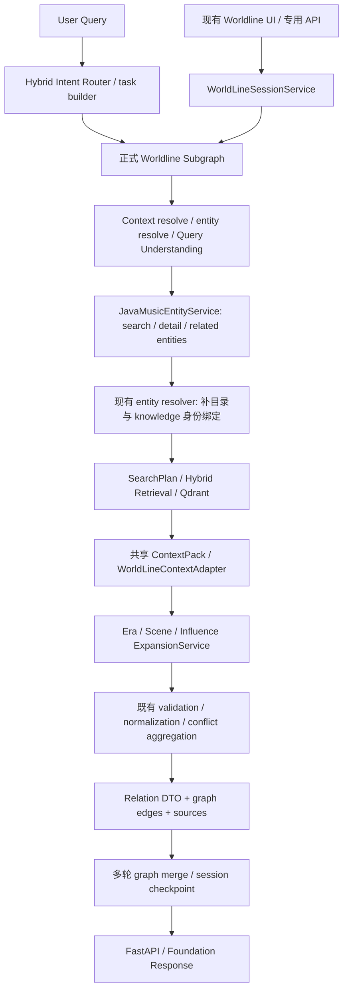

# Worldline Runtime Integration / Online Path Hardening

日期：2026-09-26。代码基线父提交：`a22da57`。本轮只完成工程接入与 smoke/integration 验证。

**结论：正式 runtime 代码已接通来源上下文、三类扩展、冲突 DTO、session 和 API；工程回归无新增失败。当前环境尚未启用在线知识检索和 PostgreSQL session，不能宣称生产在线链路已验收。可以进入下一阶段的环境与数据准备；满足下面的前置条件后，才能执行 Online E2E + PostgreSQL Persistence / Restart 验收。**

本轮未运行 Semantic Relations Evaluation baseline，没有重新计算 Gold 指标；没有修改 Gold、审核 receipt、旧 freeze、评分器、category gate、关系 validator 或方向/归属判定规则。P0 3/3 是上一轮冻结结论，本轮不重新宣称真实 Gold case PASS。deferred evaluation debt 仅登记，未修复。

## 1. 正式运行架构与入口

聊天入口通过 Foundation MainGraph 的 `HybridIntentRouter`、规则/模型/LLM 路由及 task builder，选择 `RouteKey.WORLDLINE`，经正式 subgraph adapter 执行 Worldline。公开 Foundation response 保留 `metadata.worldline_result`，并序列化 sources/citations。

现有 Worldline 页面是明确指定功能的入口：`services/worldline.ts` 直接调用 FastAPI 的 session/create、recover 和 explore 端点。它无需再次做全局意图分类；仍执行同一正式 Worldline subgraph 内的 Query Understanding。开发 Vite `/api/ai` 代理到 AI 服务，部署环境可以通过现有 `VITE_AI_API_BASE_URL` 指定地址。本轮未修改代理或部署。

具体代码路径：

| 环节 | 正式实现 | 审计结果 |
| --- | --- | --- |
| Intent → subgraph | `app/agent/foundation/main_graph.py`、`hybrid_routing.py`、`adapters.py` | 原本已接入；工程测试经过真实 HybridIntentRouter 的规则/task 构建，不使用 development_routes |
| Worldline graph | `foundation/subgraphs/worldline/graph.py` | 原本已顺序调用 Era、Scene、Influence 服务；本轮补目录 peer 绑定和多轮冲突描述保留 |
| 音乐目录 | `worldline/music_service.py` → `MusicServiceClient` → Java `/music/entities/search`、`/music/entities/{type}/{id}` | 复用现有边界；related references 通常没有 knowledge ID，需要 resolver 补绑定 |
| 在线检索 | `worldline/retrieval.py` factory → immutable ready index binding → HybridRetrievalService → Qdrant Query API | `hybrid` 是正式消费路径；`empty` 和 `shadow` 是明确配置模式，不是偷偷替换的 mock |
| 知识入库 | parse/clean/chunk metadata → enrichment/knowledge → IndexDocumentProjector v4 | 复用 `document_metadata` 继承链；新增真实捕获文本与 native claim 的绑定 |
| ContextPack | `app/rag/context_packing` → WorldLineContextAdapter | 现在携带原始 Child sidecar、来源上下文、角色、offsets 与 provenance |
| 关系结果 | 三类 ExpansionService → 既有 validator/aggregation → typed DTO | 决策/评分规则不变；三类 evidence source 都保留经过绑定的上下文和索引来源 |
| 多轮保存 | WorldLineSessionService → last_result/current_graph/evidence_history → checkpoint | 完整 relation/source DTO 随快照保存；原生产 factory 强制 PostgreSQL，未改为 memory fallback |
| API/UI contract | `app/api/worldline.py`、Foundation response、前端 `types/worldline.ts` | 三关系数组、方向、stance、冲突 flags、evidence/source metadata 可直接消费；只补类型，不重做 UI |

正式 graph 内部仍为 prepare_query_context → resolve_entity → understand_query → load_entity_facts → retrieve_music_knowledge → build_worldline_graph → generate_narrative → generate_branches。load_entity_facts 复用 QueryEntityResolver，把返回的相关目录实体绑定到受控 registry；保留原 queries/filter，重建带合法 plan_id 的 SearchPlan。未知或歧义 peer 不会被编造 knowledge ID。

## 2. 此前仅独立 context-input 可用的能力如何进入 runtime

上一轮 supplement 在独立冻结 context overlay 中提供；正式检索链原先缺少 payload 白名单、candidate metadata、ContextPack 字段和 adapter 传递。不能将那份 overlay 或审核说明直接当作线上输入。

现在的输入是原始 document metadata 中的 `source_context_captures`，也兼容已经绑定好的 `relation_source_contexts`。通用 `DocumentContextCapture` 在 chunk/claim ID 出现之前存储逐字文本、URL、publisher、title、locator、captured_at、原始 response SHA、content SHA 和角色 offsets。索引投影只将这些既有文本绑定到 native verified claim，不生成文章主体、说话人或影响方向。capture 缺失时保持缺失。

传递流程：

1. 现有 chunk engine 保留 `cleaned.metadata` 为 `document_metadata`；enrichment/knowledge 保留这份 metadata。
2. IndexDocumentProjector v4 校验 capture 的文本 SHA、offsets、唯一角色、URL/publisher、原始 exact span，并绑定 native source/parent/chunk/claim ID。
3. Qdrant payload 保存 `relation_source_contexts`、source title/locator、Child/Parent SHA、release ID、knowledge/index input hash。
4. Qdrant payload selector 与 retrieval candidate 白名单保留这些字段；含 SHA 的 Child/Parent payload 不一致时拒绝该 hit，记录 invalid payload warning。
5. ContextPack 再次做 source/claim/anchor 绑定。保留原始 Child 为 `source_evidence_content`，压缩正文用于查询上下文；两者的 hash 角色明确区分。
6. 补充文本计入原有 item/pack token budget；超预算、anchor 被省略、重复绑定或篡改时省略整个 supplement，并留下 warning。不存在只保留回答、丢掉提问/说话人的截断方式。
7. WorldLineContextAdapter 将 packet 送入正式 document metadata；三类 relation evidence source 都保存单个已绑定的 `relation_source_context` 与稳定 provenance。原 Influence context validation/contradiction aggregation 直接消费它。

共享模型移到 `app/rag/source_context.py`；旧 `worldline/source_context.py` 是兼容 import shim，原 RelationSourceContext v1 字段/约束保持兼容。没有 runtime 导入 evals/Gold/review pack 的路径。原始 capture schema 及绑定后的 schema 在本报告附件目录中。

SHA 的含义：`response_sha256` 是上游捕获的原响应标识；`content_sha256` 验证 capture 文本；`source_content_sha256` 验证未压缩 Child；`parent_content_sha256` 验证 Parent；knowledge/index hash 绑定入库输入和投影。运行时校验文本绑定与传输一致性，不把任意合法 SHA 字符串当成外部来源真实性认证。原始捕获和可审计 source release 仍由数据入库环节负责。

offsets 是原 capture 字符串的 Unicode code-point 半开区间 `[start,end)`，SHA 使用 UTF-8 字节。前端现有 UI 展示 exact_span；未来若按 offsets 切片，需要按 code points 处理，不能直接混用 UTF-16 string.slice。

## 3. Runtime smoke 完整 trace

完整机器可读记录：[runtime_smoke_trace.json](worldline_runtime_integration/runtime_smoke_trace.json)。**这是独立工程样本及外部 I/O 替身，不是真实来源 Gold、正式 baseline 或在线 E2E 证据。**

实际运行代码包含 index projection、Qdrant backend 请求/绑定检查、HybridRetrievalService 的 legs/fusion/selection、真实 Query Understanding/registry、共享 ContextPack、正式 Worldline graph、三种 expansion/validator/aggregation、session/checkpoint 和 FastAPI 路由。替身仅用于目录远端、dense encoder、Qdrant transport 和 narrative/branch generation；session factory 为测试注入 memory saver。没有替换三个 expansion 或返回预制 API DTO。

| 步骤 | 观测 |
| --- | --- |
| query | `探索歌手《A》的音乐世界线、发行年代、音乐场景与音乐影响` |
| Query Understanding | timeline / influence_style / exploratory；目录 peer 映射到 artist:a、artist:b、song:b；原始检索 scope 保留 |
| index/native inputs | 4 个独立原始 Child、4 个 native claim；source release `engineering-release-v4`；projection v4 |
| Qdrant / retrieval | 正式 backend 发出 dense/BM25 QueryRequest；返回 success、4 candidates；payload selector 保留上下文和来源 hash |
| ContextPack | 4 items，115 / 3000 tokens；child-301/302 各携带一个 source-bound context；Era/Scene 未编造额外 context |
| Era | Song B 的原始 release evidence → belongs_to_era → 1980s |
| Scene | B 的原始 membership evidence → belongs_to_scene → Neon movement |
| Influence support | article_sentence 保留 B 为主体；原 exact span 仍是 `tried to translate their spirit, along with jazz and A, into radical electronica.` |
| Influence contradiction | speaker_binding + 原 interview_question + interview_answer；原回答仍为否认文本；question 是关于 A 是否影响对方的音乐 |
| validator → aggregation | support accepted；回答保留 `negated_influence`，以 contradiction 进入既有 attribution aggregation |
| final relation | A → B influenced；direction=influencer_to_influenced；conflict_flags=[attribution_conflict]；两条 claim/evidence 都保留 |
| API/session | create revision 1；explore revision 2；普通第二轮拒绝新增三类关系，但保留全部旧 relation DTO；fresh service 使用同一 checkpoint 恢复成功 |

trace 内包含 indexed payload/point/source/chunk/claim ID、文本/hash/offsets、search plan、retrieval candidates、ContextPack、expansion 的 rejected candidate 和 validation/aggregation trace，以及 create/explore/recover 的完整响应。

## 4. 多轮状态与 frontend contract 加固

通用知识 evidence source 的 native snapshot ID 现在包含 Child/索引输入身份的稳定 hash。相同 Parent 在后续查询选中另一 Child 时，不会错误复用旧 Parent source ID。native 来源 excerpt 使用经过 SHA 绑定的原始 Child，不随压缩查询视图变化。

合并区分稳定来源身份和查询观测：rank、fusion、channel、warnings、token/rerank 观测不再造成假 source_conflict；URL、claim、span、原始 content hash、release/index hash、source context packet 等仍严格比较。只有具备 native input/content hash 的来源，压缩视图的 `context_document_sha256` 才按查询观测处理；原始 Child/capture hash 不豁免。旧 memory/evaluation 样本的完整严格身份比较仍保留。

session 中已有合法关系通过既有 merge_*_relations 保留，包含双方 evidence、stance、flags 和 provenance。新冲突进入旧 graph 时重新使用既有 conflict description helper，避免旧的确定表述覆盖当前冲突描述。失败/容量超限继续按原逻辑拒绝，未放宽关系 validator。

前端仍消费：era_relations、scene_relations、influence_relations；graph.edges 的 source/target/relation/evidence_ids；source/exact_span；Influence direction/strength/stance；metadata.conflict_flags 与各冲突布尔值。新类型只明确化原来 Record<string,unknown> 里的 source context/provenance/flags，保留可选字段和未知 metadata 扩展兼容性。

## 5. 修改文件

以下均为相对仓库根目录的路径；旧评测目录无本轮修改。

| 文件 | 修改内容 |
| --- | --- |
| `ai-service/app/rag/source_context.py` | 通用 capture/segment/绑定 contract，保留 v1 packet 兼容，三类关系 provenance helper |
| `ai-service/app/rag/indexing/source_context.py` | 从真实 document metadata 绑定 native claim；拒绝跨来源/篡改/重复/超限 packet |
| `ai-service/app/rag/indexing/projection.py` | 增加上下文和来源 hash payload；不改 claim extraction/verification |
| `ai-service/app/rag/indexing/config.py`、`indexing/config/v1.yaml` | 新投影 v4；默认输出目录/collection 与旧版本隔离，本轮未构建或替换线上索引 |
| `ai-service/app/rag/retrieval/qdrant.py`、`retrieval/selection.py` | 真实 Qdrant 字段传递，原始内容 SHA 校验 |
| `ai-service/app/rag/context_packing/models.py`、`context_packing/service.py` | 共享上下文/Child sidecar，预算/去重/完整绑定与 warning，避免重复 exact span |
| `ai-service/app/agent/foundation/subgraphs/worldline/retrieval.py` | 正式 adapter 转交 context/provenance/warnings |
| `.../worldline/source_context.py` | 旧 import shim |
| `.../worldline/era_expansion.py`、`scene_expansion.py`、`influence_expansion.py` | 只补 evidence source provenance/context；判定/评分/方向规则不改 |
| `.../worldline/graph.py` | 正式 peer catalog 绑定；多轮冲突边描述保留 |
| `.../worldline/builder.py`、`merge.py` | native source snapshot 身份、原始 excerpt、严格稳定 provenance 合并 |
| `ai-service/tests/test_worldline_runtime_integration.py` | 16 项工程集成/边界场景；使用真实 runtime 服务和独立 engineering fixtures |
| `ai-service/tests/test_rag_indexing.py` | 同步 v4 隔离路径/版本期望，未削弱验证 |
| `soul-music-room/src/types/worldline.ts` | source context、provenance、conflict metadata 类型和 offsets 说明 |
| `docs/reports/worldline_runtime_integration/*` | trace、schemas、验证记录、保护清单、readiness、deferred debt、artifact manifest |

未修改 Java backend、UI 交互/布局、部署配置、关系 validator/projector/scoring、evaluator 或 Golden data。

## 6. 验证结果与限制

| 验证 | 命令/记录 | 结果 |
| --- | --- | --- |
| 全部现有 Worldline + 相关工程回归 | ai-service `.venv/Scripts/python.exe -m pytest`；完整文件参数见 [test_command.json](worldline_runtime_integration/test_command.json) | **419 passed、5 skipped、2 subtests passed**，0 failures/errors；426 JUnit entries 包含 subtests |
| 新 runtime integration suite | `pytest tests/test_worldline_runtime_integration.py -q --tb=short`（包含在最终完整命令） | 16 场景通过：正式 router/三模块、source capture、API/session/recover、reverse/weak/negation/query isolation、tamper、budget、native Child 身份、歧义 peer |
| Python static | `.venv/Scripts/python.exe -m ruff check` 本轮模块/测试，命令见 validation.json | PASS |
| Python compile | `.venv/Scripts/python.exe -m compileall -q` Worldline/RAG 本轮目录与新增测试 | PASS |
| Frontend flow/view | `npm run test:worldline` | PASS |
| Frontend types/static | `npx eslint src/types/worldline.ts` | PASS |
| Frontend build | `npm run build`：tsc -b + vite build | PASS；仍有 bundle >500 kB 的构建提示，本轮不做打包优化 |
| 冻结保护 | [protected_artifacts.json](worldline_runtime_integration/protected_artifacts.json)、[freeze_verification.json](worldline_runtime_integration/freeze_verification.json) | **399/399 raw SHA256 unchanged** |

扩大工程回归的首次运行是 416 passed、1 failed、5 skipped、2 subtests passed：已有 long-horizon 子进程测试把 UTF-8 stdout 按 Windows 默认编码解码，出现中文 mojibake。统一 `PYTHONUTF8=1`、`PYTHONIOENCODING=utf-8` 后原测试通过，未修改/删除/跳过该测试。初次日志和 XML 一并保留；最终完整日志与 XML 无失败。

5 个原 opt-in skip 是：两个真实 Qdrant integration（未设置 QDRANT_INTEGRATION_URL），三个 PostgreSQL restart acceptance（未设置 RUN_WORLDLINE_POSTGRES_RESTART=1）。本轮未启用这些外部验收，也未修改 skip 条件。未启动 Online E2E、Final Regression 或部署。纯类型补充没有新增 UI 交互/视觉改动，因此本轮未执行浏览器视觉验收。

419 个工程测试的通过数不能替代旧 synthetic Gold 20/28，也不能据此提高任何 relation quality 指标。

## 7. Remaining integration blockers 与下一阶段

当前只读取非敏感运行模式得到：[runtime_environment.json](worldline_runtime_integration/runtime_environment.json)：retrieval_mode=empty、rerank_mode=off、无 index manifest、checkpoint_backend=memory。

| Blocker / 前置条件 | 影响 | 下一阶段处理 |
| --- | --- | --- |
| 在线 retrieval 未启用，无 approved ready index manifest | 默认生产 factory 当前只返回 EmptyMusicKnowledgeRetriever；不能证明真实 Qdrant 来源已进入结果 | 以独立 v4 source/index release 和 ready manifest 配置 hybrid；本轮未更改任何索引或 flag |
| 生产 capture metadata / corpus readiness 尚未验证 | 有通用输入/传递能力，但不能凭此宣称旧语料已有 article/Q-A/speaker captures | 上游对真实文档按 capture schema 提供可追溯 metadata，验证 ID、原响应 SHA、locator；缺失不从 Gold/review 补写。通过正常 knowledge/index release 流程准备在线验收输入 |
| checkpoint_backend=memory | 正式 get_worldline_session_service 按既有策略返回 persistent_checkpoint_required/503；工程测试注入 memory 不豁免生产要求 | 配置 PostgreSQL checkpoint，检查真实 schema/setup、锁、断线/重启与完整 DTO 恢复 |
| Java/Qdrant/模型/provider 和浏览器在线请求未联合验证 | 工程替身验证代码和契约，不证明网络、模型输出和真实服务可用 | 满足环境/数据前置条件后跑真实 Online E2E；保留同一 source/context/DTO trace 并验收 API/UI 方向/冲突显示 |

**阶段判断：** `runtime_engineering_ready=true`；`can_enter_online_e2e_preparation=true`；`can_run_online_e2e_postgres_restart_now=false`。当前配置下尚不能立即执行或宣布通过线上 PostgreSQL/restart 验收。没有新增工程 regression blocker；仍有上述环境和真实数据输入 blocker。满足前置条件后进入 Online E2E + PostgreSQL Persistence / Restart，不能跳到 Final Regression 或部署。

## 8. Deferred evaluation debt（只登记）

详见 [deferred_eval_debt.md](worldline_runtime_integration/deferred_eval_debt.md) 和 [deferred_eval_debt.json](worldline_runtime_integration/deferred_eval_debt.json)。来源是已有冻结 P0 report 的 failure diagnosis 和用户确认的 synthetic snapshot，没有重跑评分。

- Influence Direction：4 个真实漏检记录，deferred。
- Scene evidence mismatch：1 个真实漏检记录，deferred；本轮不修 Neko Case。
- Synthetic regression：沿用 **20/28** 冻结快照，8 个未通过，deferred。
- 后续整体 Agent Eval System 统一处理；本轮无 targeted repair、无新 Gold/review pack、无指标提升承诺。
