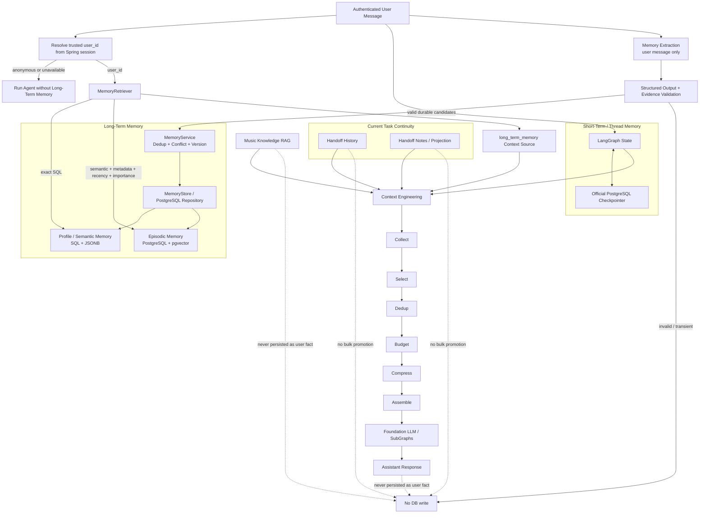

# MoodFlow Memory V1 实施报告

## 1. 当前 Memory 能力审计

### 1.1 Short-Term Memory

项目原有实现已经形成正确的线程内短期记忆边界，因此本次没有新增 `working_memory` 或其他重复表：

- `MainState` / 各 SubGraph State 保存当前 Graph 执行状态与对话消息。
- LangGraph Checkpointer 统一由 `checkpointing.py` 注入。
- 生产持久化使用官方 `PostgresSaver`；本地与单元测试使用 `InMemorySaver`。
- `thread_id` 映射为 conversation continuity identity。
- `session_id` 由 checkpointer adapter 映射到 checkpoint namespace，防止同一 conversation 的不同 Active Context Window 串线。
- `checkpoint_id` 仍由 LangGraph 管理，没有被 task/session ID 复用。

结论：`State + Checkpointer` 已经是 Short-Term Memory，应直接复用，不应另建 working-memory 存储。

### 1.2 ID 边界

| ID | 责任 |
| --- | --- |
| `user_id` | 跨 thread/session 的长期记忆隔离键；从 Spring `JSESSIONID` 对应的服务端登录态解析，不信任客户端自报身份 |
| `thread_id` / `conversation_id` | LangGraph 对话连续性 |
| `task_id` | Handoff/History 的任务生命周期 |
| `session_id` | Active Context Window 与 checkpoint namespace |
| `checkpoint_id` | LangGraph 执行快照 |
| `memory_id` | Long-Term Memory 记录标识 |

匿名请求或用户身份解析失败时，Long-Term Memory 关闭；不会用 `thread_id` 代替 `user_id`，避免跨用户污染。

### 1.3 Context Engineering

项目已有 `Collect -> Select -> Dedup -> Budget -> Compress -> Assemble` 流水线、按 SubGraph 区分的 policy、source budget、总 token budget 与 trace。原 `memory_source` 只是通用占位，没有真实 Long-Term Memory retrieval。本次新增独立 source：`long_term_memory`。

### 1.4 Handoff / History / Notes

现有 `agent_history_event`、`agent_artifact`、`agent_handoff` 与 long-horizon service 服务于当前 task 的事件历史、Artifact 和 Session rollover 交接。它们没有被改造成用户长期记忆，也没有批量导入 Long-Term Memory。

### 1.5 Structured Output

项目已有 `StructuredOutputService`，支持严格 JSON 解析、Pydantic schema validation、semantic validation、有限 retry 与 fail-closed。本次 Memory Extraction 直接复用该能力；LLM 输出无法直接执行 SQL。

### 1.6 PostgreSQL 与 pgvector

- 当前本机容器：`postgres:16`。
- 审计时 `pg_available_extensions` 中没有 `vector`，当前容器不支持 pgvector。
- 当前依赖版本包含 LangGraph 1.2.11 与 `langgraph-checkpoint-postgres` 3.1.2，并提供 `PostgresStore/AsyncPostgresStore`。
- 通用 LangGraph Store 只有 namespace/key/value 抽象，不直接满足本项目的显式 `status/version/superseded_by`、结构化 Profile SQL 查询、冲突审计与部分唯一约束。因此 Memory V1 使用专用 `MemoryStore`/repository；Short-Term Checkpointer 继续使用官方实现。
- 迁移在启用 Memory PostgreSQL 模式时检查 pgvector 并 fail-closed，不会静默降级为伪向量检索。

## 2. 最终架构

Memory V1 将短期连续性与跨线程用户知识明确分开：

- Short-Term：LangGraph State + Checkpointer。
- Task Continuity：History + Artifact + Handoff。
- Long-Term：MemoryExtractor + MemoryService + MemoryStore + MemoryRetriever。
- Music Knowledge：原 RAG，不写入用户 Memory，也不与 MemoryRetriever 混库。

运行时顺序：

1. 根据 Spring 服务端 Session 解析可信 `user_id`。
2. `MemoryRetriever` 按 `user_id` 查询 Profile，并在存在 Episodic Memory 时执行 pgvector semantic search。
3. Retrieval 结果进入 `continuity_context.long_term_memory`。
4. 各 SubGraph 通过现有 Context Engineering 选择、去重、预算和组装，不能绕过 token budget。
5. 当前用户消息完成正常 Agent 执行后，MemoryExtractor 只接收该条 user message。
6. Structured Output schema + semantic evidence validation 通过后，MemoryService 执行 dedup/conflict policy，再由 MemoryStore 持久化。
7. Memory 失败只关闭该次记忆读写，不使原聊天失败。

## 3. Long-Term Memory 数据模型

迁移新增 `agent_long_term_memory`，未删除或修改任何 LangGraph checkpoint 表和原 continuity 表。

主要字段：

| 字段 | 用途 |
| --- | --- |
| `memory_id` | 记录 ID |
| `user_id` | 强制用户隔离 |
| `memory_type` | `profile` / `episodic` |
| `memory_key` | 稳定去重与冲突 key |
| `content` | 有界的人类可读事实摘要 |
| `structured_content` | category/subject/preference/value/scene |
| `source_thread_id` | 来源 thread 审计 |
| `confidence` / `importance` | 检索与冲突策略输入 |
| `evidence_strength` | inferred / repeated_behavior / explicit |
| `confirmations` | 重复确认次数 |
| `created_at` / `updated_at` | 时间与 recency |
| `status` / `version` | active/superseded/inactive 与版本链 |
| `superseded_by` | 冲突替代指针 |
| `embedding VECTOR(1024)` | 仅 Episodic semantic search 使用 |

数据库约束保证同一 `(user_id, memory_type, memory_key)` 最多只有一条 active Memory。Profile 不写 embedding；Episodic 使用与现有 RAG 相同的 pinned Qwen3 embedding 模型与 1024 维度，但 Memory 存储/检索仍与 RAG 分离。

## 4. Extraction / Validation / Dedup / Conflict

### Extraction

- 输入仅为真实 user message，不包含 assistant response、RAG 文档、tool result、Handoff history 或 chain-of-thought。
- 明确允许长期偏好、拒绝、稳定事实、重复行为形成的重要反馈、重要历史体验。
- “这首歌先跳过”等短期动作在调用模型前由确定性 transient guard 拦截。
- 最多提取 8 条候选，字段全部有长度与枚举约束。

### Validation

- 复用 `StructuredOutputService`。
- JSON、schema 或 semantic validation 失败后不写库。
- `evidence_quote` 必须是当前 user message 的真实子串，阻止模型把助手/RAG 内容伪造成用户事实。

### Dedup / Conflict

- 同 key、同 preference/value：更新 confidence/importance/evidence strength，增加 `confirmations`，不新增重复记录。
- 新候选强度低于 active 记录：忽略。
- 已重复确认的行为，不被同等级单次行为覆盖。
- 新明确陈述可纠正旧偏好：旧记录变为 `superseded`，新记录以递增 version 成为 active。
- PostgreSQL 使用按 user/key 的 advisory transaction lock，避免并发请求产生多个 active 版本。

优先级实现为：显式陈述 > 重复行为 > 推断；重复确认 > 同等级单次行为；新的明确纠正 > 旧偏好。

## 5. Retrieval

统一入口 `MemoryRetriever.retrieve(MemoryRetrievalRequest)` 支持：

- `user_id`
- `query`
- `intent`
- `scene`
- `memory_type`
- `top_k`

策略：

- Profile：按 `user_id/status/type` 和可选 scene 走 SQL/JSONB metadata 查询，不强制 embedding。
- Episodic：先检查用户是否存在 active episode，再生成 query embedding，使用 pgvector cosine distance 与 metadata filter 召回。
- 最终排序综合 semantic/profile relevance、importance 与 180 天 recency decay。
- 所有 Store 查询都强制包含 `user_id`。

## 6. Context Engineering 集成

新增 `long_term_memory` source，并为四个 Foundation route 设置独立 source budget 与 priority。每条 Memory 作为独立 ContextItem 进入原流水线，而不是拼成一个无限增长的大字符串。

Context Engineering 负责：

- policy 是否允许 Memory；
- retrieval Top-K 后的二次选择；
- 内容去重；
- source budget 与总 token budget；
- 超预算丢弃与 trace；
- 最终 assemble。

Memory 文本标记为 `trusted="true" text_fields="untrusted"`：记录来源由应用信任，但用户文本仍不能改变系统规则。尖括号会转义，Memory 内容不能闭合上下文标签进行 prompt injection。

## 7. Handoff 边界

- State + Checkpointer：thread/session 内短期连续性。
- History：当前 task 发生的重要事件。
- Handoff：Session rollover 的当前 task 交接投影。
- Long-Term Memory：跨 thread/session 仍值得保留的用户知识。

History、Handoff Notes、RAG 文档和 assistant 内容均不会自动写入 Long-Term Memory。

## 8. 修改文件

### 新增

- `ai-service/app/agent/memory/__init__.py`
- `ai-service/app/agent/memory/models.py`
- `ai-service/app/agent/memory/store.py`
- `ai-service/app/agent/memory/postgres_store.py`
- `ai-service/app/agent/memory/service.py`
- `ai-service/app/agent/memory/retriever.py`
- `ai-service/app/agent/memory/extraction.py`
- `ai-service/app/agent/memory/embeddings.py`
- `ai-service/app/agent/memory/runtime.py`
- `ai-service/app/context/identity.py`
- `ai-service/migrations/postgresql/002_long_term_memory.sql`
- `ai-service/tests/test_memory_v1.py`
- `memory_v1_implementation_report.md`

### 修改

- `ai-service/app/agent/foundation/context_engineering.py`
- `ai-service/app/agent/foundation/streaming.py`
- `ai-service/app/agent/postgres_migrations.py`
- `ai-service/app/api/chat.py`
- `ai-service/app/main.py`
- `ai-service/app/schemas/context.py`
- `ai-service/scripts/migrate_agent_postgres.py`
- `ai-service/tests/test_postgres_persistence.py`
- `ai-service/.env.example`

## 9. 测试结果

| 验证 | 结果 |
| --- | --- |
| Memory V1 单元/集成测试 | 14 passed |
| 应用完整测试 `pytest -q tests` | 862 passed, 6 skipped, 206 subtests passed |
| PostgreSQL + pgvector 临时隔离环境 E2E | 4 passed；包含 migration、官方 checkpoint、continuity restart、真实 pgvector query、user isolation |
| Eval 独立环境 | 4 passed |
| 变更文件 Ruff | passed |
| `compileall` | passed |

覆盖了：跨 thread 同 user 召回、永久拒绝现场版、短期 skip 不升级、重复偏好去重、冲突 supersede、不同 user 隔离、Episodic semantic retrieval、非法 Structured Output 不写库、Context token budget、prompt-tag escaping、可信 user identity、原 Checkpoint/Handoff/RAG/Graph/API 回归。

PostgreSQL E2E 使用独立临时 `pgvector/pgvector:pg16` 容器，不触碰现有 `moodflow-postgres` 数据；测试后临时容器与下载的测试镜像均已删除。

## 10. 已知限制

1. 当前常驻 `moodflow-postgres` 是标准 `postgres:16`，不提供 pgvector。启用生产持久 Memory 前需使用支持 pgvector 的 PostgreSQL 实例，执行 migration，并设置 `MEMORY_BACKEND=postgres`。默认 `MEMORY_BACKEND=memory` 保证现有环境不因缺少扩展而无法启动。
2. 本次未调用真实线上 LLM 做 Extraction 质量评测；结构化与失败路径通过 deterministic fake/invalid output 测试覆盖，实际 precision/recall 仍需要离线数据集评估。
3. Extraction 目前在响应完成前同步等待，能保证本轮结束时 Memory 已落库，但会增加已认证请求的尾延迟。
4. Profile category/subject 的同义词规范化主要依赖 extraction prompt；跨语言实体 canonicalization 可在 V2 加强。
5. 全仓 Ruff 仍有 35 个既有告警，位于本次未修改的 routing/RAG/scripts 文件。本次变更文件 Ruff 全部通过。
6. 直接在应用 venv 执行仓库根 `pytest -q` 会因缺少可选 `deepeval` 依赖在 collection 阶段失败；`evals/tests` 已在项目的 `.venv-eval` 中通过。

## 11. V2 优化建议

1. 建立人工标注 Memory extraction 数据集，评估 precision、recall、错误升级率和冲突准确率。
2. 增加用户可查看、编辑、删除、禁用长期记忆的隐私控制 API/UI。
3. 增加 category/subject canonicalization 与 artist/song 实体链接，减少跨语言别名造成的重复 key。
4. 将 extraction 挪到可靠的异步 outbox/worker，同时保持幂等 key 与可观测重试。
5. 增加 time decay/category-specific TTL、用户反馈驱动的重要度校准与 episodic consolidation。
6. 将 intent/scene retrieval plan 与路由结果进一步联动，在保持 Context Engineering 总控的前提下减少无关 Profile 候选。
7. 增加 Memory provenance 管理、用户删除后的 embedding 清理与审计事件。

## 12. 最终 Mermaid 架构图

