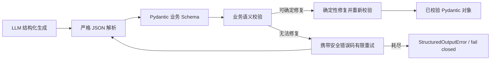

# Foundation Structured Output V1 实施报告

日期：2026-09-19（Asia/Shanghai）

## 1. 最终架构

公共机制位于 `ai-service/app/agent/structured_output/`：`parser.py` 只接受单个 JSON 对象，可去除完整 Markdown JSON fence，但不从说明文字中猜测或截取 JSON；`validator.py` 区分 Schema 与语义错误；`service.py` 执行确定性业务修复与最多 2 次生成尝试（上限硬限制为 3）；`retry.py` 构造不含模型原文和用户内容的反馈；`errors.py` 提供统一安全错误类型。业务 Schema 和语义规则留在 Router、ToolCalling、WorldLine 及外部 Response 各自模块。

公共层按 `parse_error`、`schema_validation_error`、`semantic_validation_error`、`truncation`、`model_error`、`retry_exhausted` 分类。日志只记录 `schema_name`、`attempt`、`first_pass_success`、`repair_applied`、`retry_count`、`failure_type`、`last_failure_type`、`latency_ms` 和 `final_status`；不记录完整 Prompt 或原始模型输出。

## 2. 现状审查与接入范围

| 位置 | 原有处理 | V1 处理 |
| --- | --- | --- |
| Foundation LLM Router | `LLMStructuredOutput.model_validate_json`、本地 2 次循环、`_convert` 做 span 语义校验 | 公共解析/校验/重试；保留原有 Pydantic 候选 Schema、唯一原文 span 修正和 `RouteDecision` 校验 |
| ToolCalling | LangChain 解析 `AIMessage.tool_calls`；ToolNode 执行时才校验参数；已有可信引用及重复调用保护 | 整批执行前使用 `ToolSelection`、白名单和各工具的 `tool_call_schema` 验证；含无效调用的整批不执行；保留可信引用与去重保护；回填工具结果使用 `ToolExecutionRecord` |
| WorldLine Query Understanding | 规则优先；LLM fallback 直接 `QueryTypeOutput.model_validate_json` | LLM fallback 使用公共层；规则路径不增加模型调用；失败沿原有安全 fallback |
| WorldLine Narrative | 模型同时填写正文和重复的 `citation_ids`；本地解析、引用校验、重试 | 模型只生成 `NarrativeDraft.narrative`；从内联引用确定性生成 `citation_ids`，再校验来源、知识摘录和段落锚定 |
| WorldLine Branch | 模型填写分支 ID 和完整目标 `id/type/name`；本地校验和重试 | 模型只输出 `title/description/branch_type/target_node_id`；程序从已验证图节点填写 ID、类型和名称，校验 3 个不同目标及类型匹配 |
| WorldLine citations / sources | `WorldLineResult` 已校验引用属于 sources 且与正文锚点一致 | 保留原校验；Foundation 公开结果额外拒绝未知来源引用 |
| Foundation JSON / SSE `final` | 已有 Pydantic 公开响应 | 保持 `type/status/message/search_query/results[]`；增加成功任务答复非空、引用来源和聚合状态一致性校验 |

CurrentSong 和 GeneralChat 的模型主输出是普通文本，本轮没有人为套入 JSON Schema。`app/agent/runner.py` 是显式可选的 legacy Agent 路径，已有 `TypeAdapter` 及本地重试；RAG 离线清洗、发现和富化也各有 Pydantic 处理。这些不在 Foundation 在线执行链路中，本轮审查后保留原实现，避免扩大改动到 legacy 与离线语料流水线。ToolCalling 中的 `json.loads` 用于读取工具执行结果，不用于解析模型最终结构化文本。

## 3. WorldLine 失败原因与修复

此前真实运行实际观察到：叙事结构化响应未完成、正文引用与 `citation_ids` 顺序不一致、正文段落缺少引用，以及叙事通过后分支生成失败。原生成输入同时包含完整实体事实、知识文档、图和重复的来源资料；原分支 Schema 要求模型复制已有节点的多个字段。这些是输出契约负担和语义不一致的可复现风险；不能将每次 `branch_generation_failed` 都归因于同一个未捕获的底层异常。

本轮保留 Narrative 与 Branch 两次独立生成。叙事输入保留目录事实、图结构和全部已选来源证据，去除重复的原始文档及节点元数据；业务事实和来源 ID 没有由程序猜测或改写。模型只需填写正文，引用 ID 以正文首次出现顺序生成；未知来源、未引用的事实段落仍失败关闭。分支模型只需选择当前图的节点 ID；节点类型、名称和分支 ID 由程序从已校验图生成。已知旧版 `citation_ids` / `target_entity` 形状只在字段映射可以确定时兼容修复，其余错误最多再生成一次。

在**临时进程**设置现有冻结 V3 Manifest、`AI_RAG_RETRIEVAL_MODE=hybrid`、`AI_RAG_RERANK_MODE=on` 后，真实 Qdrant + Spring + LLM 链路用“构建歌手林俊杰的音乐世界线”验证：Foundation JSON 连续 **2 次成功**，专用 `/api/ai/worldline` **1 次成功**；结果包含 3 条分支、7 条来源与 7 条引用，专用接口图包含 9 个节点和 8 条边。默认 `empty/off` 开关、模型输出上限和所有 RAG 检索/重排参数均未改动。三次成功证明该样例当前可闭环，不能作为所有实体和长期生成稳定性的统计结论。

## 4. Repair、Retry 与 Fail Closed

- 确定性修复：完整 Markdown fence；WorldLine 旧字段映射；叙事内联引用去重及首次出现顺序；无知识检索时的目录事实声明。不会猜测缺失的歌曲 ID、来源、分支节点或业务事实。
- 有限重试：默认总尝试 2 次，反馈包含错误类别和安全错误码；未完成结构化响应归类为 truncation 或 model_error。网络/模型调用异常立即包装为安全错误，不重复有副作用操作。
- 失败关闭：生成耗尽抛 `StructuredOutputError`，业务节点转换为已有失败状态；Router 不凭错误输出调度子图。ToolCalling 在整批参数和可信来源检查完成前不执行工具，非法 `AIMessage.invalid_tool_calls` 直接失败。API 继续使用通用错误或结构化 `failed`，不返回模型原文、内部堆栈或 Prompt。

## 5. 文件与外部契约

新增：`ai-service/app/agent/structured_output/{__init__,errors,parser,retry,service,validator}.py`、`ai-service/tests/test_structured_output_service.py`、本报告。

修改：Foundation LLM Router runtime/schema 接线，WorldLine `generation.py`、`grounding.py`、`models.py`、`prompts.py`，ToolCalling `graph.py`、`models.py`，RAG Query Understanding 的在线分析器，Foundation 公开 `chat.py` Schema，以及对应单元、子图、主图和 API 测试。未改变前端消费字段，也未修改 Gold、Embedding、Retrieval、RRF、Reranker、TopK 或其他后续模块。

## 6. 验证结果

| 验证 | 结果 |
| --- | --- |
| `ai-service/.venv/Scripts/python.exe -m pytest -q tests` | **820 passed，2 skipped，206 subtests passed** |
| `ai-service/.venv-eval/Scripts/python.exe -m pytest -q evals/tests` | 4 passed |
| 本轮修改的 Python 文件 `ruff check` | 通过 |
| `soul-music-room: npm run test:ai-stream` | 通过 |
| `soul-music-room: npm run build` | 通过；既存大 chunk 提示 |
| `soul-music-room: npm run lint` | 通过 |
| 冻结 V3 Qdrant/Spring/LLM 临时在线进程 | Foundation JSON 2 次成功；专用 WorldLine JSON 1 次成功 |

自动化测试覆盖合法一次成功、非法/截断 JSON、Markdown fence、多余文字、缺字段、类型/enum/范围/空值、业务语义拒绝、确定性修复、带安全反馈的重试与耗尽、ToolCalling 无效整批失败关闭、WorldLine 叙事/分支及引用关系、Foundation API/SSE 契约。

## 7. 剩余问题与 V1 结论

- 本轮复查时，网易云上游对歌曲《晴天》的实体搜索仍返回 502；该外部问题与本轮结构化输出修复无关。未对该歌曲完成真实 WorldLine 验收。
- 默认 RAG 模式仍是 `empty/off`；本轮在线 WorldLine 验证只使用临时进程环境变量，未将其切换为默认配置。
- 真实浏览器播放器动作和服务端写入不属于本轮 Structured Output 验收；ToolCalling 的执行前校验已由受控工具测试覆盖。
- 三次成功不足以证明模型输出在所有实体、负载和长时间运行下没有波动；如后续再出现失败，可用安全失败类型和重试指标定位。

**结论：Foundation 在线 Structured Output V1 的公共机制、接入和契约可标记为完成。** WorldLine 的代表性真实链路已闭环；整个 WorldLine 产品与全部 Subgraph 的无条件冻结仍受上述外部和交互验收限制。
