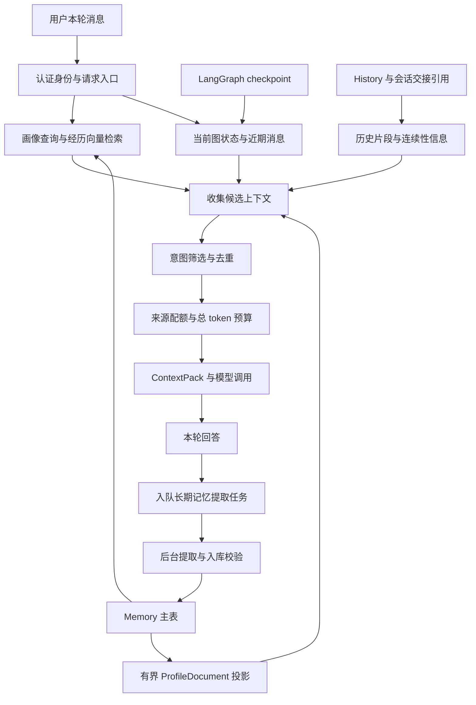

# MoodFlow Memory 学习总结：长短期记忆结合的架构

整理日期：2026-10-10。代码依据：`codex/memory-hardening` 分支，commit `59e9f3b1c3650fd4d13760f7975f675111acc7e3`。

本文用于理解项目架构和阅读源码。示例均为合成场景；文中的配置数字是该版本默认值，不代表线上最优参数，也不代表真实模型准确率已经验证。

## 1. 先理解整体设计

MoodFlow 把“记住当前正在做什么”和“记住用户长期偏好”交给不同模块，再通过上下文工程把它们组合成一次模型调用的输入。

- **短期工作记忆**：本轮输入、近期消息、当前歌曲、路由结果、工具执行结果，以及任务的执行进度。
- **会话连续性信息**：历史事件、会话交接摘要、证据与产物引用，用于长任务换 session、追溯历史和恢复执行。
- **长期用户记忆**：跨 thread 仍有价值的用户偏好、稳定事实，以及具体经历。按用户隔离保存，按当前问题检索。
- **模型上下文**：从上述来源中选出的有限视图。保存过的信息不一定每次都进入模型。

其中，长期用户记忆有 `profile` 和 `episodic` 两种类型：前者以结构化查询为主，后者以向量检索为主。历史事件片段另有 `HistoryMemorySource` 来源，不等同于已经通过入库校验的用户 Memory。



图中的入队发生在回答链路的收尾阶段。它不等待长期记忆提取模型完成，但仍有保存任务所需的存储开销。

这些链路受现有 Foundation、连续性与 Memory 配置控制；用户 Memory 需要可信用户身份。本文描述实现能力，不表示所有环境都已启用，也不改变默认图或开关。

## 2. 几类存储分别负责什么

| 信息层 | 主要内容 | 隔离范围 | 主要用途 |
| --- | --- | --- | --- |
| Graph State / checkpoint | messages、当前输入、路由、任务结果、连续性上下文、图执行状态 | conversation + session namespace | 延续同一会话与恢复图执行 |
| History / Journal | 用户和助手公开消息、决策、转交与用量事件、产物引用 | conversation / task / session / run | 审计、追溯、交接与恢复证据 |
| Memory 主表 | profile / episodic 事实、状态、版本、证据来源、可选向量 | user_id | 跨 thread 个性化召回 |
| ProfileDocument | 从有效 profile 事实生成的小型画像视图，也保留独立人工条目 | user_id + document version | 低成本提供有界画像候选 |
| ContextPack | 当前调用最终选中的消息与数据片段 | 单次模型调用 | 控制输入内容、预算和可解释性 |

这里的“短期”描述信息用途，并不意味着只能放在内存中。短期图状态也可以持久化到 PostgreSQL；长期 Memory 如果使用 `memory` 后端，反而不能保证进程重启后的持久性。

项目使用自有 `MemoryStore` 抽象与 PostgreSQL / pgvector 实现，没有把所有记忆统一成一张向量表，也没有仅靠增加聊天历史长度来实现长期记忆。

## 3. 短期记忆：延续当前对话与任务

### 3.1 图状态保存执行现场

`BaseAgentState` 包含 `messages`、`current_input` 与 `continuity_context`。`MainState` 再补充路由、任务结果、最终回答、错误和上下文 manifest。

`messages` 使用 LangGraph 的 `add_messages` reducer 合并消息。它负责状态合并，不负责判断某句话是否值得长期保存。

checkpoint saver 保存图状态与运行快照。入口配置使用 `thread_id = conversation_id`；当有应用 `session_id` 时，`SessionScopedSaverMixin` 将其映射到 checkpoint namespace。`checkpoint_id` 是 saver 管理的快照标识，不是 task 或 session 的业务标识。

### 3.2 存在历史不等于完整注入历史

共享的 `select_recent_history` 会选择近期用户 / 助手消息，避免重复当前输入，使用最多 12 条消息及 12,000 字符的筛选规则。最终输入仍由 ContextPack 的 token 预算约束，字符筛选不能替代 token 检查。

入口的 Lite Pack 有另一套更小的配置：默认最多 6 条历史消息、1,800 输入 tokens，交接投影最多占 400 tokens。它用于初步理解意图，不加载全部特权来源和完整工具协议。

因此代码中的“12 条历史”“Lite 6 条历史”和预算降级配置中的历史限制服务于不同阶段，不能当作一个统一窗口。

### 3.3 短期信息擅长处理的需求

- “刚才那首换成现场版”：需要知道上一轮歌曲和当前操作对象。
- “继续上一项分析”：需要当前任务和已完成步骤。
- “这首先跳过”：是当前动作，不应自动变成长期“不喜欢这首歌”。

这类信息主要依赖消息、当前业务状态和任务连续性，而不是先生成一条永久偏好。

## 4. 长期记忆：保存可复用的用户知识

### 4.1 Profile 与 Episodic

| 类型 | 含义 | 合成示例 | 查询方式 |
| --- | --- | --- | --- |
| profile | 可跨会话复用的偏好、拒绝或稳定事实 | “以后不要给我推荐现场版” | 用户隔离的结构化 / SQL 查询与相关性排序 |
| episodic | 值得记住的一段具体用户经历或明确总结的反馈 | 用户明确总结上次健身推荐的体验 | query embedding + pgvector 相似度检索 |

`episodic` 不是把每个点击、跳过或工具输出自动向量化。当前提取器只接收一条真实用户消息，强调保存明确总结、有证据且具有长期价值的信息。

主表 `agent_long_term_memory` 同时保存两种类型。profile 的 embedding 为空；episodic 使用向量。该版本数据库迁移定义 `VECTOR(1024)` 与余弦 HNSW 索引。

### 4.2 一条记忆需要哪些字段

| 字段 | 作用 |
| --- | --- |
| memory_id / user_id | 标识记录及其所属用户 |
| memory_type / memory_key | 区分画像与经历，标识同一逻辑事实 |
| content / structured_content | 简短摘要，以及 category、subject、preference、value、scene 等结构 |
| evidence_quote / source_message_id / source_thread_id | 回到原始用户消息，解释为什么保存 |
| confidence / importance / evidence_strength | 表达提取可信度、价值及证据强弱 |
| confirmations | 不同消息对同一事实的确认次数 |
| status / version / superseded_by | 区分有效事实与已被替换的旧版本 |
| valid_until | 明确有效期；缺失时不凭空推算截止时间 |
| embedding | 经历记忆的语义检索表示 |

`memory_key` 对 profile 主要由 category + subject 构成；有 scene 时把场景加入键。episodic 还把 value 加入键，避免把不同经历合并为同一事实。

### 4.3 示例：临时动作与长期偏好

| 用户表达 | 合理处理 |
| --- | --- |
| “这首歌先跳过” | 当前操作；提取器应返回空 memories |
| “以后不要给我推荐现场版” | profile 候选：format / live_version / avoid |
| “我通勤时喜欢爵士” | commute 场景下的 profile 候选，不覆盖全局偏好 |
| “朋友说他喜欢爵士” | 不作为当前用户的喜好保存 |
| “假如我喜欢爵士，会推荐什么？” | 假设句，不作为用户事实保存 |
| “今天先不听慢歌” | 没有明确日期边界时，不自动推算成一个长期 profile |

这些是架构上的预期和规则示例。真实模型能否正确提取任意自然语言，仍需要单独评测。

## 5. 写链路：从消息到可信记忆

生产入口的顺序是：本轮回答收尾 → 保存提取任务 → 后台处理 → 校验候选 → 写主表与证据 → 尝试同步画像投影。

### 5.1 后台任务有持久状态

`MemoryJobWorker` 负责领取租约、核验任务是否仍允许执行、调用提取模型和落库。PostgreSQL 后端保存任务状态、领取次数和派发次数；该版本最多派发 2 次，领取 / 存储重试也有上限。

已验证的 extraction 会先保存到任务中。后续存储失败时可以重试这份结果，减少重复调用模型；无法保证在“模型返回但结果尚未持久化”这一崩溃窗口绝不再次调用，但派发次数有持久上限。

终止任务清理原消息与临时提取结果。后台任务用独立的 contextvars 环境启动，避免把原请求中的私有上下文、过期调用租约直接带入新调用。

测试或显式注入 runtime 的兼容路径仍可使用 `extract_and_store`；这不代表生产入口回到了同步等待提取模型的方式。

### 5.2 模型负责提议，代码负责裁决

`MemoryExtractor` 输出严格的 `MemoryExtractionOutput`，最多包含 8 条候选；`ExtractedMemory` 拒绝额外字段，并要求原文依据、类别、摘要、置信度等字段。

随后 `validate_candidate` 检查：

1. 公开文本校验、允许的类别与置信度门槛。
2. `evidence_quote` 是否逐字存在于用户消息中。
3. 事实主体是不是用户，是否属于引用、假设或他人偏好。
4. 喜欢 / 避免的极性是否与否定表达一致。
5. artist / genre / format 等实体是否有原文依据。
6. 临时偏好和有效期是否有明确证据。
7. 是否把绕过规则等指令误当成了个人事实。

该版本 inferred 候选要求 confidence ≥ 0.9，其他证据类型要求 ≥ 0.75。模型给出的 confidence 只是一个信号，不能替代上述证据检查，也不应被当作经过校准的概率。

敏感文本在调用提取模型之前就会通过公开文本规则检查。不确定或不合格时允许返回空记忆，减少错误持久化。

### 5.3 幂等与确认次数

可信 request_id 进入 `source_message_id`，配合消息摘要和候选摘要识别重试。相同消息重放不会再增加 confirmations，也不会重复创建证据；相同 ID 对应不同内容会报幂等冲突。

不同消息表达同一事实时，可以增加 confirmations，并更新摘要、证据来源及置信度。旧调用没有稳定消息 ID 时，无法可靠区分“用户真的又说了一次”和“系统重试”，这是保留的兼容限制。

### 5.4 偏好冲突与版本

`MemoryService` 在用户与事实键的事务边界内处理冲突：

- 没有旧事实：创建新记录。
- 同一事实、同一取值：确认已有记录。
- 新证据更弱：保留已有事实，返回 ignored。
- 满足替换规则：旧记录标记 superseded，新记录成为 active，并记录版本关系。

例如用户从“我喜欢某歌手”明确改为“我现在不喜欢某歌手”，不能仅把两条相反摘要同时作为有效偏好注入。

对 episodic，摘要变化时会一起更新 embedding，并验证向量维度、有限值和非零。否则文本与向量分别描述不同内容，会造成语义检索错误。

## 6. 画像投影：小视图与主表之间的关系

Memory 主表是通过 MemoryService 管理的用户事实源。`ProfileDocument` 是读取和上下文构建使用的有界视图，不是另一套完整事实账本；独立人工画像条目仍有自己的来源。

该版本投影最多 64 条，公开文档校验默认限制 16KiB。超出容量的主表事实不会因此删除，投影记录遗漏数；后续仍可能通过主表查询召回。

主表更新与 pending revision 在同一事务中写入。`synchronize_profile` 读取待办，生成投影，以 expected_version 进行 CAS 更新；冲突可有限重试，成功后再完成对应 revision。写后以及后续 retrieve 都会尝试修复投影。

这属于可重试的一致性设计：同步失败后待办仍在，但不能宣称 Memory 主表和 ProfileStore 已经跨存储原子提交。

读路径还会重查 canonical `memory:` 引用的主表状态。即使投影同步失败，已经忘记、暂停或被替换的旧画像也不能只凭缓存继续进入模型；主表不可读时，排除需要核验的记忆引用。

## 7. 读链路：长短记忆怎样组合

### 7.1 入口先按本轮问题召回

`_retrieve_query_memories` 使用已认证 user_id 和本轮 query 请求 MemoryRuntime，默认 top_k=8。Runtime 先检查记忆开关、尝试投影修复，再调用 Retriever；结果写入 `continuity_context.long_term_memory`。

本轮的直接输入和业务状态仍然存在。长期记忆只是补充信息，因此一个偏好可以约束推荐，但不应凭过去的歌曲状态猜测用户现在播放哪首歌。

### 7.2 Profile 与经历各走适合的查询

profile 查询优先考虑明确主题匹配，再结合音乐场景、文本重合等相关性信号。episodic 先对 query 做 embedding，在相同用户范围内进行 pgvector 检索。

两条分路分别处理异常：向量不可用时保留可用的画像候选，画像查询异常时也可以保留可用经历。结果再检查 user_id、active 状态、有效期、场景和置信度。

该版本 MemoryRetriever 默认 min_relevance=0.4；经历先要求原始语义相似度 ≥ 0.25；最终候选 confidence ≥ 0.75。排序分数为：

```text
score = 0.6 × relevance
      + 0.2 × importance
      + 0.1 × recency
      + 0.1 × confidence

recency = exp(-age_days / 180)
```

这是当前 MemoryRetriever 的排序公式，不适用于所有来源。ProfileDocument 候选和 HistoryMemorySource 使用各自的摘录 / 排序逻辑，不能把整个系统描述成一个统一向量分数。

### 7.3 场景与过期过滤

场景提示支持 workout、sleep、commute、study。只推断出一个场景时使用该场景；多个场景冲突或没有可靠线索时返回未定，召回全局事实，不猜一个场景。

全局偏好可以与当前场景偏好一起成为候选；其他场景的专属事实不会混入。`valid_until` 过期的事实不召回，重复确认不会自动增加一个新的截止日期。

### 7.4 历史事件片段是另一类来源

`HistoryMemorySource` 从当前已校验 conversation 的任务历史中读取公开用户 / 助手消息，排除本轮消息，提取有限长度片段并附 event_id 引用。

它有 task 数量、候选条数和摘录长度限制，不对全部历史做无界读取。历史中的助手回答只是一条历史记录，不能据此认为它已经成为用户事实。

### 7.5 收集、选择、预算与组装

上下文工程将来源转为统一的 `ContextItem`，再构建 `ContextPack`：

1. **Collect**：收集当前问题、近期消息、业务状态、Memory、画像、历史引用、工具结果和 RAG 证据。
2. **Select**：按当前路由的 allowed_types 与来源意图筛选。多意图任务分别构建对应路由的上下文，不把所有策略直接合并。
3. **Deduplicate**：按内容摘要、memory_key、证据 ID 等去重。同一画像事实通过主表和投影到达时，避免重复注入。
4. **Budget**：先检查来源配额，再检查整个调用的输入预算；优先删除低价值可选项，必要时做受约束的截取。必需项仍超限时明确报预算问题。
5. **Assemble**：保持消息角色与工具调用配对，输出最终模型输入，并保存 trace / manifest。

注册来源的当前默认配额：user_profile 240 tokens，history_memory 600 tokens；直接召回的 long_term_memory 有各路由自己的配额，例如 current_song 为 700、tool_calling 为 900。它们是不同来源，不是一个可任意叠加的全局 Memory 上限。

输入预算还需扣除预留输出和安全余量：

```text
可用输入预算 = 调用总预算 - 预留输出 tokens - 安全余量
```

画像和记忆的文本会转义并标记为不可信文本数据。结构经过校验不代表文本有权改写系统规则；这些防护也不能证明所有提示注入风险已经消除。

## 8. 一次完整场景串起来看

假设用户 A 在会话 1 说：“以后不要给我推荐现场版。”

1. 当前图用本轮输入完成回答或操作；本轮直接表达已经可以影响当前任务。
2. 收尾阶段入队，后台模型提议 format / live_version / avoid 候选。
3. 原文、主体、极性与置信度校验通过后写主表、证据及投影待办。
4. 画像投影尝试更新；失败时保留待办，后续读取继续修复。

之后用户 A 在另一个 thread 说：“给我推荐几首歌。”

1. 新 thread 不需要复制会话 1 的全部聊天消息。
2. 入口按相同 user_id 检索到拒绝现场版的偏好。
3. format 画像条目映射到音乐任务路由，参与候选筛选。
4. 去重和预算控制后，把有效偏好与本轮 query、当前业务状态一起提供给模型。

如果用户接着说“这首先跳过”，只作为当前动作处理；如果用户主动忘记现场版偏好，后续 canonical Memory 读取会过滤该事实，并阻止旧代次后台任务把它写回来。

后台处理有延迟或可能被预算阻断，因此不能保证一句话刚说完就已经跨 thread 可召回。

## 9. 用户控制、预算与恢复边界

### 9.1 用户能管理自己的 Memory

`/memory` 页面支持查看依据、更正、忘记、暂停和恢复。API 身份来自 Spring session，不接受客户端自行指定 user_id；记录列表有分页和上限，不返回 embedding。

暂停 / 忘记推进用户 generation，旧任务即使稍后完成也不能按旧代次写入。更正要求同类型、同主题和同场景；更换主题应忘记旧条目后表达新事实。

忘记会处理 Memory 主表的同事实版本、相关证据和投影 / 缓存引用，但不物理删除原对话、历史画像原文与备份。原对话仍可能参与既有历史上下文，因此它不是“删除所有历史”的功能。暂停 Memory 也不等于关闭当前会话状态或全部 History 来源。

### 9.2 后台提取仍受原预算约束

有原累计账本时，任务入队先预留原额度，沿用 MODEL_USAGE 与原 run / agent / call 引用；不能因为进入后台就生成一套新的余额。

有完整用量回执才按实际用量结算；已派发但用量未知时保留原预留，不猜费用或退款。缺少持久预算证明的 volatile 任务在重启后被阻断，原截止时间过期时不新派发。

无累计执行上下文的独立调用使用已有单请求预算边界，不应把它理解成获得无界后台预算。

### 9.3 会话恢复和用户记忆恢复是不同问题

完整图执行通常依赖 checkpoint。History / Journal 能提供事件、摘要和引用，但摘要与 SHA-256 不能反推原输入、计划和完整执行载荷。

本项目的方案 A 重建的是 `RecoveryCheckpoint`：恢复证据中缺失的执行数据用 missing 标记表达，再走 Reality Revalidation；不能把它直接当作完整执行现场。该契约明确 `digest_verified=false`，不声称已经验证不存在于 Journal 中的原始载荷。

长期用户 Memory 主表、画像投影与任务队列另有各自的持久化路径。checkpoint 恢复、Journal 降级重建和画像投影修复，解决的是三种不同的一致性问题。

## 10. 这套设计值得学习的点与限制

可以复用的设计思路：

- 按信息用途分层：执行状态、历史证据、用户事实和模型输入各有职责。
- 保存前做语义与证据校验，避免把暂时行为变成永久画像。
- 事实具有用户范围、逻辑键、版本、状态、证据与有效期。
- 结构化画像和向量经历采用不同检索方式，再通过统一 ContextItem 接口组合。
- 小型投影提升读取便利性，同时保留主表事实与修复待办。
- 幂等覆盖请求、候选、证据与任务，确认次数不能因重试膨胀。
- 将忘记和暂停贯彻到写入、投影、缓存读取及后台任务代次。
- 用 trace / manifest 解释一次调用用了什么、丢掉了什么、为何超预算。

需要继续验证或改进的部分：

- 规则较保守，复杂指代、隐含否定和昵称可能漏存；模型 confidence 尚未校准。
- 当前检索权重、场景规则和相关性阈值还需要真实问答评测。
- 历史事件召回和用户 Memory 遗忘的产品边界需要清晰说明。
- 主表与画像投影跨存储，修复机制不能替代跨存储原子提交。
- 队列仍有外部模型调用与任务结果持久化之间的崩溃窗口，不能声称端到端 exactly once。
- 旧无 message ID 调用的幂等能力有限；memory 后端不保证重启持久化。

现有离线评测只有 15 个合成入库样例、3 个召回查询及矛盾覆盖检查。合成结果通过可以证明这些固定规则场景有效，不能证明真实提取模型准确率、真实用户纠错率或线上收益。

## 11. 源码阅读顺序

以下链接指向本文使用的独立工作树，行号对应上述 commit。

| 顺序 | 阅读入口 | 重点 |
| --- | --- | --- |
| 1 | [BaseAgentState](C:/Users/33994/.codex/worktrees/memory-hardening/MoodFlow/ai-service/app/agent/foundation/state/base.py:8)、[MainState](C:/Users/33994/.codex/worktrees/memory-hardening/MoodFlow/ai-service/app/agent/foundation/state/main.py:11) | 图状态包含什么，消息怎样合并 |
| 2 | [select_recent_history](C:/Users/33994/.codex/worktrees/memory-hardening/MoodFlow/ai-service/app/agent/foundation/history.py:14)、[checkpoint saver](C:/Users/33994/.codex/worktrees/memory-hardening/MoodFlow/ai-service/app/agent/checkpointing.py:26) | 历史窗口与会话持久化 |
| 3 | [召回入口](C:/Users/33994/.codex/worktrees/memory-hardening/MoodFlow/ai-service/app/agent/foundation/streaming.py:110)、[MemoryRuntime](C:/Users/33994/.codex/worktrees/memory-hardening/MoodFlow/ai-service/app/agent/memory/runtime.py:29) | 请求接入、召回与后台任务 |
| 4 | [Memory models](C:/Users/33994/.codex/worktrees/memory-hardening/MoodFlow/ai-service/app/agent/memory/models.py:28) | 候选、事实、证据、任务和召回结果契约 |
| 5 | [MemoryExtractor](C:/Users/33994/.codex/worktrees/memory-hardening/MoodFlow/ai-service/app/agent/memory/extraction.py:53)、[入库门](C:/Users/33994/.codex/worktrees/memory-hardening/MoodFlow/ai-service/app/agent/memory/policy.py:34) | 哪些信息值得存，如何拒绝错误候选 |
| 6 | [MemoryService](C:/Users/33994/.codex/worktrees/memory-hardening/MoodFlow/ai-service/app/agent/memory/service.py:49) | 幂等、确认、冲突与版本 |
| 7 | [PostgresMemoryStore](C:/Users/33994/.codex/worktrees/memory-hardening/MoodFlow/ai-service/app/agent/memory/postgres_store.py:28)、[初始 Memory 迁移](C:/Users/33994/.codex/worktrees/memory-hardening/MoodFlow/ai-service/migrations/postgresql/002_long_term_memory.sql:1) | SQL、事务、索引和 pgvector |
| 8 | [MemoryRetriever](C:/Users/33994/.codex/worktrees/memory-hardening/MoodFlow/ai-service/app/agent/memory/retriever.py:32)、[场景 / 有效期](C:/Users/33994/.codex/worktrees/memory-hardening/MoodFlow/ai-service/app/agent/memory/scopes.py:13) | 双路检索、过滤与评分 |
| 9 | [投影同步](C:/Users/33994/.codex/worktrees/memory-hardening/MoodFlow/ai-service/app/agent/memory/projection.py:18)、[canonical 引用核验](C:/Users/33994/.codex/worktrees/memory-hardening/MoodFlow/ai-service/app/agent/memory/context.py:7) | 待办修复与旧引用过滤 |
| 10 | [UserProfileSource / HistoryMemorySource](C:/Users/33994/.codex/worktrees/memory-hardening/MoodFlow/ai-service/app/agent/foundation/context_sources.py:59)、[ContextSelector](C:/Users/33994/.codex/worktrees/memory-hardening/MoodFlow/ai-service/app/agent/foundation/context_engineering.py:482)、[来源策略](C:/Users/33994/.codex/worktrees/memory-hardening/MoodFlow/ai-service/app/agent/foundation/context_policy.json:1) | 长短记忆怎样进入有限上下文 |
| 11 | [MemoryJobWorker](C:/Users/33994/.codex/worktrees/memory-hardening/MoodFlow/ai-service/app/agent/memory/jobs.py:22)、[管理 API](C:/Users/33994/.codex/worktrees/memory-hardening/MoodFlow/ai-service/app/api/memory.py:29) | 后台生命周期、预算和用户控制 |
| 12 | [会话 cold_start](C:/Users/33994/.codex/worktrees/memory-hardening/MoodFlow/ai-service/app/agent/foundation/long_horizon/service.py:325)、[RecoveryCheckpoint](C:/Users/33994/.codex/worktrees/memory-hardening/MoodFlow/ai-service/app/agent/foundation/long_horizon/recovery_checkpoint.py:37) | 连续性恢复的能力与缺失边界 |

阅读后可用测试核对理解：[Memory 规则与检索测试](C:/Users/33994/.codex/worktrees/memory-hardening/MoodFlow/ai-service/tests/test_memory_hardening.py)、[用户控制测试](C:/Users/33994/.codex/worktrees/memory-hardening/MoodFlow/ai-service/tests/test_memory_controls.py)、[后台任务测试](C:/Users/33994/.codex/worktrees/memory-hardening/MoodFlow/ai-service/tests/test_memory_jobs.py)、[实际 PostgreSQL 测试](C:/Users/33994/.codex/worktrees/memory-hardening/MoodFlow/ai-service/tests/test_memory_hardening_postgres.py)。

已有实现、验证数字和已知局限见[完善验收报告](C:/Users/33994/.codex/worktrees/memory-hardening/MoodFlow/workspace/user/files/memory-hardening/validation.md)。本文只新增学习文档，没有执行生产迁移，也没有改动代码或服务配置。

## 12. 自测问题

1. 为什么 checkpoint 中保留了历史消息，也不能把全部历史都交给模型？
2. “这首先跳过”和“以后不要推荐现场版”的保存策略为什么不同？
3. 为什么一个 profile 事实同时存在于主表和画像投影中，进入上下文时却只应保留一次？
4. 一条消息重试 3 次，confirmations 应该增加几次？如果是 3 条不同消息呢？
5. 用户忘记事实时，为什么只删除主表记录还不够？
6. 向量相似度很高，为什么仍需检查用户、场景、状态和有效期？
7. 队列任务重启后，凭什么可以继续使用原预算？没有证明时该怎样处理？
8. Journal 中只有摘要和摘要哈希，为什么不能恢复完整执行输入？

练习建议：沿着“我通勤时喜欢爵士 → 新 thread 推荐 → 更正 → 忘记”的场景，分别画出事实键、证据、投影、召回候选、最终 ContextPack 和后台 generation 的变化，再对照测试确认每一步。
